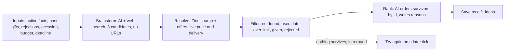

# ALL-27 Gift idea engine: Spec and Plan

**Goal:** given what we know about a person, the app produces 3–5 gifts that can really be bought, arrive on time and fit the budget, plus at most one clearly labeled over-budget gift, both in rounds and when a test or admin buyer asks for them.

**Status:** Spec approved by Jim, 2026-11-05. **Revised 2026-11-10** for what landed on `main` since then (Zinc code from ALL-32, the money-notice wording and email tone from ALL-116, `needs_address` rounds looked at on every tick from ALL-63), and for the adversarial review (T55): one attempt per run, runs counted before they spend, a time budget for the tick, and a hard cost cap per run. Jim settled the open questions the same day: fan-out comes later (ALL-125), rounds are only for paid users while they cost money, and an address can wait up to a day for the next tick. Next: the Plan and its own adversarial review.

**Links:** [ALL-27](https://linear.app/allens-forever/issue/ALL-27). Design §4.2, §6.3, §7. PRD G-1, G-2, G-4, G-5. Spike: `design/spikes/ai.md`. Planning decisions 34, 48, 52, 53. Technical decisions T11, T17, T19, T23, T39, T42, T49, T54, T68.

**Depends on:** ALL-94 (the paid-features flag and the money notice), merged 2026-11-05.

**Hands off to:** ALL-29 (approval screen, and switching rounds on in production), ALL-93 (private list), ALL-77 (linking).

## Spec: what it does

### Who it's for and what they can do

1. **Ideas in a round:** as a test or admin buyer, when a round reaches the point of needing ideas, I get real, checked gifts in the heads-up email instead of samples, so the round is worth acting on.
2. **Suggest ideas on demand:** as a test or admin buyer, I can tap "Suggest ideas for Dad" on his page and see checked gifts with the full cost, store, arrival date and a one-line reason, so I don't have to wait for a round.
3. **Told about the money:** as a test or admin buyer, I can see before I tap that this costs real money, and roughly how much.
4. **Kept out of paid features:** as a buyer without the flag, I'm never charged for and never trigger any AI or Zinc call, and the page tells me plainly that this isn't available yet.
5. **Trusting the list:** as a buyer, I never see something Dad was already given, something I already rejected, a used or refurbished item, or a price the AI guessed.

### How one run works

**One attempt per run** (Jim, 2026-11-10). A run brainstorms once. If nothing survives, a round tries again on a later tick, never inside the same run. Before it spends anything, a run writes a `concierge.idea_runs` row in its own transaction. That row counts the run toward the round's limit, holds the on-demand lease, and gets the cost as it builds, so a run that's killed part-way still leaves a record.

### Acceptance criteria

| # | Given | When | Then |
|---|---|---|---|
| AC-1 | A person with facts, a budget and a deadline | A run finishes | Up to `idea_keep_max` (5) ideas are saved within budget, plus at most one over budget, ranked, each with a one-line reason |
| AC-2 | Any saved idea | Its fields are read | Its price, shipping, delivery days and seller came from a live Zinc offer, never from the AI's estimate. It's new, and available |
| AC-3 | A search whose first result is another brand | Resolve runs | The first result matching the brand wins. If none matches, the candidate is dropped as not found |
| AC-4 | Several offers on one product | Resolve runs | Used and refurbished are never picked, even when cheaper. Order of preference: buy box, then sold by the retailer or brand, then fastest delivery |
| AC-5 | A candidate that, ordered on the latest order date, wouldn't arrive with the safety buffer to spare | Filter runs | It's dropped (`canArriveInTime`: a round passes its deadline as the order date; on demand, see the decisions below) |
| AC-6 | Totals around the budget | Filter runs | `est_total` comes from `estimatedTotalCents`, and `classifyTotal` decides within, over or dropped. With no budget, nothing is labeled over budget |
| AC-7 | A product already given to this person, or an idea already rejected for them | Filter runs | It never appears, matched by retailer product id (G-4) |
| AC-8 | Fewer than `idea_keep_min` (3) survive | The run ends | No second brainstorm in the same run. The survivors are saved and used, and the `ideas.run` event records the shortfall. Only a round left with none tries again, on a later tick (AC-9) |
| AC-9 | A round's run saves no ideas, or fails | Later ticks look at the round | A run counts as soon as its `idea_runs` row is written, before any spend, so a crash or timeout counts too. A round gets at most `idea_round_runs_max` (2) runs, at most one per tick. After the last one it spends nothing more and waits for its deadline (`next_action_at` set to it), and the buyer gets one "Sorry, we couldn't find gifts for {name} yet" email (the `no_ideas` step in `round_sends`, so it's sent once), in the ALL-116 tone: sorry, what it means, nothing was charged, and "What happens next" with the guided questions link. A new fact saved for that person brings the round back on the next tick for one more run. If that one finds nothing too, a second email says so (`no_ideas_again`). So a round's life has at most 3 runs, about $1.20. At the deadline the round skips, and the skip email goes out, because `no_ideas` counts as having asked the buyer something (ALL-28 ruling 13) |
| AC-10 | Zero survive, on demand | The run ends | The page says plainly that nothing suitable was found, and nothing is saved |
| AC-11 | A retried round step | Ideas were already saved | No second set is saved, and no second AI or Zinc spend happens |
| AC-12 | The AI or Zinc is down, times out, or returns something that fails its schema | A run hits it | Vendor shapes stop at their adapter (E4). A round's failed run counts toward `idea_round_runs_max` (AC-9) and is retried on the next tick. On demand shows "Couldn't get ideas. Try again." One bad candidate doesn't end the run. A Zinc 429 drops that candidate instead of waiting |
| AC-13 | A person with no active facts | A buyer asks on demand, or a round reaches the point of needing ideas | No money is spent. On demand: the page points to the guided questions. In a round: the same email as AC-9, sent once, and no run is counted. The next tick that finds facts runs the engine. Facts are checked before the address request, so a buyer is never asked for an address for someone we can't suggest gifts for yet |
| AC-14 | A buyer with the flag, on the person's page | The page loads | "Suggest ideas for {name}" shows, with the money notice next to it and always visible, including the rough cost from settings, in the `design/ui.md` style (no "Alpha:") |
| AC-15 | A buyer without the flag | The page loads, or they call the action directly | No button. The page says it isn't available yet. The action refuses before any AI or Zinc call |
| AC-16 | A buyer without the flag | The tick runs, or their open round reaches the point of needing ideas (they may have lost the flag mid-round) | Rounds are only for paid users while they cost money (Jim, 2026-11-10): `round_candidates` leaves this buyer out, so no round, reminder or address request is created. `generateIdeas` checks again before any AI or Zinc call, so an open round spends nothing, sends nothing new, and skips at the deadline |
| AC-17 | `idea_engine_enabled` = 0 | A round or on-demand run starts | Nothing is spent and no run is counted. On demand says it's off. A round waits and tries again on the next tick |
| AC-18 | A buyer taps Suggest twice, or asks again later | Runs complete | The button is disabled while running, and the server refuses a second run for the same person while one is under way (an unfinished `idea_runs` row younger than `idea_run_lease_ms`), so two tabs can't both spend. A new on-demand set replaces the last on-demand set for that person. Ideas in rounds aren't touched |
| AC-19 | Any run | It ends, however it ends | One event with ids, counts, stage reached and cost in cents (AI plus Zinc). An `ideas.run_started` event goes out first, and the cost so far is saved on the `idea_runs` row as it builds, so a killed run still shows what it spent. No names, facts or gift text (E6, T42) |
| AC-20 | Any idea text from the AI | Before it's saved | The sensitive-trait filter (`lib/ai/sensitive.ts`) runs on title and reason. A hit drops the idea |
| AC-21 | The AI request | It's built | It holds the relationship and facts, never the person's or buyer's name, email or address. In fact text, the person's and buyer's first and last names are replaced with "them" before it's sent, and a search query from the AI that contains either name is dropped before it reaches Zinc. Zinc gets only the search text (T42). A test uses a fact like "Bob loves fishing" for a person named Bob |
| AC-22 | The 5 fixture profiles (W1-3) | `pnpm ai:eval` runs against the real AI and Zinc | Every idea passes AC-2, AC-5 and AC-6. Cost per run is reported. One run's AI cost stays at or below the design §7 figure of about $0.20, and its whole cost under `idea_run_max_cents`. Run by hand, never in CI |
| AC-23 | A round on dev with the engine in place | The test clock runs it | Real ideas reach the heads-up email. The stub in `rounds/ideas.ts` is gone. `round_engine_enabled` stays 0 on production |
| AC-24 | A round with an over-budget idea | The heads-up or a reminder is sent | That idea is clearly labeled as over budget in the email. Today's rows show only title and price |
| AC-25 | More rounds need ideas than fit | The tick runs | The tick has one deadline, `tick_deadline_ms` after it starts. Ideas are made in their own pass, after the money path, the stale-order sweep and rejection notices. A run starts only while fewer than `idea_rounds_per_tick` have run and the time left covers a run's worst case (two AI timeouts plus two Zinc timeouts). AI and Zinc calls get an abort signal tied to that deadline. Rounds that don't get a turn are released with no run counted, and wait for the next tick. The whole tick finishes inside Vercel's 300 s limit |
| AC-26 | A buyer saves an address on a round waiting for one, or links a list whose owner shares an address (ALL-63) | The save finishes | The page doesn't wait for the engine: `updatePerson` no longer generates ideas in the request. The round's ideas are made on the next tick, which already looks at every `needs_address` round. Jim accepted the wait of up to a day (2026-11-10); ALL-125 can make it sooner |
| AC-27 | A person is deleted | A run would start, or their on-demand ideas exist | No run starts: before any spend, the run checks that the person is live and belongs to the buyer, and new rows carry a `(person_id, user_id)` foreign key to `people`. Their page is a 404, so existing ideas can't be seen in the app. The rows stay readable by their owner in the database until hard delete, the same as their facts (ALL-37) |
| AC-28 | The engine on dev | One round's run and one on-demand run are timed (`ideas.run` events) | The times are posted on this ticket and on ALL-125, so the size of the fan-out work rests on measurements, not the spike's |
| AC-29 | A run's spend so far | Before each Zinc call and before ranking | Spend is added up as the run goes: the AI cost from the Gateway's figure, and Zinc at `zinc_lookup_cents` a call. Once it reaches `idea_run_max_cents` the run stops resolving and ends without ranking, saving nothing, logged as `stopped: cost_cap`. The only overshoot is the AI call already in flight, which `idea_max_searches` and a token limit bound |

### Out of scope

| What | Where it goes |
|---|---|
| Approving or rejecting ideas, and starting a new search after a rejection | ALL-29 |
| Switching rounds on in production | ALL-29 (decision 53) |
| The private list, and "Add to private list" on an idea | ALL-93 |
| Linking to someone's own list | ALL-77 |
| Offering gifts from a person's own list as picks (`source = list`) | Stays as it is; not changed here |
| Retailers other than Amazon | Later. The resolve rules were only tested on Amazon |
| Real tax by state | Checkout gives the real figure; see the decisions below |
| Rate limits per buyer | Not needed while only test and admin users can run it. Comes back with premium |

### Open questions

- **Settled 2026-11-10 (Jim):** fan-out comes later, as ALL-125, which blocks ALL-29. Rounds are only for paid users while they cost money. An address waiting up to a day for the next tick is fine.
- **Checked 2026-11-10:** `ZINC_API_KEY` is set in Vercel. Functions on our plan (Hobby, Fluid compute on) run for 300 s by default and at most (Vercel's limits page, and the project's `functionDefaultTimeout`).
- **Still to do before AC-22:** an admin tops up the app-owned Zinc account, which had about 33¢ after the spike (T17). About $10 is plenty **[Claude's call]**.
- **[Verify]** in the Plan's first task: Zinc search and offer response fields from a live call (the spike read them defensively, `results` or `products`), and the AI Gateway's cost field on a web-search call, for AC-19.

### Fitting the tick

The daily tick is one function call with a 300 s limit. Since ALL-32 it also sweeps stale orders and places held gifts (up to `zinc_place_budget_ms`, 45 s), and since ALL-63 it looks at every `needs_address` round. One idea run takes about 55 s in the spike (brainstorm 42–46 s with Sonnet), and up to about 150 s for one attempt when the AI and Zinc run to their timeouts.

| Option | What it means | Good | Bad |
|---|---|---|---|
| **A. Cap per tick (recommended now)** | At most `idea_rounds_per_tick` (1) runs per tick, in a pass after the money path, and only while the tick's deadline leaves room for a run's worst case | No new service (E1); enough while only test and admin users have rounds, and rounds are off on production | A busy morning queues rounds a day each. Fine now, not for launch |
| B. Fan out with Vercel Queues now | The tick sends round ids; a consumer runs one round per call, each with its own 300 s | Scales to the Christmas rush | A new queue, consumer and decision (E1, a T#), and the sweep, email retries and rejection summary move to their own jobs. Larger than this ticket |

**Decided (Jim, 2026-11-10): A** in this ticket, with AC-28's timings posted. B is ALL-125, which blocks ALL-29 (switching rounds on in production). Recorded as T68.

## What was decided, and why

| Question | Answer | Why |
|---|---|---|
| Does ALL-27 switch rounds on in production? | **No.** It moves to the end of ALL-29 | Jim, decision 53. Emails would otherwise ask people to choose on a screen that doesn't exist |
| Who can use it? | Only users with the paid-features flag (ALL-94). That includes rounds: no rounds at all for users without it while they cost money | Jim, decision 53, and 2026-11-10 for rounds. Anything that costs money isn't free |
| How clear is the cost? | A plain notice next to the action, always visible, with a rough cost, in the `design/ui.md` money-notice style | Jim, decision 53. "Alpha:" was dropped by the owner (ALL-114, ALL-116) |
| What happens when a round can't produce ideas? | It spends on at most `idea_round_runs_max` (2) runs, and never on a person with no facts. The buyer gets one email with the guided questions link. A new fact allows one more run, so at most 3 runs, about $1.20, in a round's life. Otherwise it skips at the deadline and they're told | Jim, 2026-11-05; limits and cost approved 2026-11-10. Daily retries would waste money and the occasion would pass in silence |
| Is the private list here? | No, it's ALL-93. It's a real list only its creator can see | Jim, decision 52 |
| When are ideas made outside a round? | Only when the buyer asks | Jim, decision 52. Predictable spend, no new scheduled job (E1) |
| Are on-demand ideas re-checked before a round uses them? | Rounds don't reuse them in this ticket: a round always runs the engine fresh. The re-check rule applies when ALL-93 lets saved ideas feed a round | Jim accepted re-checking through the live price step. Running fresh is that check, and it's the simplest version |
| Where do on-demand ideas live? | `gift_ideas`, with `round_id` now optional and a new optional `person_id`. A check requires one of the two **[Claude's call]** | One table for ideas, in the shape ALL-93 and ALL-77 can read. Old rows and old code stay valid, so a rollback is safe (E7). `rejections` and `orders` still require a round, so on-demand ideas can't be rejected or ordered yet. ALL-93 inherits that. Details in T54 |
| Which occasion does an on-demand run use? | The next enabled occasion a gift ordered today can still reach. It uses that occasion's budget and checks arrival as if ordered today, and the page shows the date as "if ordered today". With no such occasion: no budget and no arrival check **[Claude's call]** | Far-off occasions shouldn't be limited to a round's 7-day planning window, and nothing is promised for a later order, because on-demand ideas can't be ordered yet |
| A confirm step before spending? | No, the visible notice is enough. Disabled while running **[Claude's call]** | For test and admin users only. Jim asked for clarity, not extra taps |
| What does the notice say about cost? | The usual cost and the most a run can cost, from settings: "Suggesting ideas uses AI and live product lookups, which cost real money: usually about 40¢, at most $1." Wording lives in `packages/core/src/paid-features.ts` **[Claude's call]** | The usual 40¢ is about 20–25¢ of AI (mostly web searches) plus about 16¢ of Zinc lookups. A run with slow searches can cost more, so one number wouldn't be honest (decision 53). Costs per feature are in `planning/strategy.md` > Money model, for pricing (ALL-76) |
| Retries inside a run? | None. One attempt per run; a round with no ideas tries again on a later tick | Jim, 2026-11-10. Keeps a run near 40¢ and the tick's time predictable |
| How do slow runs fit? | **Inside the tick (option A, Jim 2026-11-10; T68).** One deadline for the whole tick; ideas in their own pass after the money path; at most `idea_rounds_per_tick` (1) runs, each started only if the time left covers its worst case. Fan-out is ALL-125, which must ship before ALL-29 switches rounds on in production. Saving an address no longer runs the engine in that request | E1: no new queue while only test and admin users have rounds, and rounds are off on production. One round takes about 55 s in the spike, so a busy morning will need fan-out, but only once real users have rounds |
| Who checks the flag for rounds? | ALL-94 provides `concierge.accounts.paid_features` and one check. ALL-27 adds the filter to `round_candidates` and a second check in `generateIdeas` **[Claude's call]** | The tick runs as the server, so the check can't rely on the signed-in user. Checking at the spend point covers a flag lost mid-round |
| How is tax estimated? | A flat percentage in settings (`idea_tax_estimate_pct`, default 8) **[Claude's call]** | Nothing estimates tax today. A per-state table is more than an estimate needs, and this needs no address, which fits T42. Revises design §4.2's "estimated from the recipient's state" |
| Does a cheap model check that the found item matches? | No extra call. The brand rule filters first, then the rank step sees the real product title and can drop a mismatch **[Claude's call]** | Design §6.3 left this for W3-3. One less model and one less cost |
| Where do Zinc lookups live? | `modules/concierge/zinc/products.ts`, on the shared `ZincHttp` in `zinc/client.ts` with the **app-owned key** (T17). No more than Zinc's 10 requests a second; a 429 drops that candidate rather than waiting, and `ZincHttp` stays as it is. Unit tests pass a fake `fetch`; the browser test adds search and offers routes to `e2e/fake-zinc.ts` (`ZINC_API_BASE`) | The owner's note on this ticket (2026-11-06) and ALL-32's verified Zinc facts (`design/spikes/checkout.md`) |
| How are runs counted and leased? | One `concierge.idea_runs` row per run: user, person, optional round, started, finished, cost so far, outcome. It's written before any spend, in its own transaction. A round's runs are counted from it. An unfinished on-demand row younger than `idea_run_lease_ms` blocks a second run for that person. A trigger on saving a fact moves that person's waiting `generating` rounds back to now, and the run limit decides whether one more run is allowed. Users can read their own rows; only server functions write them **[Claude's call]** | Fixes the review's finding that runs counted only on success could be dodged by crashes and timeouts. One table covers the count, the lease and a trace of killed runs |
| What leaves for the AI? | Relationship and facts, with the person's and buyer's names replaced in fact text. A search query that contains either name is dropped | T42. A buyer can type "Bob loves fishing", which would otherwise send a name |
| Which model? | Sonnet 5.5 for both steps, with up to 3 web searches on brainstorm | T39 and ALL-42: Haiku missed the main need, Opus costs up to twice as much |
| Is a dev-only "generate ideas now" button still needed? | No | The on-demand button does the job |
| Over-budget slot | Kept from the prompt rules: a stated want above the budget can use it, inside `over_budget_pct` | Prompt v3, design §7 |

## Settings (T23)

All in `concierge.app_settings`, with no fallback in code.

| Setting | Default | What it does |
|---|---|---|
| `idea_engine_enabled` | 1 | 0 stops all runs (off switch) |
| `idea_candidates` | 8 | Candidates per brainstorm |
| `idea_max_searches` | 3 | Web searches per brainstorm |
| `idea_keep_min` | 3 | Fewer survivors than this is logged as a shortfall |
| `idea_keep_max` | 5 | Most ideas kept within budget |
| `idea_ai_timeout_ms` | 60000 | Per AI call |
| `idea_zinc_timeout_ms` | 15000 | Per Zinc call |
| `idea_tax_estimate_pct` | 8 | Flat tax estimate |
| `idea_run_estimate_cents` | 40 | The usual cost shown in the money notice |
| `idea_run_max_cents` | 100 | The cap on one run's spend (AC-29), shown in the money notice |
| `idea_round_runs_max` | 2 | Runs a round may spend on before it stops and tells the buyer. A new fact allows one more |
| `idea_rounds_per_tick` | 1 | Most rounds that make ideas in one tick. Raise it only with the AC-28 timings in hand |
| `idea_run_lease_ms` | 600000 | How long an unfinished on-demand run blocks another for the same person |
| `tick_deadline_ms` | 270000 | The tick starts no new work after this, leaving 30 s of Vercel's 300 s |
| `zinc_lookup_cents` | 1 | Cost of one Zinc call, for logging |

The order fee (`zinc_order_fee_cents`) already exists in settings, and `over_budget_pct` is per account in `concierge.accounts`. `pnpm ai:eval` only checks capture reading today, so it's extended for AC-22, and the 5 profiles move from `spikes/ai/fixtures/` to `apps/web/lib/ai/fixtures/`. Product lookups are new (`zinc/products.ts`); the HTTP client and error type are ALL-32's.

## Principles check

- **Simplest version?** Cut: retries inside a run, reusing saved ideas in rounds, a queue or worker, per-buyer limits, a confirm step, a tax table, a match-checking model, other retailers, a dev button.
- **Hard-coded values?** The settings above. Model IDs stay in `lib/ai/models.ts` (T11), and prompt wording stays in code.
- **Product boundaries?** Everything is in `modules/concierge` and `lib/ai`. Past gifts and rejections are concierge tables. No list tables touched (T19).
- **New personal data?** No new fields about people. `gift_ideas.person_id` is an id, and `idea_runs` holds only ids, times, cents and an outcome, and idea text may reflect facts, so it stays owner-only under RLS. Deleting a person is a soft delete, so rows stay until hard delete, like facts (AC-27). AI gets relationship and facts; Zinc gets search text (T42).
- **E1:** no new service, queue or scheduled job in this ticket (option A, T68). Fan-out is ALL-125 and gets its own T#.
- **E2:** one `generateIdeas` used by both callers. The `searchWeb` step stays a small replaceable function because T11 requires it.
- **E3:** clients, settings, the AI and Zinc arrive as arguments, so tests pass fakes for the vendors.
- **E4:** the Zinc adapter validates responses and translates them to our shape. AI output is schema-checked.
- **E5 and T67:** Vitest for filter, pick and gate rules; component tests for the button, notice and messages; pgTAP for the schema change, grants and the paid filter on rounds; one Playwright journey (Suggest ideas with the flag) against local Supabase, with Zinc as the fake HTTP server and the AI faked at its adapter. Rounds move money later, so the round path keeps a real-database test.
- **E6:** the event in AC-19, ids and counts only.
- **E7/E9:** `idea_engine_enabled`, Vercel rollback, expand-only migration. On production we'll see `ideas.run` events and the button working for test and admin users. Rounds remain off there.
- **Bends:** G-1 says ideas per round, and this adds them outside a round too (decisions 48, 52). Design §4.2's tax wording and §5.1's long-steps note change as noted. Design §5.1 says stuck rounds never reach `needs_attention` while §7 says a hit AI cap does: this ticket follows §5.1 and uses AC-9's email, and §7 gets corrected.
- **Docs and decisions:** T54, T68, design §3, §4.2, §5.1, §6.3, §7, `design/ui.md` (the Ideas section and notice), `design/operations.md` (settings and turning it off), ALL-28 note that the stub is gone.
- **Adversarial review (T55):** done on the revised spec, 2026-11-10. It found 3 blockers (run limits that crashes could dodge, tick timing, no hard cost cap), 7 should-fixes (on-demand lease, ownership check, facts before address, names to the AI, a record of killed runs, no retries inside a run, ownership key) and 4 nits, all fixed above. Its owner questions were answered by Jim. The Plan gets its own review.

## Plan

To be written next.
