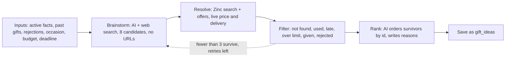

# ALL-27 Gift idea engine: Spec and Plan

**Goal:** given what we know about a person, the app produces 3–5 gifts that can really be bought, arrive on time and fit the budget, plus at most one clearly labeled over-budget gift, both in rounds and when a test or admin buyer asks for them.

**Status:** Spec written, waiting for Jim's review. The Plan comes after that.

**Links:** [ALL-27](https://linear.app/allens-forever/issue/ALL-27). Design §4.2, §6.3, §7. PRD G-1, G-2, G-4, G-5. Spike: `design/spikes/ai.md`. Planning decisions 34, 48, 52, 53. Technical decisions T11, T17, T19, T23, T39, T42, T49.

**Depends on:** ALL-94 (the paid-features flag and the money notice) ships first.

**Hands off to:** ALL-29 (approval screen, and switching rounds on in production), ALL-93 (private list), ALL-77 (linking).

## Spec: what it does

### Who it's for and what they can do

1. **Ideas in a round:** as a test or admin buyer, when a round reaches the point of needing ideas, I get real, checked gifts in the heads-up email instead of samples, so the round is worth acting on.
2. **Suggest ideas on demand:** as a test or admin buyer, I can tap "Suggest ideas for Dad" on his page and see checked gifts with the full cost, store, arrival date and a one-line reason, so I don't have to wait for a round.
3. **Told about the money:** as a test or admin buyer, I can see before I tap that this spends real money during alpha.
4. **Kept out of paid features:** as a buyer without the flag, I'm never charged for and never trigger any AI or Zinc call, and the page tells me plainly that this isn't available yet.
5. **Trusting the list:** as a buyer, I never see something Dad was already given, something I already rejected, a used or refurbished item, or a price the AI guessed.

### How one run works

### Acceptance criteria

| # | Given | When | Then |
|---|---|---|---|
| AC-1 | A person with facts, a budget and a deadline | A run finishes | 3–5 ideas are saved within budget, plus at most one over budget, ranked, each with a one-line reason |
| AC-2 | Any saved idea | Its fields are read | Its price, shipping, delivery days and seller came from a live Zinc offer, never from the AI's estimate. It's new, and available |
| AC-3 | A search whose first result is another brand | Resolve runs | The first result matching the brand wins. If none matches, the candidate is dropped as not found |
| AC-4 | Several offers on one product | Resolve runs | Used and refurbished are never picked, even when cheaper. Order of preference: buy box, then sold by the retailer or brand, then fastest delivery |
| AC-5 | A candidate that, ordered on the latest order date, wouldn't arrive with the safety buffer to spare | Filter runs | It's dropped (`canArriveInTime`: a round passes its deadline as the order date; on demand, see the decisions below) |
| AC-6 | Totals around the budget | Filter runs | `est_total` comes from `estimatedTotalCents`, and `classifyTotal` decides within, over or dropped. With no budget, nothing is labeled over budget |
| AC-7 | A product already given to this person, or an idea already rejected for them | Filter runs | It never appears, matched by retailer product id (G-4) |
| AC-8 | Fewer than 3 survive | A run finishes its loop | Brainstorm, resolve and filter repeat up to `idea_retry_max` more times, telling the AI what to avoid. Then the survivors are saved and the shortfall is logged |
| AC-9 | Zero survive after retries, or the run keeps failing, in a round | `idea_round_runs_max` runs have been used | **[Pending Jim]** No heads-up with empty ideas, and no more spending on this round. The buyer gets one "We couldn't find gifts for {name}" email with the guided questions link. New facts allow one more run on the next tick. Otherwise the round skips at the deadline, and the skip email goes out because we told them |
| AC-10 | Zero survive, on demand | The run ends | The page says plainly that nothing suitable was found, and nothing is saved |
| AC-11 | A retried round step | Ideas were already saved | No second set is saved, and no second AI or Zinc spend happens |
| AC-12 | The AI or Zinc is down, times out, or returns something that fails its schema | A run hits it | Vendor shapes stop at their adapter (E4). A round's failed run counts toward `idea_round_runs_max` (AC-9) and is retried on the next tick. On demand shows "Couldn't get ideas. Try again." One bad candidate doesn't end the run |
| AC-13 | A person with no active facts | A buyer asks on demand, or a round reaches the point of needing ideas | No money is spent. On demand: the page points to the guided questions. **[Pending Jim]** In a round: the same email as AC-9, sent once, and the next tick that finds facts runs the engine |
| AC-14 | A buyer with the flag, on the person's page | The page loads | "Suggest ideas for {name}" shows, with the alpha money notice next to it and always visible, including the rough cost from settings |
| AC-15 | A buyer without the flag | The page loads, or they call the action directly | No button. The page says it isn't available yet. The action refuses before any AI or Zinc call |
| AC-16 | A buyer without the flag | The tick runs, or their open round reaches the point of needing ideas (they may have lost the flag mid-round) | No round is created for them, and `generateIdeas` refuses before any AI or Zinc call. An open round spends nothing, sends nothing new, and skips at the deadline |
| AC-17 | `idea_engine_enabled` = 0 | A round or on-demand run starts | Nothing is spent and no run is counted. On demand says it's off. A round waits and tries again on the next tick |
| AC-18 | A buyer taps Suggest twice, or asks again later | Runs complete | The button is disabled while running. A new on-demand set replaces the last on-demand set for that person. Ideas in rounds aren't touched |
| AC-19 | Any run | It ends, however it ends | One event with ids, counts, stage reached and cost in cents (AI plus Zinc). No names, facts or gift text (E6, T42) |
| AC-20 | Any idea text from the AI | Before it's saved | The sensitive-trait filter (`lib/ai/sensitive.ts`) runs on title and reason. A hit drops the idea |
| AC-21 | The AI request | It's built | It holds the relationship and facts, never the person's or buyer's name, email or address. Zinc gets only the search text (T42) |
| AC-22 | The 5 fixture profiles (W1-3) | `pnpm ai:eval` runs against the real AI and Zinc | Every idea passes AC-2, AC-5 and AC-6. Cost per run is reported. One attempt's AI cost stays at or below the design §7 figure of about $0.20. Retries are extra and count toward the most a run can cost. Run by hand, never in CI |
| AC-23 | A round on dev with the engine in place | The test clock runs it | Real ideas reach the heads-up email. The stub in `rounds/ideas.ts` is gone. `round_engine_enabled` stays 0 on production |
| AC-24 | A round with an over-budget idea | The heads-up or a reminder is sent | That idea is clearly labeled as over budget in the email. Today's rows show only title and price |
| AC-25 | More rounds need ideas than `idea_rounds_per_tick` | The tick runs | Only that many run. The rest wait for the next tick, and the tick still finishes its other work |
| AC-26 | A buyer saves an address on a round waiting for one | The save finishes | The page doesn't wait for the engine. The round's ideas are made on the next tick |
| AC-27 | A person is deleted | Their on-demand ideas exist | Their page is a 404, so the ideas can't be seen in the app. The rows stay readable by their owner in the database until hard delete, the same as their facts (ALL-37) |

### Out of scope

| What | Where it goes |
|---|---|
| Approving or rejecting ideas, and starting a new search after a rejection | ALL-29 |
| Switching rounds on in production | ALL-29 (decision 53) |
| The private list, and "Add to private list" on an idea | ALL-93 |
| Linking to someone's own list | ALL-77 |
| Offering gifts from a person's own list as picks (`source = list`) | Stays as it is; not changed here |
| Retailers other than Amazon | Later. The resolve rules were only tested on Amazon |
| Real tax by state | Checkout gives the real figure; see the decisions below |
| Rate limits per buyer | Not needed while only test and admin users can run it. Comes back with premium |

### Open questions

None block the Plan unless the builder check below raises one. **[Verify]** items are checked in the Plan's first task:

- **[Verify]** the Zinc production key (`ZINC_API_KEY`) is set in Vercel. The app-owned account has about 33¢ left after the spike, which won't cover AC-22, so an admin needs to top it up first (T17). About $10 is plenty for this ticket **[Claude's call]**.
- **[Verify]** how long a Vercel function can run on our plan, for a server action and for the tick. A run with retries can take minutes. If the limit is under `idea_run_deadline_ms`, that setting and `idea_rounds_per_tick` come down to fit.
- **[Verify]** Zinc search and offer response fields, from a live call. The spike read them defensively (`results` or `products`).

## What was decided, and why

| Question | Answer | Why |
|---|---|---|
| Does ALL-27 switch rounds on in production? | **No.** It moves to the end of ALL-29 | Jim, decision 53. Emails would otherwise ask people to choose on a screen that doesn't exist |
| Who can use it? | Only users with the paid-features flag (ALL-94) | Jim, decision 53. Anything that costs money isn't free |
| How clear is the cost? | A plain notice next to the action, always visible, with a rough cost | Jim, decision 53 |
| Is the private list here? | No, it's ALL-93. It's a real list only its creator can see | Jim, decision 52 |
| When are ideas made outside a round? | Only when the buyer asks | Jim, decision 52. Predictable spend, no new scheduled job (E1) |
| Are on-demand ideas re-checked before a round uses them? | Rounds don't reuse them in this ticket: a round always runs the engine fresh. The re-check rule applies when ALL-93 lets saved ideas feed a round | Jim accepted re-checking through the live price step. Running fresh is that check, and it's the simplest version |
| Where do on-demand ideas live? | `gift_ideas`, with `round_id` now optional and a new optional `person_id`. A check requires one of the two **[Claude's call]** | One table for ideas, in the shape ALL-93 and ALL-77 can read. Old rows and old code stay valid, so a rollback is safe (E7). `rejections` and `orders` still require a round, so on-demand ideas can't be rejected or ordered yet. ALL-93 inherits that. Details in T54 |
| Which occasion does an on-demand run use? | The next enabled occasion a gift ordered today can still reach. It uses that occasion's budget and checks arrival as if ordered today, and the page shows the date as "if ordered today". With no such occasion: no budget and no arrival check **[Claude's call]** | Far-off occasions shouldn't be limited to a round's 7-day planning window, and nothing is promised for a later order, because on-demand ideas can't be ordered yet |
| A confirm step before spending? | No, the visible notice is enough. Disabled while running **[Claude's call]** | For test and admin users only. Jim asked for clarity, not extra taps |
| What does the notice say about cost? | The usual cost and the most a run can cost, from settings: "Alpha: this spends real money, usually about 40¢ and at most $1." **[Claude's call]** | Retries can make one run cost far more than the usual figure, so one number wouldn't be honest (decision 53) |
| How do retries stay cheap? | A retry brainstorms with `idea_retry_searches` web searches (1) instead of 3, and only asks for what's still needed **[Claude's call]** | Search results are most of the AI cost |
| How do slow runs fit? | Inside the tick, one round at a time, up to `idea_rounds_per_tick`. The rest wait for the next tick. Saving an address no longer runs the engine in that request **[Claude's call]** | E1: no new function or queue while only test and admin users have rounds. Revises design §5.1's plan to hand each round to its own call. Revisit before the public launch, because a busy tick could delay heads-ups by days |
| Who checks the flag for rounds? | ALL-94 provides `concierge.accounts.paid_features` and one check. ALL-27 adds the filter to `round_candidates` and a second check in `generateIdeas` **[Claude's call]** | The tick runs as the server, so the check can't rely on the signed-in user. Checking at the spend point covers a flag lost mid-round |
| How is tax estimated? | A flat percentage in settings (`idea_tax_estimate_pct`, default 8) **[Claude's call]** | Nothing estimates tax today. A per-state table is more than an estimate needs, and this needs no address, which fits T42. Revises design §4.2's "estimated from the recipient's state" |
| Does a cheap model check that the found item matches? | No extra call. The brand rule filters first, then the rank step sees the real product title and can drop a mismatch **[Claude's call]** | Design §6.3 left this for W3-3. One less model and one less cost |
| Which model? | Sonnet 5.5 for both steps, with up to 3 web searches on brainstorm | T39 and ALL-42: Haiku missed the main need, Opus costs up to twice as much |
| Is a dev-only "generate ideas now" button still needed? | No | The on-demand button does the job |
| Over-budget slot | Kept from the prompt rules: a stated want above the budget can use it, inside `over_budget_pct` | Prompt v3, design §7 |

## Settings (T23)

All in `concierge.app_settings`, with no fallback in code.

| Setting | Default | What it does |
|---|---|---|
| `idea_engine_enabled` | 1 | 0 stops all runs (off switch) |
| `idea_candidates` | 8 | Candidates per brainstorm |
| `idea_max_searches` | 3 | Web searches per brainstorm |
| `idea_keep_min` | 3 | Fewer survivors than this triggers a retry |
| `idea_keep_max` | 5 | Most ideas kept within budget |
| `idea_retry_max` | 2 | Extra attempts when too few survive |
| `idea_ai_timeout_ms` | 60000 | Per AI call |
| `idea_zinc_timeout_ms` | 15000 | Per Zinc call |
| `idea_run_deadline_ms` | 240000 | No new retry starts after this |
| `idea_tax_estimate_pct` | 8 | Flat tax estimate |
| `idea_run_estimate_cents` | 40 | The usual cost shown in the money notice |
| `idea_run_max_cents` | 100 | The most a run can cost, shown in the money notice |
| `idea_retry_searches` | 1 | Web searches on a retry |
| `idea_round_runs_max` | 2 | **[Pending Jim]** Runs a round may spend on before it stops and tells the buyer |
| `idea_rounds_per_tick` | 3 | Most rounds that make ideas in one tick |
| `zinc_lookup_cents` | 1 | Cost of one Zinc call, for logging |

The order fee (`zinc_order_fee_cents`) already exists in settings, and `over_budget_pct` is per account in `concierge.accounts`. `pnpm ai:eval` only checks capture reading today, so it's extended for AC-22, and the 5 profiles move from `spikes/ai/fixtures/` to `apps/web/lib/ai/fixtures/`. No Zinc code exists in `apps/web`, so the adapter is new.

## Principles check

- **Simplest version?** Cut: reusing saved ideas in rounds, a queue or worker, per-buyer limits, a confirm step, a tax table, a match-checking model, other retailers, a dev button.
- **Hard-coded values?** The settings above. Model IDs stay in `lib/ai/models.ts` (T11), and prompt wording stays in code.
- **Product boundaries?** Everything is in `modules/concierge` and `lib/ai`. Past gifts and rejections are concierge tables. No list tables touched (T19).
- **New personal data?** No new fields about people. `gift_ideas.person_id` is an id, and idea text may reflect facts, so it stays owner-only under RLS. Deleting a person is a soft delete, so rows stay until hard delete, like facts (AC-27). AI gets relationship and facts; Zinc gets search text (T42).
- **E1:** no new service, queue or scheduled job. It runs inside the existing tick and a server action, with a cap per tick.
- **E2:** one `generateIdeas` used by both callers. The `searchWeb` step stays a small replaceable function because T11 requires it.
- **E3:** clients, settings, the AI and Zinc arrive as arguments, so tests pass fakes for the vendors.
- **E4:** the Zinc adapter validates responses and translates them to our shape. AI output is schema-checked.
- **E5:** Vitest for filter and pick rules; pgTAP for the schema change and grants; Playwright for the button, notice and gate against local Supabase, with Zinc and the AI mocked at the adapter.
- **E6:** the event in AC-19, ids and counts only.
- **E7/E9:** `idea_engine_enabled`, Vercel rollback, expand-only migration. On production we'll see `ideas.run` events and the button working for test and admin users. Rounds remain off there.
- **Bends:** G-1 says ideas per round, and this adds them outside a round too (decisions 48, 52). Design §4.2's tax wording and §5.1's long-steps note change as noted. Design §5.1 says stuck rounds never reach `needs_attention` while §7 says a hit AI cap does: this ticket follows §5.1 and uses AC-9's email, and §7 gets corrected.
- **Docs and decisions:** T54, design §3, §4.2, §6.3, §7, `design/ui.md` (the Ideas section and notice), ALL-28 note that the stub is gone.

## Plan

To be written after Jim reviews the Spec.
