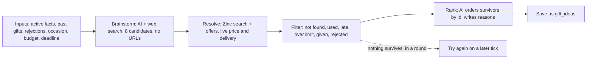

# ALL-27 Gift idea engine: Spec and Plan

**Goal:** given what we know about a person, the app produces 3–5 gifts that can really be bought, arrive on time and fit the budget, plus at most one clearly labeled over-budget gift, both in rounds and when a test or admin buyer asks for them.

**Status:** Spec approved by Jim, 2026-11-05. **Revised 2026-11-10** for what landed on `main` since then (Zinc code from ALL-32, the money-notice wording and email tone from ALL-116, `needs_address` rounds looked at on every tick from ALL-63), and for the adversarial review (T55): one attempt per run, runs counted before they spend, a time budget for the tick, and a hard cost cap per run. Jim settled the open questions the same day: fan-out comes later (ALL-125), rounds are only for paid users while they cost money, and an address can wait up to a day for the next tick. Next: the Plan and its own adversarial review.

**Links:** [ALL-27](https://linear.app/allens-forever/issue/ALL-27). Design §4.2, §6.3, §7. PRD G-1, G-2, G-4, G-5. Spike: `design/spikes/ai.md`. Planning decisions 34, 48, 52, 53. Technical decisions T11, T17, T19, T23, T39, T42, T49, T54, T68.

**Depends on:** ALL-94 (the paid-features flag and the money notice), merged 2026-11-05.

**Hands off to:** ALL-29 (approval screen, and switching rounds on in production), ALL-93 (private list), ALL-77 (linking).

## Spec: what it does

### Who it's for and what they can do

1. **Ideas in a round:** as a test or admin buyer, when a round reaches the point of needing ideas, I get real, checked gifts in the heads-up email instead of samples, so the round is worth acting on.
2. **Suggest ideas on demand:** as a test or admin buyer, I can tap "Suggest ideas for Dad" on his page and see checked gifts with the full cost, store, arrival date and a one-line reason, so I don't have to wait for a round.
3. **Told about the money:** as a test or admin buyer, I can see before I tap that this costs real money, and roughly how much.
4. **Kept out of paid features:** as a buyer without the flag, I'm never charged for and never trigger any AI or Zinc call, and the page tells me plainly that this isn't available yet.
5. **Trusting the list:** as a buyer, I never see something Dad was already given, something I already rejected, a used or refurbished item, or a price the AI guessed.

### How one run works



**One attempt per run** (Jim, 2026-11-10). A run brainstorms once. If nothing survives, a round tries again on a later tick, never inside the same run. Before it spends anything, a run writes a `concierge.idea_runs` row in its own transaction. That row counts the run toward the round's limit, holds the on-demand lease, and gets the cost as it builds, so a run that's killed part-way still leaves a record.

### Acceptance criteria

| # | Given | When | Then |
|---|---|---|---|
| AC-1 | A person with facts, a budget and a deadline | A run finishes | Up to `idea_keep_max` (5) ideas are saved within budget, plus at most one over budget, ranked, each with a one-line reason |
| AC-2 | Any saved idea | Its fields are read | Its price, shipping, delivery days and seller came from a live Zinc offer, never from the AI's estimate. It's new, and available |
| AC-3 | A search whose first result is another brand | Resolve runs | The first result matching the brand wins. If none matches, the candidate is dropped as not found |
| AC-4 | Several offers on one product | Resolve runs | Used and refurbished are never picked, even when cheaper. Order of preference: buy box, then sold by the retailer or brand, then fastest delivery |
| AC-5 | A candidate that, ordered on the latest order date, wouldn't arrive with the safety buffer to spare | Filter runs | It's dropped (`canArriveInTime`: a round passes its deadline as the order date; on demand, see the decisions below) |
| AC-6 | Totals around the budget | Filter runs | `est_total` comes from `estimatedTotalCents`, and `classifyTotal` decides within, over or dropped. With no budget, nothing is labeled over budget |
| AC-7 | A product already given to this person, or an idea already rejected for them | Filter runs | It never appears, matched by retailer product id (G-4) |
| AC-8 | Fewer than `idea_keep_min` (3) survive | The run ends | No second brainstorm in the same run. The survivors are saved and used, and the `ideas.run` event records the shortfall. Only a round left with none tries again, on a later tick (AC-9) |
| AC-9 | A round's run saves no ideas, or fails | Later ticks look at the round | A run counts as soon as its `idea_runs` row is written, before any spend, so a crash or timeout counts too. A round gets at most `idea_round_runs_max` (2) runs, at most one per tick. After the last one it spends nothing more and waits for its deadline (`next_action_at` set to it), and the buyer gets one "Sorry, we couldn't find gifts for {name} yet" email (the `no_ideas` step in `round_sends`, so it's sent once), in the ALL-116 tone: sorry, what it means, nothing was charged, and "What happens next" with the guided questions link. A new fact saved for that person brings the round back on the next tick for one more run. If that one finds nothing too, a second email says so (`no_ideas_again`). So a round's life has at most 3 runs, about $1.20. At the deadline the round skips, and the skip email goes out, because `no_ideas` counts as having asked the buyer something (ALL-28 ruling 13) |
| AC-10 | Zero survive, on demand | The run ends | The page says plainly that nothing suitable was found, and nothing is saved |
| AC-11 | A retried round step | Ideas were already saved | No second set is saved, and no second AI or Zinc spend happens |
| AC-12 | The AI or Zinc is down, times out, or returns something that fails its schema | A run hits it | Vendor shapes stop at their adapter (E4). A round's failed run counts toward `idea_round_runs_max` (AC-9) and is retried on the next tick. On demand shows "Couldn't get ideas. Try again." One bad candidate doesn't end the run. A Zinc 429 drops that candidate instead of waiting |
| AC-13 | A person with no active facts | A buyer asks on demand, or a round reaches the point of needing ideas | No money is spent. On demand: the page points to the guided questions. In a round: the same email as AC-9, sent once, and no run is counted. The next tick that finds facts runs the engine. Facts are checked before the address request, so a buyer is never asked for an address for someone we can't suggest gifts for yet |
| AC-14 | A buyer with the flag, on the person's page | The page loads | "Suggest ideas for {name}" shows, with the money notice next to it and always visible, including the rough cost from settings, in the `design/ui.md` style (no "Alpha:") |
| AC-15 | A buyer without the flag | The page loads, or they call the action directly | No button. The page says it isn't available yet. The action refuses before any AI or Zinc call |
| AC-16 | A buyer without the flag | The tick runs, or their open round reaches the point of needing ideas (they may have lost the flag mid-round) | Rounds are only for paid users while they cost money (Jim, 2026-11-10): `round_candidates` leaves this buyer out, so no round, reminder or address request is created. `generateIdeas` checks again before any AI or Zinc call, so an open round spends nothing, sends nothing new, and skips at the deadline |
| AC-17 | `idea_engine_enabled` = 0 | A round or on-demand run starts | Nothing is spent and no run is counted. On demand says it's off. A round waits and tries again on the next tick |
| AC-18 | A buyer taps Suggest twice, or asks again later | Runs complete | The button is disabled while running, and the server refuses a second run for the same person while one is under way (an unfinished `idea_runs` row younger than `idea_run_lease_ms`), so two tabs can't both spend. A new on-demand set replaces the last on-demand set for that person. Ideas in rounds aren't touched |
| AC-19 | Any run | It ends, however it ends | One event with ids, counts, stage reached and cost in cents (AI plus Zinc). An `ideas.run_started` event goes out first, and the cost so far is saved on the `idea_runs` row as it builds, so a killed run still shows what it spent. No names, facts or gift text (E6, T42) |
| AC-20 | Any idea text from the AI | Before it's saved | The sensitive-trait filter (`lib/ai/sensitive.ts`) runs on title and reason. A hit drops the idea |
| AC-21 | The AI request | It's built | It holds the relationship and facts, never the person's or buyer's name, email or address. In fact text, the person's and buyer's first and last names are replaced with "them" before it's sent, and a search query from the AI that contains either name is dropped before it reaches Zinc. Zinc gets only the search text (T42). A test uses a fact like "Bob loves fishing" for a person named Bob |
| AC-22 | The 5 fixture profiles (W1-3) | `pnpm ai:eval` runs against the real AI and Zinc | Every idea passes AC-2, AC-5 and AC-6. Cost per run is reported. One run's AI cost stays at or below the design §7 figure of about $0.20, and its whole cost under `idea_run_max_cents`. Run by hand, never in CI |
| AC-23 | A round on dev with the engine in place | The test clock runs it | Real ideas reach the heads-up email. The stub in `rounds/ideas.ts` is gone. `round_engine_enabled` stays 0 on production |
| AC-24 | A round with an over-budget idea | The heads-up or a reminder is sent | That idea is clearly labeled as over budget in the email. Today's rows show only title and price |
| AC-25 | More rounds need ideas than fit | The tick runs | The tick has one deadline, `tick_deadline_ms` after it starts. Ideas are made in their own pass, after the money path, the stale-order sweep and rejection notices. A run starts only while fewer than `idea_rounds_per_tick` have run and the time left covers a run's worst case (two AI timeouts plus two Zinc timeouts). AI and Zinc calls get an abort signal tied to that deadline. Rounds that don't get a turn are released with no run counted, and wait for the next tick. The whole tick finishes inside Vercel's 300 s limit |
| AC-26 | A buyer saves an address on a round waiting for one, or links a list whose owner shares an address (ALL-63) | The save finishes | The page doesn't wait for the engine: `updatePerson` no longer generates ideas in the request. The round's ideas are made on the next tick, which already looks at every `needs_address` round. Jim accepted the wait of up to a day (2026-11-10); ALL-125 can make it sooner |
| AC-27 | A person is deleted | A run would start, or their on-demand ideas exist | No run starts: before any spend, the run checks that the person is live and belongs to the buyer, and new rows carry a `(person_id, user_id)` foreign key to `people`. Their page is a 404, so existing ideas can't be seen in the app. The rows stay readable by their owner in the database until hard delete, the same as their facts (ALL-37) |
| AC-28 | The engine on dev | One round's run and one on-demand run are timed (`ideas.run` events) | The times are posted on this ticket and on ALL-125, so the size of the fan-out work rests on measurements, not the spike's |
| AC-29 | A run's spend so far | Before each Zinc call and before ranking | Spend is added up as the run goes: the AI cost from the Gateway's figure, and Zinc at `zinc_lookup_cents` a call. Once it reaches `idea_run_max_cents` the run stops resolving and ends without ranking, saving nothing, logged as `stopped: cost_cap`. The only overshoot is the AI call already in flight, which `idea_max_searches` and a token limit bound |

### Out of scope

| What | Where it goes |
|---|---|
| Approving or rejecting ideas, and starting a new search after a rejection | ALL-29 |
| Switching rounds on in production | ALL-29 (decision 53) |
| The private list, and "Add to private list" on an idea | ALL-93 |
| Linking to someone's own list | ALL-77 |
| Offering gifts from a person's own list as picks (`source = list`) | Stays as it is; not changed here |
| Retailers other than Amazon | Later. The resolve rules were only tested on Amazon |
| Real tax by state | Checkout gives the real figure; see the decisions below |
| Rate limits per buyer | Not needed while only test and admin users can run it. Comes back with premium |

### Open questions

- **Settled 2026-11-10 (Jim):** fan-out comes later, as ALL-125, which blocks ALL-29. Rounds are only for paid users while they cost money. An address waiting up to a day for the next tick is fine.
- **Checked 2026-11-10:** `ZINC_API_KEY` is set in Vercel. Functions on our plan (Hobby, Fluid compute on) run for 300 s by default and at most (Vercel's limits page, and the project's `functionDefaultTimeout`).
- **Still to do before AC-22:** an admin tops up the app-owned Zinc account, which had about 33¢ after the spike (T17). About $10 is plenty **[Claude's call]**.
- **[Verify]** in the Plan's first task: Zinc search and offer response fields from a live call (the spike read them defensively, `results` or `products`), and the AI Gateway's cost field on a web-search call, for AC-19.

### Fitting the tick

The daily tick is one function call with a 300 s limit. Since ALL-32 it also sweeps stale orders and places held gifts (up to `zinc_place_budget_ms`, 45 s), and since ALL-63 it looks at every `needs_address` round. One idea run takes about 55 s in the spike (brainstorm 42–46 s with Sonnet), and up to about 150 s for one attempt when the AI and Zinc run to their timeouts.

| Option | What it means | Good | Bad |
|---|---|---|---|
| **A. Cap per tick (recommended now)** | At most `idea_rounds_per_tick` (1) runs per tick, in a pass after the money path, and only while the tick's deadline leaves room for a run's worst case | No new service (E1); enough while only test and admin users have rounds, and rounds are off on production | A busy morning queues rounds a day each. Fine now, not for launch |
| B. Fan out with Vercel Queues now | The tick sends round ids; a consumer runs one round per call, each with its own 300 s | Scales to the Christmas rush | A new queue, consumer and decision (E1, a T#), and the sweep, email retries and rejection summary move to their own jobs. Larger than this ticket |

**Decided (Jim, 2026-11-10): A** in this ticket, with AC-28's timings posted. B is ALL-125, which blocks ALL-29 (switching rounds on in production). Recorded as T68.

## What was decided, and why

| Question | Answer | Why |
|---|---|---|
| Does ALL-27 switch rounds on in production? | **No.** It moves to the end of ALL-29 | Jim, decision 53. Emails would otherwise ask people to choose on a screen that doesn't exist |
| Who can use it? | Only users with the paid-features flag (ALL-94). That includes rounds: no rounds at all for users without it while they cost money | Jim, decision 53, and 2026-11-10 for rounds. Anything that costs money isn't free |
| How clear is the cost? | A plain notice next to the action, always visible, with a rough cost, in the `design/ui.md` money-notice style | Jim, decision 53. "Alpha:" was dropped by the owner (ALL-114, ALL-116) |
| What happens when a round can't produce ideas? | It spends on at most `idea_round_runs_max` (2) runs, and never on a person with no facts. The buyer gets one email with the guided questions link. A new fact allows one more run, so at most 3 runs, about $1.20, in a round's life. Otherwise it skips at the deadline and they're told | Jim, 2026-11-05; limits and cost approved 2026-11-10. Daily retries would waste money and the occasion would pass in silence |
| Is the private list here? | No, it's ALL-93. It's a real list only its creator can see | Jim, decision 52 |
| When are ideas made outside a round? | Only when the buyer asks | Jim, decision 52. Predictable spend, no new scheduled job (E1) |
| Are on-demand ideas re-checked before a round uses them? | Rounds don't reuse them in this ticket: a round always runs the engine fresh. The re-check rule applies when ALL-93 lets saved ideas feed a round | Jim accepted re-checking through the live price step. Running fresh is that check, and it's the simplest version |
| Where do on-demand ideas live? | `gift_ideas`, with `round_id` now optional and a new optional `person_id`. A check requires one of the two **[Claude's call]** | One table for ideas, in the shape ALL-93 and ALL-77 can read. Old rows and old code stay valid, so a rollback is safe (E7). `rejections` and `orders` still require a round, so on-demand ideas can't be rejected or ordered yet. ALL-93 inherits that. Details in T54 |
| Which occasion does an on-demand run use? | The next enabled occasion a gift ordered today can still reach. It uses that occasion's budget and checks arrival as if ordered today, and the page shows the date as "if ordered today". With no such occasion: no budget and no arrival check **[Claude's call]** | Far-off occasions shouldn't be limited to a round's 7-day planning window, and nothing is promised for a later order, because on-demand ideas can't be ordered yet |
| A confirm step before spending? | No, the visible notice is enough. Disabled while running **[Claude's call]** | For test and admin users only. Jim asked for clarity, not extra taps |
| What does the notice say about cost? | The usual cost and the most a run can cost, from settings: "Suggesting ideas uses AI and live product lookups, which cost real money: usually about 40¢, at most $1." Wording lives in `packages/core/src/paid-features.ts` **[Claude's call]** | The usual 40¢ is about 20–25¢ of AI (mostly web searches) plus about 16¢ of Zinc lookups. A run with slow searches can cost more, so one number wouldn't be honest (decision 53). Costs per feature are in `planning/strategy.md` > Money model, for pricing (ALL-76) |
| Retries inside a run? | None. One attempt per run; a round with no ideas tries again on a later tick | Jim, 2026-11-10. Keeps a run near 40¢ and the tick's time predictable |
| How do slow runs fit? | **Inside the tick (option A, Jim 2026-11-10; T68).** One deadline for the whole tick; ideas in their own pass after the money path; at most `idea_rounds_per_tick` (1) runs, each started only if the time left covers its worst case. Fan-out is ALL-125, which must ship before ALL-29 switches rounds on in production. Saving an address no longer runs the engine in that request | E1: no new queue while only test and admin users have rounds, and rounds are off on production. One round takes about 55 s in the spike, so a busy morning will need fan-out, but only once real users have rounds |
| Who checks the flag for rounds? | ALL-94 provides `concierge.accounts.paid_features` and one check. ALL-27 adds the filter to `round_candidates` and a second check in `generateIdeas` **[Claude's call]** | The tick runs as the server, so the check can't rely on the signed-in user. Checking at the spend point covers a flag lost mid-round |
| How is tax estimated? | A flat percentage in settings (`idea_tax_estimate_pct`, default 8) **[Claude's call]** | Nothing estimates tax today. A per-state table is more than an estimate needs, and this needs no address, which fits T42. Revises design §4.2's "estimated from the recipient's state" |
| Does a cheap model check that the found item matches? | No extra call. The brand rule filters first, then the rank step sees the real product title and can drop a mismatch **[Claude's call]** | Design §6.3 left this for W3-3. One less model and one less cost |
| Where do Zinc lookups live? | `modules/concierge/zinc/products.ts`, on the shared `ZincHttp` in `zinc/client.ts` with the **app-owned key** (T17). No more than Zinc's 10 requests a second; a 429 drops that candidate rather than waiting, and `ZincHttp` stays as it is. Unit tests pass a fake `fetch`; the browser test adds search and offers routes to `e2e/fake-zinc.ts` (`ZINC_API_BASE`) | The owner's note on this ticket (2026-11-06) and ALL-32's verified Zinc facts (`design/spikes/checkout.md`) |
| How are runs counted and leased? | One `concierge.idea_runs` row per run: user, person, optional round, started, finished, cost so far, outcome. It's written before any spend, in its own transaction. A round's runs are counted from it. An unfinished on-demand row younger than `idea_run_lease_ms` blocks a second run for that person. A trigger on saving a fact moves that person's waiting `generating` rounds back to now, and the run limit decides whether one more run is allowed. Users can read their own rows; only server functions write them **[Claude's call]** | Fixes the review's finding that runs counted only on success could be dodged by crashes and timeouts. One table covers the count, the lease and a trace of killed runs |
| What leaves for the AI? | Relationship and facts, with the person's and buyer's names replaced in fact text. A search query that contains either name is dropped | T42. A buyer can type "Bob loves fishing", which would otherwise send a name |
| Which model? | Sonnet 5.5 for both steps, with up to 3 web searches on brainstorm | T39 and ALL-42: Haiku missed the main need, Opus costs up to twice as much |
| Is a dev-only "generate ideas now" button still needed? | No | The on-demand button does the job |
| Over-budget slot | Kept from the prompt rules: a stated want above the budget can use it, inside `over_budget_pct` | Prompt v3, design §7 |

## Settings (T23)

All in `concierge.app_settings`, with no fallback in code.

| Setting | Default | What it does |
|---|---|---|
| `idea_engine_enabled` | 1 | 0 stops all runs (off switch) |
| `idea_candidates` | 8 | Candidates per brainstorm |
| `idea_max_searches` | 3 | Web searches per brainstorm |
| `idea_keep_min` | 3 | Fewer survivors than this is logged as a shortfall |
| `idea_keep_max` | 5 | Most ideas kept within budget |
| `idea_ai_timeout_ms` | 60000 | Per AI call |
| `idea_zinc_timeout_ms` | 15000 | Per Zinc call |
| `idea_tax_estimate_pct` | 8 | Flat tax estimate |
| `idea_run_estimate_cents` | 40 | The usual cost shown in the money notice |
| `idea_run_max_cents` | 100 | The cap on one run's spend (AC-29), shown in the money notice |
| `idea_round_runs_max` | 2 | Runs a round may spend on before it stops and tells the buyer. A new fact allows one more |
| `idea_rounds_per_tick` | 1 | Most rounds that make ideas in one tick. Raise it only with the AC-28 timings in hand |
| `idea_run_lease_ms` | 600000 | How long an unfinished on-demand run blocks another for the same person |
| `tick_deadline_ms` | 270000 | The tick starts no new work after this, leaving 30 s of Vercel's 300 s |
| `zinc_lookup_cents` | 1 | Cost of one Zinc call, for logging and the cost cap |
| `zinc_requests_per_second` | 10 | Zinc's rate limit per key; a run never calls faster |
| `idea_ai_max_tokens` | 6000 | Output token limit per AI call, which bounds the cost of the call in flight (AC-29) |

The order fee (`zinc_order_fee_cents`) already exists in settings, and `over_budget_pct` is per account in `concierge.accounts`. `pnpm ai:eval` only checks capture reading today, so it's extended for AC-22, and the 5 profiles move from `spikes/ai/fixtures/` to `apps/web/lib/ai/fixtures/`. Product lookups are new (`zinc/products.ts`); the HTTP client and error type are ALL-32's.

## Principles check

- **Simplest version?** Cut: retries inside a run, reusing saved ideas in rounds, a queue or worker, per-buyer limits, a confirm step, a tax table, a match-checking model, other retailers, a dev button.
- **Hard-coded values?** The settings above. Model IDs stay in `lib/ai/models.ts` (T11), and prompt wording stays in code.
- **Product boundaries?** Everything is in `modules/concierge` and `lib/ai`. Past gifts and rejections are concierge tables. No list tables touched (T19).
- **New personal data?** No new fields about people. `gift_ideas.person_id` is an id, and `idea_runs` holds only ids, times, cents and an outcome, and idea text may reflect facts, so it stays owner-only under RLS. Deleting a person is a soft delete, so rows stay until hard delete, like facts (AC-27). AI gets relationship and facts; Zinc gets search text (T42).
- **E1:** no new service, queue or scheduled job in this ticket (option A, T68). Fan-out is ALL-125 and gets its own T#.
- **E2:** one `generateIdeas` used by both callers. The `searchWeb` step stays a small replaceable function because T11 requires it.
- **E3:** clients, settings, the AI and Zinc arrive as arguments, so tests pass fakes for the vendors.
- **E4:** the Zinc adapter validates responses and translates them to our shape. AI output is schema-checked.
- **E5 and T67:** Vitest for filter, pick and gate rules; component tests for the button, notice and messages; pgTAP for the schema change, grants and the paid filter on rounds; one Playwright journey (Suggest ideas with the flag) against local Supabase, with Zinc as the fake HTTP server and the AI faked at its adapter. Rounds move money later, so the round path keeps a real-database test.
- **E6:** the event in AC-19, ids and counts only.
- **E7/E9:** `idea_engine_enabled`, Vercel rollback, expand-only migration. On production we'll see `ideas.run` events and the button working for test and admin users. Rounds remain off there.
- **Bends:** G-1 says ideas per round, and this adds them outside a round too (decisions 48, 52). Design §4.2's tax wording and §5.1's long-steps note change as noted. Design §5.1 says stuck rounds never reach `needs_attention` while §7 says a hit AI cap does: this ticket follows §5.1 and uses AC-9's email, and §7 gets corrected.
- **Docs and decisions:** T54, T68, design §3, §4.2, §5.1, §6.3, §7, `design/ui.md` (the Ideas section and notice), `design/operations.md` (settings and turning it off), ALL-28 note that the stub is gone.
- **Adversarial review (T55):** done on the revised spec, 2026-11-10. It found 3 blockers (run limits that crashes could dodge, tick timing, no hard cost cap), 7 should-fixes (on-demand lease, ownership check, facts before address, names to the AI, a record of killed runs, no retries inside a run, ownership key) and 4 nits, all fixed above. Its owner questions were answered by Jim. The Plan gets its own review.

## Plan

> **For agentic workers:** REQUIRED SUB-SKILL: Use superpowers:subagent-driven-development (recommended) or superpowers:executing-plans to implement this plan task-by-task. Steps use checkbox (`- [ ]`) syntax for tracking.

**Goal:** build the spec above. A paid buyer gets live, checked gift ideas in a round (on dev) and on demand from a person's page, inside the tick's time and a hard cost cap per run.

**Architecture:** pure rules (offer choice, filtering, keeping, name redaction) live in `packages/core/src/ideas.ts`. Vendor adapters: Zinc product lookups in `modules/concierge/zinc/products.ts`, and the AI's brainstorm and rank in `lib/ai/ideas.ts`. A single run orchestrator, `modules/concierge/ideas/run.ts`, is used both by the round engine's new idea pass and by an on-demand server action. The database counts and leases runs (`concierge.idea_runs`) and saves ideas atomically through service-role functions.

**Tech stack:** Next.js 16, Supabase (Postgres, RLS, pgTAP), Vitest, Playwright, the AI Gateway's Anthropic-compatible `/v1/messages` endpoint (Sonnet 5.5 with `web_search`), and the Zinc REST API.

**Spec:** this file, above. Branch: `JimtheBurger/all-27-idea-engine`.

### Global constraints

- Every number comes from `concierge.app_settings` via `setting_int`. There are no fallbacks in code (T23). New settings are listed in Task 1.
- Logic never reads `process.env` or builds clients (E3). Only `app/settings/zinc-deps.ts` and the server action read env and build deps.
- Events go through `logEvent`, with ids, counts and cents only (E6, T42). Events: `ideas.run_started`, `ideas.run`, `ideas.candidate_dropped` (reason only).
- The AI never sees a name, email or address. Zinc only ever gets search text and product ids (AC-21).
- Copy: plain words. The money notice uses the `design/ui.md` style, with no "Alpha:". Emails use the ALL-116 tone.
- Migrations are expand-only (E7). **Don't push this branch's migration to dev before it merges** (ALL-32 rule in `design/operations.md`). Test against local Supabase.
- The AI and Zinc are mocked in unit and browser tests. The database is always real for privacy, ownership and run limits (E5, T67).
- Before the PR: `pnpm lint && pnpm typecheck && pnpm test && pnpm test:db && pnpm db:test && pnpm build`.

### Review focus

1. **A Zinc 429 in the middle of resolving.** Eight candidates make about 16 calls, so a burst can pass 10 a second. The run limits itself to `zinc_requests_per_second` (setting, 10). A 429 drops only that candidate and the run carries on. Test this in Task 5.
2. **A run killed by the deadline or a closed tab.** The `idea_runs` row stays unfinished. After `idea_run_lease_ms` the person can run again, and a round counts the killed run. Test both in Task 2.
3. **A person deleted, or their facts changed, during a run.** `save_ideas` checks again that the person is live and owned, and saves nothing otherwise. Test this in Task 2.
4. **Names that are parts of other words.** A person called "Al" must not turn "always" into "themways". Redaction matches whole words, ignoring case, and skips names shorter than 2 letters. Test this in Task 3.
5. **An occasion with no budget, or no reachable occasion on demand.** No over-budget label, and no arrival check on demand. The total still shows. Test this in Task 3 and Task 6.

### File map

| File | Change |
|---|---|
| `supabase/migrations/20261115100000_idea_engine.sql` | New: `gift_ideas` changes, `idea_runs`, functions, trigger, `round_candidates` filter, settings |
| `supabase/tests/idea_engine.test.sql` | New pgTAP |
| `packages/core/src/ideas.ts` (+ `index.ts`) | New: pure rules |
| `packages/core/src/paid-features.ts` | `ideaRunNotice`, `IDEA_RUN_OFF` |
| `packages/core/src/round-plan.ts` | `RoundView.hasFacts`, `ideaRunsLeft`; `no_ideas` and `no_ideas_again` steps |
| `apps/web/modules/concierge/zinc/client.ts` | `SendOptions.signal` |
| `apps/web/modules/concierge/zinc/products.ts` | New: search and offers adapter |
| `apps/web/lib/ai/messages.ts`, `lib/ai/ideas.ts`, `lib/ai/models.ts` | New: Gateway `/v1/messages` client, brainstorm and rank |
| `apps/web/modules/concierge/ideas/{run,store,read}.ts` | New: orchestrator, Supabase store, on-demand read |
| `apps/web/modules/concierge/rounds/{engine,store}.ts` | Idea pass, tick deadline, `unlock`, skip rule, facts and runs in the view |
| `apps/web/modules/concierge/rounds/ideas.ts` | Deleted (the stub) |
| `apps/web/modules/concierge/people/people.ts` | No resume in `updatePerson` and `saveAddress` |
| `apps/web/modules/concierge/notify/templates.ts` | `no_ideas` email; over-budget label on idea rows |
| `apps/web/app/settings/zinc-deps.ts` | Builds the real `generateIdeas` and on-demand deps |
| `apps/web/app/people/actions.ts`, `app/people/[id]/ideas-section.tsx`, `person-view.tsx` | On-demand button, notice and results |
| `apps/web/e2e/fake-zinc.ts`, `e2e/fake-gateway.ts`, `e2e/suggest-ideas.spec.ts` | Fake vendors and the one journey |
| `apps/web/scripts/ai-eval.ts`, `lib/ai/fixtures/people.json` | `--ideas` mode (AC-22) |

---

### Task 1: Confirm vendor shapes (no code)

**Files:** `design/spikes/checkout.md` (Zinc), `design/spikes/ai.md` (Gateway).

- [ ] **Step 1:** Ask an admin to top up the app Zinc account (about $10, T17). Until then the two calls below cost about 2¢ of the 33¢ left.
- [ ] **Step 2:** Make one live `GET /products/search?retailer=amazon&query=lodge%20cast%20iron` and one `GET /products/{id}/offers?retailer=amazon` with `ZINC_API_KEY`. Record which list field holds the results (`results` or `products`), and the field names for `product_id`, `title`, `brand`, `price`, `available`, `condition`, `buy_box_winner`, `seller.name`, `seller.first_party`, `handling_days`, `shipping_options[].{price,delivery_days}`.
- [ ] **Step 3:** Make one `POST /v1/messages` to the Gateway with `web_search` (`max_uses: 1`). Record whether the reply carries a cost (in a header or the body). If it doesn't, record the `usage` fields and where `GET /v1/models` gives prices.
- [ ] **Step 4:** Write both down in the two spike docs under "ALL-27 shapes", then commit (`docs: Zinc product and Gateway cost shapes for ALL-27`).

Tasks 4 and 5 use these field names. If one differs from what's assumed there, the schema in that task changes and nothing else does.

### Task 2: Schema, run limits and pgTAP

**Files:** create the migration and `supabase/tests/idea_engine.test.sql`; regenerate `packages/core/src/database.types.ts`.

**Produces:**
- `gift_ideas.round_id` becomes nullable.
- New columns on `gift_ideas`: `person_id uuid` (FK `(person_id, user_id)` → `public.people(id, user_id)`), check `round_id is not null or person_id is not null`, and index `(person_id) where round_id is null`.
- New table `concierge.idea_runs`:
  - `id`
  - `user_id`
  - `person_id` not null (FK to people as above)
  - `round_id` null (FK `(round_id, user_id)` → `gift_rounds`, on delete cascade)
  - `started_at`, `finished_at`
  - `cost_cents int not null default 0`
  - `outcome text` check in (`saved`, `none`, `failed`, `cost_cap`, `deadline`)
  - Owner read RLS, no insert, update or delete for `authenticated`.
- `concierge.start_idea_run(p_user_id uuid, p_person_id uuid, p_round_id uuid, p_now timestamptz) returns table (run_id uuid, refusal text)`. Security definer, service_role only. It takes `pg_advisory_xact_lock(hashtext(p_person_id::text))`. Refusals, checked in this order:
  - `not_found`: the person isn't live or isn't owned.
  - `not_paid`: `has_paid_features` is false.
  - `busy`: an unfinished run for this person started less than `idea_run_lease_ms` ago.
  - `limit`: a round has used `idea_round_runs_max` runs, and no active fact was created after its last run started. A round can never pass `idea_round_runs_max + 1` runs.
  - Otherwise it inserts a row and returns its id.
- `concierge.idea_runs_left(p_round_id uuid) returns boolean`: the same round rule, read-only.
- `concierge.save_ideas(p_run_id uuid, p_ideas jsonb) returns int`. Security definer, service_role only. It:
  - returns 0 if the person is no longer live or owned
  - returns 0 for a round that already has ideas (AC-11)
  - for on-demand, deletes that person's previous `round_id is null` ideas (AC-18)
  - inserts the rest with `source 'generated'`, `status 'proposed'`, and the run's user, person and round
  - all in one transaction
- `concierge.excluded_products(p_person_id uuid) returns setof text`: `retailer_product_id` of this person's ideas that were ordered (orders in any status except `failed`, `cancelled`, `refunded`), rejected (`status = 'rejected'`, or a `rejections` row), or turned down as a whole. Service_role only.
- A trigger on `profile_facts` insert, and on update to `active = true`: sets `next_action_at = now()` on that person's open rounds before approval (`scheduled`, `needs_address`, `generating`) whose `next_action_at` is later, so a round that sent `no_ideas` for lack of facts comes back too.
- `round_candidates` is re-created with `and concierge.has_paid_features(o.user_id)`. Grants stay as they are.
- Settings, each with a description:

| Setting | Value |
|---|---|
| `idea_engine_enabled` | 1 |
| `idea_candidates` | 8 |
| `idea_max_searches` | 3 |
| `idea_ai_max_tokens` | 6000 |
| `idea_keep_min` | 3 |
| `idea_keep_max` | 5 |
| `idea_ai_timeout_ms` | 60000 |
| `idea_zinc_timeout_ms` | 15000 |
| `idea_tax_estimate_pct` | 8 |
| `idea_run_estimate_cents` | 40 |
| `idea_run_max_cents` | 100 |
| `idea_round_runs_max` | 2 |
| `idea_rounds_per_tick` | 1 |
| `idea_run_lease_ms` | 600000 |
| `tick_deadline_ms` | 270000 |
| `zinc_lookup_cents` | 1 |
| `zinc_requests_per_second` | 10 |

  `idea_ai_max_tokens` and `zinc_requests_per_second` are added to the spec's Settings table in this task.

- [ ] **Step 1: Write the failing pgTAP tests**, each as one `is`, `ok` or `throws_ok`:
  - `an on-demand idea needs a person`: insert with both ids null fails the check.
  - `a user reads only their own runs`, and `a user can't insert or update runs`.
  - `start_idea_run refuses a deleted person` → `not_found`; `another user's person` → `not_found`.
  - `start_idea_run refuses without paid features` → `not_paid`.
  - `a second on-demand run inside the lease is busy`, and `after the lease it starts` (insert a row with `started_at = now() - interval '11 minutes'`).
  - `a round gets two runs, then limit`.
  - `a fact saved after the last run allows a third`.
  - `never a fourth`.
  - `a killed run counts`: an unfinished row counts toward the limit.
  - `save_ideas saves nothing for a round that has ideas`.
  - `save_ideas replaces the previous on-demand set and leaves round ideas alone`.
  - `save_ideas saves nothing once the person is deleted`.
  - `excluded_products lists ordered and rejected products for that person only`.
  - `saving a fact moves a waiting scheduled, needs_address or generating round to now, and leaves awaiting_approval alone`.
  - `round_candidates leaves out users without paid features`.
  - `anon and authenticated can't execute the new functions`.
- [ ] **Step 2:** `pnpm db:test`. Expected: the new file fails (functions missing).
- [ ] **Step 3:** Write the migration. Copy `round_candidates` from `20261105100000_round_engine.sql` and add the filter.
- [ ] **Step 4:** `supabase db reset && pnpm db:test`. Expected: everything passes. Then `pnpm db:types`.
- [ ] **Step 5:** Commit `feat(db): idea runs, on-demand ideas and paid-only rounds (ALL-27)`.

### Task 3: Pure rules in `packages/core`

**Files:**
- Create `packages/core/src/ideas.ts` and `src/__tests__/ideas.test.ts`.
- Modify `paid-features.ts` and `index.ts`.

**Produces:**
```ts
export type ZincHit = { productId: string; title: string; brand: string | null; priceCents: number | null };
export type ZincOffer = { offerId: string | null; priceCents: number; shippingCents: number; available: boolean;
  condition: string; buyBox: boolean; firstParty: boolean; sellerName: string | null;
  handlingDaysMax: number; deliveryDaysMin: number; deliveryDaysMax: number };
export type DropReason = "not_found" | "unavailable" | "late" | "over_limit" | "given_or_rejected" | "sensitive" | "names";
export function matchHit(hits: ZincHit[], brand: string | null): ZincHit | null;          // AC-3
export function pickOffer(offers: ZincOffer[]): ZincOffer | null;                           // AC-4
export function judgeCandidate(c: { productId: string; offer: ZincOffer }, ctx: JudgeContext, s: ScheduleSettings):
  { keep: true; totalCents: number; fit: "within" | "over"; arriveBy: CalendarDate | null } | { keep: false; reason: DropReason };
export type JudgeContext = { budgetCents: number | null; overBudgetPct: number; taxPct: number; feeCents: number;
  occasionDate: CalendarDate | null; orderDate: CalendarDate; excluded: ReadonlySet<string> };
export function keepIdeas<T extends { fit: "within" | "over" }>(ranked: T[], keepMax: number): T[]; // AC-1
export function redactNames(text: string, names: string[]): string;                         // AC-21
export function mentionsName(text: string, names: string[]): boolean;
export function onDemandOccasion(occasions: { date: CalendarDate; budgetCents: number | null }[], today: CalendarDate, s: ScheduleSettings):
  { date: CalendarDate; budgetCents: number | null } | null;
export function ideaRunWorstMs(aiTimeoutMs: number, zincTimeoutMs: number): number;         // 2*ai + 2*zinc
// paid-features.ts
export function ideaRunNotice(estimateCents: number, maxCents: number): string;
export const IDEA_RUN_OFF: string;
```

- [ ] **Step 1: Write the failing tests:**
  - `matchHit picks the first hit whose brand matches, ignoring case`.
  - `matchHit returns null when no brand matches`.
  - `matchHit takes the first hit when the candidate names no brand`.
  - `pickOffer never picks used or refurbished, even when cheaper`.
  - `pickOffer prefers buy box, then first party, then fastest delivery`.
  - `pickOffer skips unavailable offers`.
  - `judgeCandidate drops a late arrival`: uses `canArriveInTime` with `orderDate` and `occasionDate`.
  - `judgeCandidate skips the arrival check when occasionDate is null`.
  - `judgeCandidate totals with estimatedTotalCents and the flat tax`: price 2000, shipping 500, tax 8% of 2000 = 160, fee 100 → 2760.
  - `judgeCandidate marks over and drops past the limit` (via `classifyTotal`).
  - `judgeCandidate never says over with no budget`.
  - `judgeCandidate drops excluded products` → `given_or_rejected`.
  - `keepIdeas keeps up to keepMax within plus the first over`.
  - `redactNames replaces whole words only, any case`: "Bob loves fishing" → "them loves fishing", and "always" stays as it is for the name "Al".
  - `redactNames ignores names under 2 letters`.
  - `mentionsName finds a whole-word name`.
  - `onDemandOccasion picks the next occasion an order today can reach, else null`.
  - `ideaRunWorstMs(60000, 15000) is 150000`.
  - `ideaRunNotice(40, 100)` equals "Suggesting ideas uses AI and live product lookups, which cost real money: usually about 40¢, at most $1."
- [ ] **Step 2:** `pnpm --filter @gifts-af/core test ideas`. Expected: FAIL (module missing).
- [ ] **Step 3:** Implement. Tax is `Math.round(price * taxPct / 100)`. `centsLabel` and `dollarsLabel` already exist.
- [ ] **Step 4:** Run again. Expected: PASS.
- [ ] **Step 5:** Commit `feat(core): rules for choosing and keeping gift ideas (ALL-27)`.

### Task 4: Zinc product lookups

**Files:**
- Modify `zinc/client.ts`: add `signal?: AbortSignal` to `SendOptions`, combined as `AbortSignal.any([AbortSignal.timeout(h.timeoutMs), o.signal])`.
- Create `zinc/products.ts` and `__tests__/zinc-products.test.ts`.

**Produces:**
```ts
export function searchProducts(h: ZincHttp, key: string, query: string, signal: AbortSignal): Promise<ZincHit[]>;
export function productOffers(h: ZincHttp, key: string, productId: string, signal: AbortSignal): Promise<ZincOffer[]>;
```
Both use `call()` with a zod schema shaped from Task 1. Paths: `/products/search` (`retailer=amazon`, `query`) and `/products/{id}/offers` (`retailer=amazon`). Prices are converted to cents here, and Zinc's shape stops here (E4).

- [ ] **Step 1: Write the failing tests**, using the `fake(replies)` pattern from `zinc-adapter.test.ts`:
  - `search maps hits to ZincHit`.
  - `offers maps price, shipping and the slowest delivery to ZincOffer`.
  - `a 429 throws ZincError unavailable with status 429`.
  - `a reply that fails the schema throws rejected`.
  - `an aborted signal throws unavailable`.
  - `sends the app key and only the search text`: assert the URL and the Authorization header.
- [ ] **Step 2:** `pnpm --filter @gifts-af/web test zinc-products`. Expected: FAIL.
- [ ] **Step 3:** Implement.
- [ ] **Step 4:** Run again, plus the existing `zinc-adapter` tests. Expected: PASS.
- [ ] **Step 5:** Commit `feat(zinc): product search and offers for gift ideas (ALL-27)`.

### Task 5: AI brainstorm and rank

**Files:**
- Create `lib/ai/messages.ts`, `lib/ai/ideas.ts`, and `lib/ai/__tests__/ideas.test.ts`.
- Modify `models.ts` to add `ideas: "anthropic/claude-sonnet-5.5"`.

**[Claude's call]** Both steps call the Gateway's Anthropic-compatible `/v1/messages` directly, as the spike did. The AI SDK has no Gateway route for Anthropic's server-side `web_search`. A plain HTTP adapter can also be faked in the browser test the same way Zinc is.

**Produces:**
```ts
export type GatewayHttp = { base: string; apiKey: string; fetch: typeof fetch };
export function sendMessages(h: GatewayHttp, body: object, signal: AbortSignal): Promise<{ text: string; costCents: number }>;
export type IdeaCandidate = { id: string; title: string; search: string; brand: string | null; why: string };
export type BrainstormInput = { relationship: string; occasion: string | null; budgetCents: number | null; facts: string[]; avoidTitles: string[] };
export function brainstorm(h: GatewayHttp, input: BrainstormInput, o: { candidates: number; maxSearches: number; maxTokens: number; signal: AbortSignal }): Promise<{ candidates: IdeaCandidate[]; costCents: number }>;
export type RankInput = { relationship: string; facts: string[]; options: { id: string; title: string; totalCents: number; fit: "within" | "over" }[] };
export function rank(h: GatewayHttp, input: RankInput, o: { maxTokens: number; signal: AbortSignal }): Promise<{ order: { id: string; reason: string }[]; costCents: number }>;
```
- The prompts are the spike's v3 `IDEAS_SYSTEM` and `RANK_SYSTEM`, kept in code.
- Output is the last text block, parsed as JSON and checked with zod. A failed check throws `AiError("malformed")`.
- Cost comes from Task 1's finding. If there's no cost field, it's tokens times the `/v1/models` prices plus searches times the search price, fetched once per run and passed in.
- `rank` keeps only ids it was given.

- [ ] **Step 1: Write the failing tests**, faking `fetch`:
  - `brainstorm sends web_search with max_uses and no names`: assert the body has no fact text that was meant to be redacted. That's the caller's job, so this test asserts the body is exactly the input.
  - `brainstorm parses candidates and cost`.
  - `brainstorm throws malformed on bad JSON`.
  - `rank drops ids it wasn't given`.
  - `an aborted signal rejects`.
- [ ] **Step 2:** Run. Expected: FAIL.
- [ ] **Step 3:** Implement.
- [ ] **Step 4:** Run. Expected: PASS.
- [ ] **Step 5:** Commit `feat(ai): brainstorm and rank gift ideas through the Gateway (ALL-27)`.

### Task 6: One run, from start to saved ideas

**Files:** create `modules/concierge/ideas/run.ts`, `ideas/store.ts`, `ideas/read.ts`, `__tests__/idea-run.test.ts` (unit, fakes), and `__tests__/idea-store.test.ts` (local-db; add it to `LOCAL_DB_TESTS`). Export through `modules/concierge/index.ts`.

**Produces:**
```ts
export type IdeaRequest = { userId: string; personId: string; roundId: string | null; signal: AbortSignal };
export type IdeaOutcome =
  | { status: "saved"; count: number } | { status: "none" } | { status: "no_facts" } | { status: "off" }
  | { status: "refused"; reason: "not_found" | "not_paid" | "busy" | "limit" } | { status: "failed" } | { status: "cost_cap" };
export type IdeaDeps = { store: IdeaStore; gateway: GatewayHttp; zinc: { http: ZincHttp; key: string }; today: CalendarDate };
export function runIdeas(req: IdeaRequest, deps: IdeaDeps): Promise<IdeaOutcome>;
export interface IdeaStore {
  settings(): Promise<IdeaSettings>;           // every idea_* setting plus schedule settings and the order fee
  hasPaidFeatures(userId: string): Promise<boolean>;
  inputs(req: IdeaRequest): Promise<IdeaInputs>; // relationship, names (person and buyer), active facts, excluded ids, occasion, budget, over_budget_pct
  start(req: IdeaRequest, now: Date): Promise<{ runId: string } | { refused: "not_found" | "not_paid" | "busy" | "limit" }>;
  addCost(runId: string, cents: number): Promise<void>;
  finish(runId: string, outcome: "saved" | "none" | "failed" | "cost_cap" | "deadline", costCents: number): Promise<void>;
  save(runId: string, ideas: SavedIdea[]): Promise<number>;
}
export function createSupabaseIdeaStore(db: AdminDb): IdeaStore;
export function onDemandIdeas(db: Db, personId: string): Promise<ShownIdea[]>; // the user's client, RLS
```
- Order of work: `idea_engine_enabled` → `off`. Paid check → `refused not_paid`. `inputs`; no active facts → `no_facts`. Neither counts a run.
- Then `start`, and log `ideas.run_started`.
- Brainstorm with redacted facts. Drop any candidate whose search mentions a name.
- Resolve the candidates with at most `zinc_requests_per_second` calls a second. Before each call, stop if the cost reached `idea_run_max_cents`. A `ZincError` drops that candidate.
- Then `judgeCandidate`, and drop any title that `isSensitive`.
- Stop before ranking if the cost reached the cap. Otherwise rank, then `keepIdeas`, then `save`, then `finish`.
- An abort ends as `deadline`, and a thrown vendor error as `failed`.
- Always log `ideas.run` with `run_id`, `user_id`, `person_id`, `round_id`, `candidates`, `resolved`, `kept`, `short` (kept < `idea_keep_min`), `stage`, `cost_cents` and `ms`.

- [ ] **Step 1: Write the failing unit tests** (fake store, gateway and Zinc):
  - `off spends nothing and starts no run`.
  - `not paid spends nothing`.
  - `no facts spends nothing and starts no run`.
  - `busy and limit refusals spend nothing`.
  - `saves up to keepMax within plus one over, from live offers only` (AC-1, AC-2).
  - `a 429 on one candidate drops only that one`.
  - `stops resolving at the cost cap and saves nothing` (AC-29).
  - `an abort finishes the run as deadline`.
  - `facts reach the AI with names replaced` (AC-21).
  - `a search naming the person never reaches Zinc`.
  - `a sensitive title is dropped` (AC-20).
  - `ideas.run carries no fact or title text` (spy on `logEvent`; AC-19).
  - `a run with nothing left saves nothing and returns none`.
  - `never calls Zinc more than 10 times in a second`: a fake clock records the call times.
- [ ] **Step 2: Write the failing local-db tests** for `createSupabaseIdeaStore`:
  - `inputs reads only active facts of a live person` (via `activeFacts`).
  - `start and save round-trip a run`.
  - `excluded comes from excluded_products`.
  - `onDemandIdeas shows only the signed-in user's ideas`.
- [ ] **Step 3:** `pnpm test idea-run && pnpm test:db idea-store`. Expected: FAIL.
- [ ] **Step 4:** Implement.
- [ ] **Step 5:** Run. Expected: PASS.
- [ ] **Step 6:** Commit `feat(concierge): one gift idea run, capped by cost and time (ALL-27)`.

### Task 7: Rounds use the engine

**Files:**
- `packages/core/src/round-plan.ts` and its tests.
- `rounds/engine.ts`, `rounds/store.ts`, `__tests__/fake-round-store.ts`, `__tests__/round-engine.test.ts`.
- `notify/templates.ts`, `samples.ts` and their tests.
- `people/people.ts`, `app/settings/zinc-deps.ts`.
- Delete `rounds/ideas.ts` and its export.
- Update `e2e/round-engine.spec.ts`: after saving the address, it ticks before expecting ideas.

**Interfaces:**
- `RoundView` gains `hasFacts: boolean` and `ideaRunsLeft: boolean`.
- `StepKey` gains `"no_ideas" | "no_ideas_again"`.
- `nextAction`, for `scheduled`, `needs_address` and `generating` before the deadline:
  - `!hasFacts` or `!ideaRunsLeft` → `{ do: "send", send: "no_ideas" }` if not sent; else `{ do: "send", send: "no_ideas_again" }` if runs are spent and that wasn't sent; else `wait` until `shipByDeadline`.
  - The facts check comes before `request_address` (AC-13).
- `GenerateIdeas` becomes `(round: { id: string; userId: string; personId: string }, signal: AbortSignal) => Promise<IdeaOutcome>`.
- `RoundStore` gains `unlock(roundId: string, lockedUntil: Date): Promise<void>` and `ideaFacts(roundId): Promise<{ hasFacts: boolean; ideaRunsLeft: boolean }>` (read into `view`).
- `RoundContext.ideas` items gain `overBudget: boolean`, and `IdeaRow` gains `overBudget?: boolean`, shown as the row detail "Over budget".
- Template kind `no_ideas` with `TemplateData` `{ personName; again: boolean }` and the `answer_questions` link.
- `runTick` sets `tickDeadline = clock() + tick_deadline_ms`. `runStep`'s `generate` case no longer generates. It adds the round to `pass` and returns `"deferred"`, keeping the lock.
- After `tellOwnersOfRejections`, the idea pass runs. For each deferred round, while fewer than `idea_rounds_per_tick` have run and `tickDeadline - clock() >= ideaRunWorstMs(...)`, it calls `generateIdeas(round, AbortSignal.timeout(tickDeadline - clock()))`:
  - `saved` → the existing heads-up path.
  - `none`, `failed`, `deadline` or `cost_cap` → `finishStep` with status `generating`.
  - `refused not_paid` or `not_found` → `finishStep` (`skip` at the deadline).
  - Any other deferred round → `unlock`, with no run counted.
- Outside the tick (`advanceRound`), a `generate` action finishes with `next_action_at` = now, so the next tick picks it up.
- The skip email rule adds `sent.has("no_ideas")`.
- `updatePerson` and `saveAddress` stop calling `resumeWaitingRounds`.

- [ ] **Step 1: Write the failing tests:**
  - round-plan:
    - `no facts asks for facts before the address`.
    - `no_ideas once, then waits for the deadline`.
    - `no_ideas_again after the runs are spent`.
    - `generate while runs are left`.
  - engine (`FakeRoundStore`, `vi.fn` generateIdeas):
    - `ideas run after the money path and rejection notices`: record the call order.
    - `only idea_rounds_per_tick rounds generate; the rest are unlocked uncounted`.
    - `no run starts when the time left is under the worst case`.
    - `a run that saves none stays generating`.
    - `a skip after no_ideas is emailed`.
    - `saving an address doesn't generate`.
  - templates:
    - `no_ideas says sorry, nothing was charged, and links the questions`.
    - `the again version says it tried with the new facts`.
    - `an over-budget idea is labeled in the heads-up`.
  - The local-db part of `round-engine.test.ts`: `a fact saved after giving up gets one more run on the next tick`.
- [ ] **Step 2:** Run `pnpm test round-plan round-engine templates && pnpm test:db round-engine`. Expected: FAIL.
- [ ] **Step 3:** Implement. Wire `generateIdeas` in `buyingWiring` from `runIdeas` with `createSupabaseIdeaStore(admin)`:
  - Gateway from `AI_GATEWAY_BASE` and `AI_GATEWAY_API_KEY`.
  - Zinc from `ZINC_API_BASE` and `ZINC_API_KEY`, with `idea_zinc_timeout_ms`.
  - Add `AI_GATEWAY_BASE` to `.env.example` and `design/operations.md`.
  - If a key is missing, `generateIdeas` returns `{ status: "failed" }` and logs `ideas.not_configured`. No stub remains.
- [ ] **Step 4:** Run all of Step 2, then the full `pnpm test && pnpm test:db`. Expected: PASS.
- [ ] **Step 5:** Commit `feat(rounds): real gift ideas in rounds, in their own pass of the tick (ALL-27)`.

### Task 8: Suggest ideas on a person's page

**Files:**
- Create `app/people/[id]/ideas-section.tsx` and `__tests__/ideas-section.test.tsx`.
- Modify `person-view.tsx` and `app/people/actions.ts`.
- Modify `e2e/fake-zinc.ts`: add `GET /products/search` and `GET /products/:id/offers` with canned replies.
- Create `e2e/fake-gateway.ts`: `POST /v1/messages` returning one canned brainstorm or rank, chosen by whether the body has tools. Start it in `global-setup.ts` and pass `AI_GATEWAY_BASE` in `playwright.config.ts`.
- Create `e2e/suggest-ideas.spec.ts`.

**Interfaces:**
- `suggestIdeasAction(personId: string): Promise<{ ok: true; count: number } | { ok: false; error: string }>`. It reads the user from the session client, checks the person through `getPerson` (RLS), then calls `runIdeas` with admin deps and `AbortSignal.timeout(idea_ai_timeout_ms * 2 + idea_zinc_timeout_ms * 2)`, then `revalidatePath`. Messages:
  - `none` → "We couldn't find anything suitable this time."
  - `no_facts` → "Tell us a bit about them first." plus the questions link.
  - `busy` → "Already looking. This takes about a minute."
  - `off` → "Suggestions are switched off right now."
  - `failed`, `deadline` or `cost_cap` → "Couldn't get ideas. Try again."
  - `not_paid` → `IDEA_RUN_OFF`.
- `IdeasSection` props: `{ personName: string; offer: { estimateCents: number; maxCents: number } | null; ideas: ShownIdea[]; occasionLabel: string | null; action: typeof suggestIdeasAction }`.
  - With `offer`: the button "Suggest ideas for {name}", disabled while pending, and the `role="note"` notice beside it.
  - Without it: the `IDEA_RUN_OFF` line and no button.
  - Each idea shows title, store, full cost, "Arrives by {date} if ordered today" (no date when there's no occasion), reason, and the over-budget label.

- [ ] **Step 1: Write the failing component tests:**
  - `shows the button and money notice with the offer`.
  - `shows the off line and no button without it`.
  - `disables the button while running`.
  - `shows each error message`.
  - `labels the over-budget idea`.
  - `no arrival date without an occasion`.
- [ ] **Step 2: Write the failing journey.** `@layout` isn't needed; this is behaviour. With `signIn`, a person with facts, and `paid_features` set via `rest()`: tap Suggest → 3 ideas from the fake Zinc's prices appear with reasons. Tap again → still 3 (replaced, not added).
- [ ] **Step 3:** Run `pnpm test ideas-section` and `pnpm --filter @gifts-af/web e2e suggest-ideas`. Expected: FAIL.
- [ ] **Step 4:** Implement. Add the section to `person-view.tsx` after `WhatWeKnow`, and read `offer` the same way `captureReadOffer` does.
- [ ] **Step 5:** Run again. Expected: PASS.
- [ ] **Step 6:** Commit `feat(people): suggest gift ideas on a person's page (ALL-27)`.

### Task 9: `pnpm ai:eval --ideas`

**Files:**
- `scripts/ai-eval.ts`.
- Move `spikes/ai/fixtures/people.json` to `apps/web/lib/ai/fixtures/people.json`.

- [ ] **Step 1:** Add the `--ideas` mode. For each of the 5 profiles, it runs `runIdeas` with an in-memory `IdeaStore` built from the fixture (no database) and real vendors. It checks AC-2, AC-5 and AC-6 on each kept idea using the core rules, prints cost per run, and fails if any check fails or the AI cost is over 20¢.
- [ ] **Step 2:** Run it by hand once Task 1's top-up is done, and save the output for evidence. It never runs in CI.
- [ ] **Step 3:** Commit `test(ai): idea eval against the five fixture profiles (ALL-27)`.

### Task 10: Docs, pages, evidence and PR

- [ ] **Step 1: Docs.**
  - Design §3, §4.2 (flat tax), §6.3 (paths and the idea pass) and §7 (stuck rounds follow §5.1).
  - `design/ui.md` gets an Ideas section and the notice.
  - `design/operations.md` gets the new settings, `AI_GATEWAY_BASE`, how to turn ideas off, and the fake gateway.
  - ALL-28 gets a note that the stub is gone.
- [ ] **Step 2: Pages.**
  - Republish the round engine page: read it, add the idea pass, the tick deadline, `no_ideas`, and the skip rule.
  - Run `pnpm gallery` and republish the screens and emails page (person page with ideas, the `no_ideas` email).
- [ ] **Step 3: Verify.** `pnpm lint && pnpm typecheck && pnpm test && pnpm test:db && pnpm db:test && pnpm build`, all green.
- [ ] **Step 4: PR.** Open `feat: gift idea engine for rounds and on demand (ALL-27)` with `Part of ALL-27`, since dev checks follow the merge. The body answers E9: we'll see it working through `ideas.run` events and the button for test and admin users, and turn it off with `idea_engine_enabled = 0` or a Vercel rollback. Run the adversarial review (T55), then read PR feedback (T59).
- [ ] **Step 5: After merge, with Jim's approval.** The migration reaches dev and prod through the Action. Then, on dev:
  - one round through the test clock with real ideas in the heads-up (AC-23)
  - timings for one round run and one on-demand run (AC-28), posted on ALL-27 and ALL-125
  - the eval output (AC-22)
  - screenshots
  
  Tick the boxes and move ALL-27 to Done when nothing is still open.

### Consistency check

| Spec item | Task |
|---|---|
| AC-1, AC-2, AC-3, AC-4, AC-5, AC-6, AC-7 | 3 (rules), 6 (run) |
| AC-8 | 6 (`short`, no second brainstorm) |
| AC-9, AC-13 | 2 (limits, trigger), 7 (plan, emails) |
| AC-10, AC-14, AC-15, AC-18 | 8 (UI), 2 (lease, replace) |
| AC-11 | 2 (`save_ideas`) |
| AC-12 | 4 (errors), 6 (drop, failed) |
| AC-16 | 2 (`round_candidates`), 6 (paid check) |
| AC-17 | 6 (`off`), 8 (message) |
| AC-19, AC-20, AC-21 | 6, 3 |
| AC-22 | 9 |
| AC-23, AC-28 | 10 (dev checks) |
| AC-24 | 7 (template) |
| AC-25 | 7 (idea pass, deadline) |
| AC-26 | 7 (no resume) |
| AC-27 | 2 (FK, `start`, `save_ideas`) |
| AC-29 | 6 |
| Settings table | 2 (adds `idea_ai_max_tokens` and `zinc_requests_per_second`, and the spec's table is updated) |
| Docs list in Principles check | 10 |

Types line up across tasks:
- `ZincHit`/`ZincOffer` (3, 4, 6)
- `GatewayHttp` (5, 6, 7)
- `IdeaOutcome` (6, 7, 8)
- `IdeaStore` (6, 9)
- `GenerateIdeas` (7)
