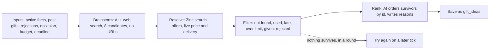

# ALL-27 Gift idea engine: Spec and Plan

**Goal:** given what we know about a person, the app produces 3–5 gifts that can really be bought, arrive on time and fit the budget, plus at most one clearly labeled over-budget gift, both in rounds and when a test or admin buyer asks for them.

**Status:** Spec approved by Jim, 2026-11-05. **Revised 2026-11-10** for what landed on `main` since then (Zinc code from ALL-32, the money-notice wording and email tone from ALL-116, `needs_address` rounds looked at on every tick from ALL-63), and for the adversarial review (T55): one attempt per run, runs counted before they spend, a time budget for the tick, and a hard cost cap per run. Jim settled the open questions the same day: fan-out comes later (ALL-125), rounds are only for paid users while they cost money, and an address can wait up to a day for the next tick. Updated 2026-11-17 for what merged since: ALL-93 became saved gifts that are never shared (decision 54, T72), ALL-120 added a base budget per person (T73), and ALL-127 made the person page a list of rows (T71). The Plan's adversarial review findings are fixed in the Plan below.

**Links:** [ALL-27](https://linear.app/allens-forever/issue/ALL-27). Design §4.2, §6.3, §7. PRD G-1, G-2, G-4, G-5. Spike: `design/spikes/ai.md`. Planning decisions 34, 48, 52, 53, 54. Technical decisions T11, T17, T19, T23, T39, T42, T49, T54, T68, T71, T72, T73.

**Depends on:** ALL-94 (the paid-features flag and the money notice), merged 2026-11-05.

**Hands off to:** ALL-29 (approval screen, and switching rounds on in production), ALL-125 (fan-out), ALL-128 ("Save" on a suggested idea, into the person's saved gifts).

## Spec: what it does

### Who it's for and what they can do

1. **Ideas in a round:** as a test or admin buyer, when a round reaches the point of needing ideas, I get real, checked gifts in the heads-up email instead of samples, so the round is worth acting on.
2. **Suggest ideas on demand:** as a test or admin buyer, I can tap "Suggest ideas for Dad" on his page and see checked gifts with the full cost, store, arrival date and a one-line reason, so I don't have to wait for a round.
3. **Told about the money:** as a test or admin buyer, I can see before I tap that this costs real money, and roughly how much.
4. **Kept out of paid features:** as a buyer without the flag, I'm never charged for and never trigger any AI or Zinc call, and the page tells me plainly that this isn't available yet.
5. **Trusting the list:** as a buyer, I never see something Dad was already given, something I already rejected, a used or refurbished item, or a price the AI guessed.

### How one run works



**One attempt per run** (Jim, 2026-11-10). A run brainstorms once. If nothing survives, a round tries again on a later tick, never inside the same run. Before it spends anything, a run writes a `concierge.idea_runs` row in its own transaction. That row counts the run toward the round's limit, holds the on-demand lease, and gets the cost as it builds, so a run that's killed part-way still leaves a record.

### Acceptance criteria

| # | Given | When | Then |
|---|---|---|---|
| AC-1 | A person with facts, a budget and a deadline | A run finishes | Up to `idea_keep_max` (5) ideas are saved within budget, plus at most one over budget, ranked, each with a one-line reason |
| AC-2 | Any saved idea | Its fields are read | Its price, shipping, delivery days and seller came from a live Zinc offer, never from the AI's estimate. It's new, and available |
| AC-3 | A search whose first result is another brand | Resolve runs | The first result matching the brand wins. If none matches, the candidate is dropped as not found |
| AC-4 | Several offers on one product | Resolve runs | Used and refurbished are never picked, even when cheaper. Order of preference: buy box, then sold by the retailer or brand, then fastest delivery |
| AC-5 | A candidate that, ordered on the latest order date, wouldn't arrive with the safety buffer to spare | Filter runs | It's dropped (`canArriveInTime`: a round passes its deadline as the order date; on demand, see the decisions below) |
| AC-6 | Totals around the budget | Filter runs | `est_total` comes from `estimatedTotalCents`, and `classifyTotal` decides within, over or dropped. With no budget, nothing is labeled over budget |
| AC-7 | A product already given to this person, or an idea already rejected for them | Filter runs | It never appears, matched by retailer product id (G-4) |
| AC-8 | Fewer than `idea_keep_min` (3) survive | The run ends | No second brainstorm in the same run. The survivors are saved and used, and the `ideas.run` event records the shortfall. Only a round left with none tries again, on a later tick (AC-9) |
| AC-9 | A round's run saves no ideas, or fails | Later ticks look at the round | A run counts as soon as its `idea_runs` row is written, before any spend, so a crash or timeout counts too. A round gets at most `idea_round_runs_max` (2) runs, at most one per tick. After the last one it spends nothing more and waits for its deadline (`next_action_at` set to it), and the buyer gets one "Sorry, we couldn't get gift ideas for {name} yet" email (the `no_ideas` step in `round_sends`, so it's sent once). The wording is true whether nothing suitable was found or a service was down. It's in the ALL-116 tone: sorry, what it means, nothing was charged, and "What happens next" with the guided questions link. A fact added, edited or turned back on for that person brings the round back on the next tick for one more run. If that one finds nothing too, a second email says so (`no_ideas_again`). So a round's life has at most 3 runs, about $1.20. At the deadline the round skips, and the skip email goes out, because `no_ideas` counts as having asked the buyer something (ALL-28 ruling 13) |
| AC-10 | Zero survive, on demand | The run ends | The page says plainly that nothing suitable was found, and nothing is saved |
| AC-11 | A retried round step | Ideas were already saved | No second set is saved, and no second AI or Zinc spend happens |
| AC-12 | The AI or Zinc is down, times out, or returns something that fails its schema | A run hits it | Vendor shapes stop at their adapter (E4). A round's failed run counts toward `idea_round_runs_max` (AC-9) and is retried on the next tick, with no email until the runs are used up (Jim, 2026-11-17). If every candidate failed because Zinc refused the key or was down, the run ends `failed`, not "nothing found", and a refused key logs an alert. On demand shows "Couldn't get ideas. Try again." One bad candidate doesn't end the run. A Zinc 429 drops that candidate instead of waiting |
| AC-13 | A person with no active facts | A buyer asks on demand, or a round reaches the point of needing ideas | No money is spent. On demand: the page points to the guided questions. In a round: the same email as AC-9, sent once, and no run is counted. The next tick that finds facts runs the engine. Facts are checked before the address request, so a buyer is never asked for an address for someone we can't suggest gifts for yet |
| AC-14 | A buyer with the flag, on the person's Gift ideas screen (a row in the person page's Gifts group, T71) | The screen loads | "Suggest ideas for {name}" shows, with the money notice next to it and always visible, including the rough cost from settings, in the `design/ui.md` style (no "Alpha:") |
| AC-15 | A buyer without the flag | The page loads, or they call the action directly | No button. The page says it isn't available yet. The action refuses before any AI or Zinc call |
| AC-16 | A buyer without the flag | The tick runs, or their open round reaches the point of needing ideas (they may have lost the flag mid-round) | Rounds are only for paid users while they cost money (Jim, 2026-11-10): `round_candidates` leaves this buyer out, so no round, reminder or address request is created. `generateIdeas` checks again before any AI or Zinc call, so an open round spends nothing, sends nothing new, and skips at the deadline |
| AC-17 | `idea_engine_enabled` = 0 | A round or on-demand run starts | Nothing is spent and no run is counted. On demand says it's off. A round waits and tries again on the next tick |
| AC-18 | A buyer taps Suggest twice, or asks again later | Runs complete | The button is disabled while running, and the server refuses a second run for the same person while one is under way (an unfinished `idea_runs` row younger than `idea_run_lease_ms`), so two tabs can't both spend. A new on-demand set replaces the last on-demand set for that person. Ideas in rounds aren't touched |
| AC-19 | Any run | It ends, however it ends | One event with ids, counts, stage reached and cost in cents (AI plus Zinc). An `ideas.run_started` event goes out first, and the cost so far is saved on the `idea_runs` row as it builds, so a killed run still shows what it spent. No names, facts or gift text (E6, T42) |
| AC-20 | Any idea text from the AI | Before it's saved | The sensitive-trait filter (`lib/ai/sensitive.ts`) runs on title and reason. A hit drops the idea |
| AC-21 | The AI request | It's built | It holds the relationship and facts, never the person's or buyer's name, email or address. In fact text, the person's and buyer's first and last names are replaced with "them" before it's sent, and a search query from the AI that contains either name is dropped before it reaches Zinc. Zinc gets only the search text (T42). A test uses a fact like "Bob loves fishing" for a person named Bob |
| AC-22 | The 5 fixture profiles (W1-3) | `pnpm ai:eval` runs against the real AI and Zinc | Every idea passes AC-2, AC-5 and AC-6. Cost per run is reported. One run's AI cost stays at or below the design §7 figure of about $0.20, and its whole cost under `idea_run_max_cents`. Run by hand, never in CI |
| AC-23 | A round on dev with the engine in place | The test clock runs it | Real ideas reach the heads-up email. The stub in `rounds/ideas.ts` is gone. `round_engine_enabled` stays 0 on production |
| AC-24 | A round with an over-budget idea | The heads-up or a reminder is sent | That idea is clearly labeled as over budget in the email. Today's rows show only title and price |
| AC-25 | More rounds need ideas than fit | The tick runs | The tick has one deadline, `tick_deadline_ms` after it starts. Ideas are made in their own pass, after the money path, the stale-order sweep and rejection notices. A run starts only while fewer than `idea_rounds_per_tick` have run and the time left covers a run's worst case (two AI timeouts plus two Zinc timeouts). AI and Zinc calls get an abort signal tied to that deadline. Rounds that don't get a turn are released with no run counted, and wait for the next tick. The whole tick finishes inside Vercel's 300 s limit |
| AC-26 | A buyer saves an address on a round waiting for one, or links a list whose owner shares an address (ALL-63) | The save finishes | The page doesn't wait for the engine: `updatePerson` no longer generates ideas in the request. The round's ideas are made on the next tick, which already looks at every `needs_address` round. Jim accepted the wait of up to a day (2026-11-10); ALL-125 can make it sooner |
| AC-27 | A person is deleted | A run would start, or their on-demand ideas exist | No run starts: before any spend, the run checks that the person is live and belongs to the buyer, and new rows carry a `(person_id, user_id)` foreign key to `people`. Their page is a 404, so existing ideas can't be seen in the app. The rows stay readable by their owner in the database until hard delete, the same as their facts (ALL-37) |
| AC-28 | The engine on dev | One round's run and one on-demand run are timed (`ideas.run` events) | The times are posted on this ticket and on ALL-125, so the size of the fan-out work rests on measurements, not the spike's |
| AC-29 | A run's spend so far | Before each Zinc call and before ranking | Spend is added up as the run goes: the AI cost from the Gateway's figure, and Zinc at `zinc_lookup_cents` a call. The run stops resolving once spend reaches `idea_run_max_cents`, and it ranks only if spend plus the rank call's worst cost (from `idea_ai_max_tokens`) stays under the cap. Otherwise it ends without ranking, saving nothing, logged as `stopped: cost_cap`. So "at most $1" in the notice is true (Jim, 2026-11-17) |

### Out of scope

| What | Where it goes |
|---|---|
| Approving or rejecting ideas, and starting a new search after a rejection | ALL-29 |
| Switching rounds on in production | ALL-29 (decision 53) |
| "Save" on a suggested idea, into the person's saved gifts | ALL-128 (copies the idea and matches on `retailer_product_id`, which this ticket stores) |
| Showing ideas to anyone but the buyer who asked | Never (decision 54) |
| Offering gifts from a person's own list as picks (`source = list`) | Stays as it is; not changed here |
| Retailers other than Amazon | Later. The resolve rules were only tested on Amazon |
| Real tax by state | Checkout gives the real figure; see the decisions below |
| Rate limits per buyer | Not needed while only test and admin users can run it. Comes back with premium |

### Open questions

- **Settled 2026-11-10 (Jim):** fan-out comes later, as ALL-125, which blocks ALL-29. Rounds are only for paid users while they cost money. An address waiting up to a day for the next tick is fine.
- **Checked 2026-11-10:** `ZINC_API_KEY` is set in Vercel. Functions on our plan (Hobby, Fluid compute on) run for 300 s by default and at most (Vercel's limits page, and the project's `functionDefaultTimeout`).
- **Still to do before AC-22:** an admin tops up the app-owned Zinc account, which had about 33¢ after the spike (T17). About $10 is plenty **[Claude's call]**.
- **[Verify]** in the Plan's first task: Zinc search and offer response fields from a live call (the spike read them defensively, `results` or `products`), and the AI Gateway's cost field on a web-search call, for AC-19.

### Fitting the tick

The daily tick is one function call with a 300 s limit. Since ALL-32 it also sweeps stale orders and places held gifts (up to `zinc_place_budget_ms`, 45 s), and since ALL-63 it looks at every `needs_address` round. One idea run takes about 55 s in the spike (brainstorm 42–46 s with Sonnet), and up to about 150 s for one attempt when the AI and Zinc run to their timeouts.

| Option | What it means | Good | Bad |
|---|---|---|---|
| **A. Cap per tick (recommended now)** | At most `idea_rounds_per_tick` (1) runs per tick, in a pass after the money path, and only while the tick's deadline leaves room for a run's worst case | No new service (E1); enough while only test and admin users have rounds, and rounds are off on production | A busy morning queues rounds a day each. Fine now, not for launch |
| B. Fan out with Vercel Queues now | The tick sends round ids; a consumer runs one round per call, each with its own 300 s | Scales to the Christmas rush | A new queue, consumer and decision (E1, a T#), and the sweep, email retries and rejection summary move to their own jobs. Larger than this ticket |

**Decided (Jim, 2026-11-10): A** in this ticket, with AC-28's timings posted. B is ALL-125, which blocks ALL-29 (switching rounds on in production). Recorded as T68.

## What was decided, and why

| Question | Answer | Why |
|---|---|---|
| Does ALL-27 switch rounds on in production? | **No.** It moves to the end of ALL-29 | Jim, decision 53. Emails would otherwise ask people to choose on a screen that doesn't exist |
| Who can use it? | Only users with the paid-features flag (ALL-94). That includes rounds: no rounds at all for users without it while they cost money | Jim, decision 53, and 2026-11-10 for rounds. Anything that costs money isn't free |
| How clear is the cost? | A plain notice next to the action, always visible, with a rough cost, in the `design/ui.md` money-notice style | Jim, decision 53. "Alpha:" was dropped by the owner (ALL-114, ALL-116) |
| What happens when a round can't produce ideas? | It spends on at most `idea_round_runs_max` (2) runs, and never on a person with no facts. The buyer gets one email with the guided questions link. A new fact allows one more run, so at most 3 runs, about $1.20, in a round's life. Otherwise it skips at the deadline and they're told | Jim, 2026-11-05; limits and cost approved 2026-11-10. Daily retries would waste money and the occasion would pass in silence |
| Are saved gifts here? | No. Saved gifts are ALL-93 (merged), and saving an idea into them is ALL-128. Nothing is ever shared | Decision 54 (owner, 2026-11-16), which revises 52 |
| When are ideas made outside a round? | Only when the buyer asks | Jim, decision 52. Predictable spend, no new scheduled job (E1) |
| Are on-demand ideas re-checked before a round uses them? | Rounds don't reuse them in this ticket: a round always runs the engine fresh. The re-check rule applies when saved gifts feed a round (decision 54) | Jim accepted re-checking through the live price step. Running fresh is that check, and it's the simplest version |
| Where do on-demand ideas live? | `gift_ideas`, with `round_id` now optional and a new optional `person_id`. A check requires one of the two **[Claude's call]** | One table for ideas. ALL-128 copies a kept idea into `saved_gifts` (T72), so nothing depends on these rows surviving the next run. Old rows and old code stay valid, so a rollback is safe (E7). `rejections` and `orders` still require a round, so on-demand ideas can't be rejected or ordered. Details in T54 |
| Which occasion does an on-demand run use? | The next enabled occasion a gift ordered today can still reach. It uses that occasion's budget in T73's order (its own, else the person's base budget, else the relationship default) and checks arrival as if ordered today, and the screen shows the date as "if ordered today". With no such occasion: the base budget or the default, and no arrival check **[Claude's call]** | Far-off occasions shouldn't be limited to a round's 7-day planning window, and nothing is promised for a later order, because on-demand ideas can't be ordered yet |
| A confirm step before spending? | No, the visible notice is enough. Disabled while running **[Claude's call]** | For test and admin users only. Jim asked for clarity, not extra taps |
| What does the notice say about cost? | The usual cost and the most a run can cost, from settings: "Suggesting ideas uses AI and live product lookups, which cost real money: usually about 40¢, at most $1." Wording lives in `packages/core/src/paid-features.ts` **[Claude's call]** | The usual 40¢ is about 20–25¢ of AI (mostly web searches) plus about 16¢ of Zinc lookups. A run with slow searches can cost more, so one number wouldn't be honest (decision 53). Costs per feature are in `planning/strategy.md` > Money model, for pricing (ALL-76) |
| Retries inside a run? | None. One attempt per run; a round with no ideas tries again on a later tick | Jim, 2026-11-10. Keeps a run near 40¢ and the tick's time predictable |
| How do slow runs fit? | **Inside the tick (option A, Jim 2026-11-10; T68).** One deadline for the whole tick; ideas in their own pass after the money path; at most `idea_rounds_per_tick` (1) runs, each started only if the time left covers its worst case. Fan-out is ALL-125, which must ship before ALL-29 switches rounds on in production. Saving an address no longer runs the engine in that request | E1: no new queue while only test and admin users have rounds, and rounds are off on production. One round takes about 55 s in the spike, so a busy morning will need fan-out, but only once real users have rounds |
| Who checks the flag for rounds? | ALL-94 provides `concierge.accounts.paid_features` and one check. ALL-27 adds the filter to `round_candidates` and a second check in `generateIdeas` **[Claude's call]** | The tick runs as the server, so the check can't rely on the signed-in user. Checking at the spend point covers a flag lost mid-round |
| How is tax estimated? | A flat percentage in settings (`idea_tax_estimate_pct`, default 8) **[Claude's call]** | Nothing estimates tax today. A per-state table is more than an estimate needs, and this needs no address, which fits T42. Revises design §4.2's "estimated from the recipient's state" |
| Does a cheap model check that the found item matches? | No extra call. The brand rule filters first, then the rank step sees the real product title and can drop a mismatch **[Claude's call]** | Design §6.3 left this for W3-3. One less model and one less cost |
| Where do Zinc lookups live? | `modules/concierge/zinc/products.ts`, on the shared `ZincHttp` in `zinc/client.ts` with the **app-owned key** (T17). No more than Zinc's 10 requests a second; a 429 drops that candidate rather than waiting, and `ZincHttp` stays as it is. Unit tests pass a fake `fetch`; the browser test adds search and offers routes to `e2e/fake-zinc.ts` (`ZINC_API_BASE`) | The owner's note on this ticket (2026-11-06) and ALL-32's verified Zinc facts (`design/spikes/checkout.md`) |
| How are runs counted and leased? | One `concierge.idea_runs` row per run: user, person, optional round, started, finished, cost so far, outcome. It's written before any spend, in its own transaction. A round's runs are counted from it. An unfinished on-demand row younger than `idea_run_lease_ms` blocks a second run for that person. A trigger on saving a fact moves that person's waiting `generating` rounds back to now, and the run limit decides whether one more run is allowed. Users can read their own rows; only server functions write them **[Claude's call]** | Fixes the review's finding that runs counted only on success could be dodged by crashes and timeouts. One table covers the count, the lease and a trace of killed runs |
| What leaves for the AI? | Relationship and facts, with the person's and buyer's names replaced in fact text. A search query that contains either name is dropped | T42. A buyer can type "Bob loves fishing", which would otherwise send a name |
| Which model? | Sonnet 5.5 for both steps, with up to 3 web searches on brainstorm | T39 and ALL-42: Haiku missed the main need, Opus costs up to twice as much |
| Where does the button live? | A "Gift ideas" row in the person page's Gifts group, showing how many ideas there are, opens `/people/{id}/ideas` with the button, the money notice beside it, and the results **[Claude's call]** | The person page is a list of rows since ALL-127 (T71); a spending action gets its own screen, like saved gifts |
| What happens when Zinc or the AI is down in a round? | The run counts and the round tries again on the next tick, with no email. Only when the runs are used up does the one email go, worded so it's true either way | Jim, 2026-11-17. A short outage shouldn't email the buyer, but the occasion must never pass in silence |
| Does editing or turning a fact back on allow the extra run? | Yes. Any fact added, edited or turned back on after the round's last run allows the one extra run **[Claude's call]** | It's new information from the buyer, which is what the extra run is for |
| Can testing spend money? | **No** (Jim, 2026-11-17). The engine ships switched off (`idea_engine_enabled` = 0) everywhere. Every test uses fake AI and Zinc servers. Vendor shapes come from the spike's recorded responses. The eval and the dev checks that need real calls (AC-22, AC-23 with real ideas, AC-28) wait for Jim's go-ahead and stay under Still open until then | A paid call is easy to make by accident in a test; the switch keeps dev and prod from spending even after merge |
| Is a dev-only "generate ideas now" button still needed? | No | The on-demand button does the job |
| Over-budget slot | Kept from the prompt rules: a stated want above the budget can use it, inside `over_budget_pct` | Prompt v3, design §7 |

## Settings (T23)

All in `concierge.app_settings`, with no fallback in code.

| Setting | Default | What it does |
|---|---|---|
| `idea_engine_enabled` | 0 | 1 lets runs happen. Ships as 0 on every environment (no money while testing, Jim 2026-11-17); tests set it to 1 with fake vendors |
| `idea_candidates` | 8 | Candidates per brainstorm |
| `idea_max_searches` | 3 | Web searches per brainstorm |
| `idea_keep_min` | 3 | Fewer survivors than this is logged as a shortfall |
| `idea_keep_max` | 5 | Most ideas kept within budget |
| `idea_ai_timeout_ms` | 60000 | Per AI call |
| `idea_zinc_timeout_ms` | 15000 | Per Zinc call |
| `idea_tax_estimate_pct` | 8 | Flat tax estimate |
| `idea_run_estimate_cents` | 40 | The usual cost shown in the money notice |
| `idea_run_max_cents` | 100 | The cap on one run's spend (AC-29), shown in the money notice |
| `idea_round_runs_max` | 2 | Runs a round may spend on before it stops and tells the buyer. A new fact allows one more |
| `idea_rounds_per_tick` | 1 | Most rounds that make ideas in one tick. Raise it only with the AC-28 timings in hand |
| `idea_run_lease_ms` | 600000 | How long an unfinished on-demand run blocks another for the same person |
| `tick_deadline_ms` | 270000 | The tick starts no new work after this, leaving 30 s of Vercel's 300 s |
| `zinc_lookup_cents` | 1 | Cost of one Zinc call, for logging and the cost cap |
| `zinc_requests_per_second` | 10 | Zinc's rate limit per key; a run never calls faster |
| `idea_ai_max_tokens` | 6000 | Output token limit per AI call, which bounds the cost of the call in flight (AC-29) |

The order fee (`zinc_order_fee_cents`) already exists in settings, and `over_budget_pct` is per account in `concierge.accounts`. `pnpm ai:eval` only checks capture reading today, so it's extended for AC-22, and the 5 profiles move from `spikes/ai/fixtures/` to `apps/web/lib/ai/fixtures/`. Product lookups are new (`zinc/products.ts`); the HTTP client and error type are ALL-32's.

## Principles check

- **Simplest version?** Cut: retries inside a run, reusing saved ideas in rounds, a queue or worker, per-buyer limits, a confirm step, a tax table, a match-checking model, other retailers, a dev button.
- **Hard-coded values?** The settings above. Model IDs stay in `lib/ai/models.ts` (T11), and prompt wording stays in code.
- **Product boundaries?** Everything is in `modules/concierge` and `lib/ai`. Past gifts and rejections are concierge tables. No list tables touched (T19).
- **New personal data?** No new fields about people. `gift_ideas.person_id` is an id, and `idea_runs` holds only ids, times, cents and an outcome, and idea text may reflect facts, so it stays owner-only under RLS. Deleting a person is a soft delete, so rows stay until hard delete, like facts (AC-27). AI gets relationship and facts; Zinc gets search text (T42).
- **E1:** no new service, queue or scheduled job in this ticket (option A, T68). Fan-out is ALL-125 and gets its own T#.
- **E2:** one `generateIdeas` used by both callers. The `searchWeb` step stays a small replaceable function because T11 requires it.
- **E3:** clients, settings, the AI and Zinc arrive as arguments, so tests pass fakes for the vendors.
- **E4:** the Zinc adapter validates responses and translates them to our shape. AI output is schema-checked.
- **E5 and T67:** Vitest for filter, pick and gate rules; component tests for the button, notice and messages; pgTAP for the schema change, grants and the paid filter on rounds; one Playwright journey (Suggest ideas with the flag) against local Supabase, with Zinc as the fake HTTP server and the AI faked at its adapter. Rounds move money later, so the round path keeps a real-database test.
- **E6:** the event in AC-19, ids and counts only.
- **E7/E9:** `idea_engine_enabled`, Vercel rollback, expand-only migration. On production we'll see `ideas.run` events and the button working for test and admin users. Rounds remain off there.
- **Bends:** G-1 says ideas per round, and this adds them outside a round too (decisions 48, 52). Design §4.2's tax wording and §5.1's long-steps note change as noted. Design §5.1 says stuck rounds never reach `needs_attention` while §7 says a hit AI cap does: this ticket follows §5.1 and uses AC-9's email, and §7 gets corrected.
- **Docs and decisions:** T54, T68, design §3, §4.2, §5.1, §6.3, §7, `design/ui.md` (the Ideas section and notice), `design/operations.md` (settings and turning it off), ALL-28 note that the stub is gone.
- **Adversarial review (T55):** the Plan's review (2026-11-10) found 3 blockers and 10 should-fixes, fixed in the Plan (2026-11-17). Before that, the review of the revised spec (2026-11-10) found 3 blockers (run limits that crashes could dodge, tick timing, no hard cost cap), 7 should-fixes (on-demand lease, ownership check, facts before address, names to the AI, a record of killed runs, no retries inside a run, ownership key) and 4 nits, all fixed above. Its owner questions were answered by Jim. The Plan gets its own review.

## Plan

> **For agentic workers:** REQUIRED SUB-SKILL: Use superpowers:subagent-driven-development (recommended) or superpowers:executing-plans to implement this plan task-by-task. Steps use checkbox (`- [ ]`) syntax for tracking.

**Goal:** build the spec above. A paid buyer gets live, checked gift ideas in a round (on dev) and on demand from a person's Gift ideas screen, inside the tick's time and a hard cost cap per run.

**Architecture:**
- **Pure rules** live in `packages/core/src/ideas.ts`: offer choice, filtering, keeping, name redaction and the cost headroom.
- **Vendor adapters:** Zinc product lookups in `modules/concierge/zinc/products.ts`, and the AI's brainstorm and rank in `lib/ai/ideas.ts`.
- **One run orchestrator,** `modules/concierge/ideas/run.ts`. It is used by the round engine's new idea pass and by an on-demand server action.
- **The database** counts and leases runs (`concierge.idea_runs`) and saves ideas in one transaction, through service-role functions.

**Tech stack:** Next.js 16, Supabase (Postgres, RLS, pgTAP), Vitest, Playwright, the AI Gateway's Anthropic-compatible `/v1/messages` with `web_search` (Sonnet 5.5), and the Zinc REST API.

**Spec:** this file, above. Branch: `JimtheBurger/all-27-idea-engine`, cut from `main` at the start of Task 2.

**Revised 2026-11-17** after the Plan's adversarial review (T55):
- **B1:** a retried round never pays twice.
- **B2:** lookups run in parallel, and an abort ends the run as `deadline`.
- **B3:** the tests that will break are listed.
- **S1–S10 and the nits:** below, where they apply.

The update also covers what merged since: the person page as rows, base budgets and saved gifts.

### Global constraints

- **Settings, not constants (T23):** every number comes from `concierge.app_settings` via `setting_int`, with no fallback in code. The new settings are listed in Task 2.
- **Explicit dependencies (E3):** logic never reads `process.env` or builds clients. Only `app/settings/zinc-deps.ts` and the server action do.
- **Events (E6, T42):** go through `logEvent`, with ids, counts, cents and stage names only. The events are `ideas.run_started`, `ideas.run`, `ideas.candidate_dropped` (reason only) and `ideas.zinc_unauthorized` (`alert: true`). Vendor error messages never include request or response bodies.
- **What leaves the app:** the AI never sees a name, email or address, including in `avoidTitles`. Zinc gets only search text and product ids (AC-21).
- **Copy:** plain words. The money notice uses the `design/ui.md` style, and emails use the ALL-116 tone.
- **Migration:** expand-only (E7). It's named `20261117100000_idea_engine.sql` and is re-dated past `main`'s newest migration just before merge, because `db push` refuses migrations out of order. Don't push it to dev before merge (ALL-32 rule). Test against local Supabase.
- **No money while testing (Jim, 2026-11-17):** no step calls the real AI Gateway or a Zinc key that can charge. The migration ships `idea_engine_enabled` = 0 on every environment. Tests turn it on locally, with fake vendors. Paid checks wait for Jim's go-ahead.
- **Fakes (E5, T67):** the AI and Zinc are faked in unit and browser tests. The database is always real for privacy, ownership and run limits.
- **Before the PR:** `pnpm lint && pnpm typecheck && pnpm test && pnpm test:db && pnpm db:test && pnpm build`.

### Review focus

1. **A Zinc 429 or outage in the middle of resolving.**
   - One 429 drops only that candidate.
   - If every candidate failed because Zinc was unavailable or refused the key, the run ends `failed`, not `none`. Task 6 has the test.
   - Calls start at no more than `zinc_requests_per_second` per run. Zinc's limit is per key, so a round run and an on-demand run at the same moment could briefly reach 20 a second. Any 429 that causes is handled the same way: drop the candidate. Accepted while only test and admin users run ideas.
2. **A run killed by the deadline or a closed tab.**
   - The `idea_runs` row stays unfinished. After `idea_run_lease_ms` the person can run again, and a round counts the killed run.
   - An abort mid-resolve ends as `deadline`, never `none`. Tests in Tasks 2 and 6.
3. **The person is deleted, or a round already has ideas, when a run would start or save.** `start_idea_run` refuses (`not_found` or `done`), and `save_ideas` saves nothing. Task 2.
4. **Names that are parts of other words.** A person called "Al" must not turn "always" into "themways". Redaction matches whole words, ignoring case, and skips names under 2 letters. Task 3.
5. **No budget, or no reachable occasion on demand.** The budget falls back in T73's order: the occasion's own, then the person's base budget, then the relationship default. With no budget at all there's no over-budget label. With no reachable occasion there's no arrival check. Tasks 3 and 6.

### File map

| File | Change |
|---|---|
| `supabase/migrations/20261117100000_idea_engine.sql` | New: `gift_ideas` changes, `idea_runs`, functions, trigger, `round_candidates` paid filter, settings |
| `supabase/tests/idea_engine.test.sql` | New pgTAP; existing round tests gain the paid flag |
| `packages/core/src/ideas.ts` (+ `index.ts`) | New: pure rules |
| `packages/core/src/paid-features.ts` | `ideaRunNotice`, `IDEA_RUN_OFF` |
| `packages/core/src/round-plan.ts` | `RoundView.hasFacts`, `ideaRunsLeft`; `no_ideas`, `no_ideas_again` |
| `apps/web/modules/concierge/zinc/client.ts` | `SendOptions.signal` |
| `apps/web/modules/concierge/zinc/products.ts` | New: search and offers adapter |
| `apps/web/lib/ai/{messages,ideas,models}.ts` | New Gateway `/v1/messages` client, brainstorm, rank; `AI_MODELS.ideas` |
| `apps/web/modules/concierge/ideas/{run,store,read}.ts` | New: orchestrator, Supabase store, on-demand read |
| `apps/web/modules/concierge/rounds/{engine,store}.ts` | Idea pass, tick deadline, skip rule, facts and runs in `roundContext` |
| `apps/web/modules/concierge/rounds/ideas.ts` | Deleted (the stub) |
| `apps/web/modules/concierge/people/people.ts` | No resume in `updatePerson` and `saveAddress` |
| `apps/web/modules/concierge/notify/{templates,samples}.ts` | `no_ideas` email; over-budget label on idea rows |
| `apps/web/app/settings/zinc-deps.ts` | Builds `generateIdeas` and the on-demand deps |
| `apps/web/app/people/actions.ts`, `app/people/[id]/person-view.tsx`, `app/people/[id]/ideas/{page,ideas-screen}.tsx` | Gift ideas row and screen |
| `apps/web/e2e/{fake-zinc,fake-gateway,global-setup,suggest-ideas.spec,round-engine.spec}.ts`, `playwright.config.ts` | Fake vendors, the journey, the round journey's new setup |
| `apps/web/scripts/ai-eval.ts`, `lib/ai/fixtures/people.json` | `--ideas` mode (AC-22) |
| `apps/web/.env.example`, `design/operations.md` | `AI_GATEWAY_BASE` |

---

### Task 1: Vendor shapes from recorded data (no code, no calls)

**Files:** `design/spikes/checkout.md` (Zinc), `design/spikes/ai.md` (Gateway).

No live calls: no money while testing.

- [ ] **Step 1: Zinc offers.** Take the fields from the spike's recorded raw replies in `spikes/ai/out/resolve.json` (`offers_raw`):
  - The top level is `{ status, asin, retailer, offers: [...] }`.
  - Each offer has `price` (cents), `available`, `condition`, `buy_box_winner`, `offer_id` and `seller.{name, first_party}`.
  - It also has `handling_days.{min,max}` and `shipping_options[].{price, delivery_days.{min,max}}`.
- [ ] **Step 2: Zinc search.** No raw reply was saved. The spike read `results ?? products`, and each hit has `product_id`, `title` and `price` in cents, with no brand field.
  - The schema accepts either list key.
  - `matchHit` matches the brand against the title.
  - Mark the list key **[Verify]** for the first paid check.
- [ ] **Step 3: AI cost.** Cost is worked out from `usage` (`input_tokens`, `output_tokens`, `server_tool_use.web_search_requests`), using prices from the Gateway's `GET /v1/models`, as the spike did in `spikes/ai/run.mjs`. That listing is free.
  - The recorded brainstorm text has `<cite index=…>` tags around web-search quotes, so text is cleaned before use (Task 5).
  - Mark the cost math **[Verify]** against the Gateway's own spend report at the first paid check.
- [ ] **Step 4: Write it down and commit.** Put both under "ALL-27 shapes" in the spike docs, then commit (`docs: Zinc product and Gateway shapes for ALL-27, from recorded spike data`).

### Task 2: Schema, run limits and pgTAP

**Files:** create the migration and `supabase/tests/idea_engine.test.sql`; update `round_engine.test.sql` and `money_rounds_claim.test.sql` (their users get `paid_features`); regenerate `packages/core/src/database.types.ts`.

**Produces:**

*`gift_ideas`:*
- `round_id` becomes nullable.
- New `person_id uuid`, with a foreign key `(person_id, user_id)` → `public.people(id, user_id)`.
- A check that `round_id is not null or person_id is not null`.
- An index on `(person_id) where round_id is null`.

*New table `concierge.idea_runs`:*
- `id`, `user_id`
- `person_id` not null, with the same foreign key to people
- `round_id`, which may be null, with a foreign key `(round_id, user_id)` → `gift_rounds`, on delete cascade
- `started_at`, `finished_at`
- `cost_cents int not null default 0`
- `stage text`
- `outcome text`, checked in (`saved`, `none`, `failed`, `cost_cap`, `deadline`)
- Owner-read RLS. `authenticated` gets no insert, update or delete.

*`concierge.start_idea_run(p_user_id uuid, p_person_id uuid, p_round_id uuid, p_now timestamptz) returns table (run_id uuid, refusal text)`:*
- Security definer, service_role only. Takes `pg_advisory_xact_lock(hashtext(p_person_id::text))`.
- Refuses, checked in this order:
  - `not_found`: the person isn't live or isn't the user's.
  - `not_paid`: `has_paid_features` is false.
  - `done`: the round already has ideas (B1).
  - `busy`: an unfinished run for this person started less than `idea_run_lease_ms` ago.
  - `limit`: the round has used `idea_round_runs_max` runs and no active fact has `updated_at` after its last run's `started_at`. Adding, editing or turning on a fact all touch `updated_at`, so all three count. A round never gets more than `idea_round_runs_max + 1` runs.
- Otherwise inserts a row and returns its id.

*`concierge.save_ideas(p_run_id uuid, p_ideas jsonb) returns int`:*
- Security definer, service_role only. One transaction.
- Returns 0 when the person is no longer live or the user's, or when the round already has ideas.
- On demand, it deletes that person's earlier `round_id is null` ideas (AC-18).
- Inserts with `source 'generated'` and `status 'proposed'`, plus the run's user, person and round.

*`concierge.excluded_products(p_person_id uuid) returns setof text`:*
- Service_role only.
- Returns the `retailer_product_id`s of this person's ideas that were ordered (orders not `failed`, `cancelled` or `refunded`) or rejected (`status = 'rejected'`, or a `rejections` row).
- It finds the person through `coalesce(gift_ideas.person_id, gift_rounds.person_id)`, so round ideas saved before this migration count too (S9).

*`concierge.round_idea_state(p_round_id uuid) returns table (has_facts boolean, runs_left boolean)`:*
- The rules `start_idea_run` uses, read-only, for `roundContext`.

*Fact trigger, after insert or update of `value` or `active` on `profile_facts`:*
- Security definer, `set search_path = ''` (S7).
- When the fact ends up active, it sets `next_action_at = now()` on that person's `scheduled`, `needs_address` and `generating` rounds whose `next_action_at` is later.

*`round_candidates`:*
- Re-created from its latest definition in `20261116130000_base_budget.sql`, keeping T73's budget order, with `and concierge.has_paid_features(o.user_id)` added. Grants stay as they are.

*Settings, each with a description:*

| Setting | Value |
|---|---|
| `idea_engine_enabled` | 1 |
| `idea_candidates` | 8 |
| `idea_max_searches` | 3 |
| `idea_ai_max_tokens` | 6000 |
| `idea_keep_min` | 3 |
| `idea_keep_max` | 5 |
| `idea_ai_timeout_ms` | 60000 |
| `idea_zinc_timeout_ms` | 15000 |
| `idea_tax_estimate_pct` | 8 |
| `idea_run_estimate_cents` | 40 |
| `idea_run_max_cents` | 100 |
| `idea_round_runs_max` | 2 |
| `idea_rounds_per_tick` | 1 |
| `idea_run_lease_ms` | 600000 |
| `tick_deadline_ms` | 270000 |
| `zinc_lookup_cents` | 1 |
| `zinc_requests_per_second` | 10 |

- [ ] **Step 1: Write the failing pgTAP tests,** each as one `is`, `ok` or `throws_ok`:
  - **Ownership and access:**
    - `an on-demand idea needs a person`
    - `a user reads only their own runs`
    - `a user can't insert or update runs`
    - `start_idea_run refuses a deleted person` (`not_found`)
    - `start_idea_run refuses another user's person` (`not_found`)
    - `start_idea_run refuses without paid features` (`not_paid`)
    - `anon and authenticated can't execute the new functions`
  - **Run limits:**
    - `start_idea_run refuses a round that has ideas` (`done`)
    - `a second on-demand run inside the lease is busy`
    - `after the lease it starts`
    - `a round gets two runs, then limit`
    - `a fact added after the last run allows a third`
    - `turning a fact back on allows a third`
    - `never a fourth`
    - `a killed run counts`
  - **Saving and exclusions:**
    - `save_ideas saves nothing for a round that has ideas`
    - `save_ideas replaces the previous on-demand set and leaves round ideas alone`
    - `save_ideas saves nothing once the person is deleted`
    - `excluded_products lists ordered and rejected products for that person only`
    - `excluded_products includes an old round idea with no person_id`
  - **Rounds:**
    - `a user's fact save moves their waiting round to now and leaves awaiting_approval alone`
    - `round_candidates leaves out users without paid features`
    - `round_candidates keeps the base budget order`
- [ ] **Step 2: Watch them fail.** Run `pnpm db:test`. Expected: the new file fails because the functions are missing.
- [ ] **Step 3: Write the migration.** Give the users in the existing round pgTAP files the paid flag, so they keep passing.
- [ ] **Step 4: Watch them pass.** Run `supabase db reset && pnpm db:test`, then `pnpm db:types`. Expected: everything passes.
- [ ] **Step 5: Commit** `feat(db): idea runs, on-demand ideas and paid-only rounds (ALL-27)`.

### Task 3: Pure rules in `packages/core`

**Files:**
- Create `packages/core/src/ideas.ts` and `src/__tests__/ideas.test.ts`.
- Modify `paid-features.ts` and `index.ts`.

**Produces:**
```ts
export type ZincHit = { productId: string; title: string; priceCents: number | null };  // brand is matched against the title
export type ZincOffer = { offerId: string | null; priceCents: number; shippingCents: number; available: boolean;
  condition: string; buyBox: boolean; firstParty: boolean; sellerName: string | null;
  handlingDaysMax: number; deliveryDaysMin: number; deliveryDaysMax: number };
export type DropReason = "not_found" | "unavailable" | "late" | "over_limit" | "given_or_rejected" | "sensitive" | "names" | "vendor_error";
export function matchHit(hits: ZincHit[], brand: string | null): ZincHit | null;           // AC-3
export function pickOffer(offers: ZincOffer[]): ZincOffer | null;                            // AC-4
export type JudgeContext = { budgetCents: number | null; overBudgetPct: number; taxPct: number; feeCents: number;
  occasionDate: CalendarDate | null; orderDate: CalendarDate; excluded: ReadonlySet<string> };
export function judgeCandidate(c: { productId: string; offer: ZincOffer }, ctx: JudgeContext, s: ScheduleSettings):
  { keep: true; totalCents: number; fit: "within" | "over"; arriveBy: CalendarDate | null } | { keep: false; reason: DropReason };
export function keepIdeas<T extends { fit: "within" | "over" }>(ranked: T[], keepMax: number): T[];  // AC-1
export function redactNames(text: string, names: string[]): string;                          // AC-21
export function mentionsName(text: string, names: string[]): boolean;
export function appliedBudget(own: number | null, base: number | null, byDefault: number | null): number | null; // T73
export function onDemandOccasion(occasions: { date: CalendarDate; ownBudgetCents: number | null }[], today: CalendarDate, s: ScheduleSettings):
  { date: CalendarDate; ownBudgetCents: number | null } | null;
export function ideaRunWorstMs(aiTimeoutMs: number, zincTimeoutMs: number): number;          // 2*ai + 2*zinc, lookups in parallel
export function canAffordRank(spentCents: number, rankWorstCents: number, maxCents: number): boolean; // S3
// paid-features.ts
export function ideaRunNotice(estimateCents: number, maxCents: number): string;
export const IDEA_RUN_OFF: string;
```

- [ ] **Step 1: Write the failing tests.**
  - **`matchHit`:**
    - picks the first hit whose title contains the brand, ignoring case
    - returns null when no brand matches
    - takes the first hit when there's no brand
  - **`pickOffer`:**
    - never picks used or refurbished, even when cheaper
    - prefers buy box, then first party, then fastest delivery
    - skips unavailable offers
  - **`judgeCandidate`:**
    - drops a late arrival
    - skips the arrival check without an occasion date
    - totals with the flat tax: price 2000, shipping 500, tax 8% of 2000 = 160, fee 100 → 2760
    - marks over budget, and drops past the limit
    - never says over budget with no budget
    - drops excluded products as `given_or_rejected`
  - **`keepIdeas`:** keeps up to `keepMax` within budget, plus the first over budget.
  - **`redactNames`:**
    - replaces whole words only, in any case: "Bob loves fishing" → "them loves fishing", and "always" is untouched for "Al"
    - ignores names under 2 letters
  - **`mentionsName`:** finds a whole-word name.
  - **`appliedBudget`:** own, else base, else default, else null.
  - **`onDemandOccasion`:** picks the next occasion an order today can reach, else null.
  - **`ideaRunWorstMs(60000, 15000)`** is 150000.
  - **`canAffordRank`:** `canAffordRank(90, 15, 100)` is false and `canAffordRank(80, 15, 100)` is true.
  - **`ideaRunNotice(40, 100)`** equals "Suggesting ideas uses AI and live product lookups, which cost real money: usually about 40¢, at most $1."
- [ ] **Step 2: Watch them fail.** `pnpm --filter @gifts-af/core test ideas`. Expected: FAIL.
- [ ] **Step 3: Implement.** Tax is `Math.round(price * taxPct / 100)`.
- [ ] **Step 4: Watch them pass.** Expected: PASS.
- [ ] **Step 5: Commit** `feat(core): rules for choosing and keeping gift ideas (ALL-27)`.

### Task 4: Zinc product lookups

**Files:**
- Modify `zinc/client.ts`: add `signal?: AbortSignal` to `SendOptions`, combined with the timeout as `AbortSignal.any([AbortSignal.timeout(h.timeoutMs), o.signal])`.
- Create `zinc/products.ts` and `__tests__/zinc-products.test.ts`.

**Produces:**
```ts
export function searchProducts(h: ZincHttp, key: string, query: string, signal: AbortSignal): Promise<ZincHit[]>;
export function productOffers(h: ZincHttp, key: string, productId: string, signal: AbortSignal): Promise<ZincOffer[]>;
```
- Both use `call()` with zod schemas shaped from Task 1. The search schema accepts `results` or `products`.
- Paths: `/products/search` with `retailer=amazon` and `query`, and `/products/{id}/offers` with `retailer=amazon`.
- Prices become cents here, and Zinc's shape stops here (E4).

- [ ] **Step 1: Write the failing tests,** using `fake(replies)` from `zinc-adapter.test.ts`:
  - `search maps hits`
  - `offers map price, shipping and the slowest delivery`
  - `a 429 throws unavailable with status 429`
  - `a 401 throws unauthorized`
  - `a schema mismatch throws rejected`
  - `an aborted signal throws unavailable and the signal reports aborted`
  - `sends the app key and only the search text`
- [ ] **Step 2: Watch them fail.** Expected: FAIL.
- [ ] **Step 3: Implement.**
- [ ] **Step 4: Watch them pass,** plus `zinc-adapter`. Expected: PASS.
- [ ] **Step 5: Commit** `feat(zinc): product search and offers for gift ideas (ALL-27)`.

### Task 5: AI brainstorm and rank

**Files:**
- Create `lib/ai/messages.ts`, `lib/ai/ideas.ts` and `lib/ai/__tests__/ideas.test.ts`.
- `models.ts` gains `ideas: "anthropic/claude-sonnet-5.5"`.

**[Claude's call]** Both steps call the Gateway's Anthropic-compatible `/v1/messages` directly, as the spike did. The AI SDK has no Gateway route for Anthropic's server-side `web_search`, and a plain HTTP adapter is faked in the browser test the same way Zinc is.

**Produces:**
```ts
export type GatewayHttp = { base: string; apiKey: string; fetch: typeof fetch };
export class AiError extends Error { kind: "unavailable" | "malformed" }   // message is a fixed phrase, never body text (S5)
export function sendMessages(h: GatewayHttp, body: object, signal: AbortSignal): Promise<{ text: string; costCents: number }>;
export type IdeaCandidate = { id: string; title: string; search: string; brand: string | null; why: string };
export type BrainstormInput = { relationship: string; occasion: string | null; budgetCents: number | null; facts: string[]; avoidTitles: string[] };
export function brainstorm(h: GatewayHttp, input: BrainstormInput, o: { candidates: number; maxSearches: number; maxTokens: number; signal: AbortSignal }): Promise<{ candidates: IdeaCandidate[]; costCents: number }>;
export type RankInput = { relationship: string; facts: string[]; options: { id: string; title: string; totalCents: number; fit: "within" | "over" }[] };
export function rank(h: GatewayHttp, input: RankInput, o: { maxTokens: number; signal: AbortSignal }): Promise<{ order: { id: string; reason: string }[]; costCents: number }>;
export function rankWorstCents(prices: GatewayPrices, maxTokens: number, inputTokens: number): number;
```
- The prompts are the spike's v3 `IDEAS_SYSTEM` and `RANK_SYSTEM`, kept in code.
- The last text block is parsed as JSON and checked with zod.
- Cost comes from Task 1's finding. Without a cost field, it's tokens times the `/v1/models` prices plus searches times the search price. Prices are fetched once per run and passed in as `GatewayPrices`.
- `rank` keeps only the ids it was given.

- [ ] **Step 1: Write the failing tests** with a fake `fetch`:
  - `brainstorm sends web_search with max_uses and exactly the input it was given`
  - `brainstorm parses candidates and cost`
  - `bad JSON throws malformed, with no body text in the message`
  - `a 5xx throws unavailable, with no body text in the message`
  - `rank drops ids it wasn't given`
  - `strips <cite> tags from titles, reasons and why` (the recorded replies have them)
  - `an aborted signal rejects`
  - `rankWorstCents is input plus maxTokens at the output price`
- [ ] **Step 2: Watch them fail.** Expected: FAIL.
- [ ] **Step 3: Implement.**
- [ ] **Step 4: Watch them pass.** Expected: PASS.
- [ ] **Step 5: Commit** `feat(ai): brainstorm and rank gift ideas through the Gateway (ALL-27)`.

### Task 6: One run, from start to saved ideas

**Files:**
- Create `modules/concierge/ideas/run.ts`, `ideas/store.ts` and `ideas/read.ts`.
- Create `__tests__/idea-run.test.ts` (unit, with fakes) and `__tests__/idea-store.test.ts` (local-db; add it to `LOCAL_DB_TESTS` in `vitest.config.ts`).
- Export them through `modules/concierge/index.ts`.

**Produces:**
```ts
export type IdeaRequest = { userId: string; personId: string; roundId: string | null; signal: AbortSignal };
export type IdeaOutcome =
  | { status: "saved"; count: number } | { status: "none" } | { status: "no_facts" } | { status: "off" }
  | { status: "refused"; reason: "not_found" | "not_paid" | "done" | "busy" | "limit" }
  | { status: "failed" } | { status: "cost_cap" } | { status: "deadline" };
export type IdeaDeps = { store: IdeaStore; gateway: GatewayHttp; zinc: { http: ZincHttp; key: string }; today: CalendarDate; clock: () => number };
export function runIdeas(req: IdeaRequest, deps: IdeaDeps): Promise<IdeaOutcome>;
export interface IdeaStore {
  settings(): Promise<IdeaSettings>;              // idea_* settings, schedule settings, the order fee, Gateway prices
  hasPaidFeatures(userId: string): Promise<boolean>;
  inputs(req: IdeaRequest): Promise<IdeaInputs>;    // relationship, names (person and buyer), active facts, excluded ids,
                                                    // occasion date, budget via appliedBudget, over_budget_pct
  start(req: IdeaRequest, now: Date): Promise<{ runId: string } | { refused: "not_found" | "not_paid" | "done" | "busy" | "limit" }>;
  progress(runId: string, stage: "brainstormed" | "resolved" | "ranked", costCents: number): Promise<void>;
  finish(runId: string, outcome: "saved" | "none" | "failed" | "cost_cap" | "deadline", costCents: number): Promise<void>;
  save(runId: string, ideas: SavedIdea[]): Promise<number>;
}
export function createSupabaseIdeaStore(db: AdminDb): IdeaStore;
export function onDemandIdeas(db: Db, personId: string): Promise<ShownIdea[]>;   // the user's client, RLS
```

**Order of work:**
1. If `idea_engine_enabled` is 0 → `off`. If the user doesn't have paid features → `refused not_paid`.
2. Read the inputs. With no active facts → `no_facts`. None of the outcomes in steps 1–2 count a run.
3. Call `start`, then log `ideas.run_started`.
4. **Brainstorm.** Facts and `avoidTitles` go through `redactNames`, and any candidate whose search mentions a name is dropped. Then `progress("brainstormed")`.
5. **Resolve all candidates in parallel (B2).** Each one is a search and then an offers call. Calls start through a limiter that allows no more than `zinc_requests_per_second` a second. Before each call, check the cost cap.
   - A `ZincError` drops that candidate, recording `vendor_error` and the error kind.
   - `judgeCandidate` decides keep or drop.
   - Then `progress("resolved")`.
6. **After resolving,** in this order:
   - If `signal.aborted` → `deadline`.
   - If nothing resolved and every drop was a vendor error → `failed`. Log `ideas.zinc_unauthorized` with `alert: true` if any of those errors was `unauthorized` (S2).
   - If nothing survived → `none`.
7. **Rank,** but only if `canAffordRank(spent, rankWorstCents(...), idea_run_max_cents)`. Otherwise → `cost_cap` (S3).
8. **Check for sensitive text** with `isSensitive` on the title and the reason, after ranking, and drop any hit (S4).
9. Then `keepIdeas`, `save` and `finish`.
10. A thrown `AiError`, or any other vendor error, ends the run as `failed`, or as `deadline` if `signal.aborted`.
11. Always log `ideas.run` with:
    - ids: `run_id`, `user_id`, `person_id`, `round_id`
    - counts: `candidates`, `resolved`, `kept`, and `short` (kept < `idea_keep_min`)
    - `stage`, `outcome`, `cost_cents` and `ms`

- [ ] **Step 1: Write the failing unit tests** (fake store, Gateway and Zinc):
  - **Nothing spent:**
    - `off spends nothing and starts no run`
    - `not paid spends nothing`
    - `no facts spends nothing and starts no run`
    - `done, busy and limit refusals spend nothing`
  - **Results:**
    - `saves up to keepMax within plus one over, from live offers only` (AC-1, AC-2)
    - `the budget falls back to the base budget, then the default` (T73)
    - `a run with nothing left saves nothing and returns none`
  - **Vendor trouble:**
    - `a 429 on one candidate drops only that one`
    - `all candidates unavailable ends failed, not none`
    - `an unauthorized key ends failed and logs the alert`
    - `an abort while resolving ends deadline, not none` (B2)
  - **Cost and speed:**
    - `stops at the cost cap and saves nothing` (AC-29)
    - `doesn't rank when the rank could pass the cap` (S3)
    - `starts no more than zinc_requests_per_second calls a second` (fake clock)
    - `resolves candidates in parallel` (all searches start before any offers call finishes)
  - **Privacy and safety:**
    - `facts and avoid titles reach the AI with names replaced` (AC-21)
    - `a search naming the person never reaches Zinc`
    - `a sensitive title or reason is dropped` (AC-20)
    - `ideas.run carries no fact, title or reason text` (spy on `logEvent`, AC-19)
- [ ] **Step 2: Write the failing local-db tests** for `createSupabaseIdeaStore`:
  - `inputs reads only active facts of a live person` (through `activeFacts`)
  - `inputs uses the base budget when the occasion has none`
  - `start, progress and save round-trip a run`
  - `excluded comes from excluded_products`
  - `onDemandIdeas shows only the signed-in user's ideas`
- [ ] **Step 3: Watch them fail.** Run `pnpm test idea-run && pnpm test:db idea-store`. Expected: FAIL.
- [ ] **Step 4: Implement.**
- [ ] **Step 5: Watch them pass.** Expected: PASS.
- [ ] **Step 6: Commit** `feat(concierge): one gift idea run, capped by cost and time (ALL-27)`.

### Task 7: Rounds use the engine

**Files:**
- `packages/core/src/round-plan.ts` and its tests
- `rounds/engine.ts`, `rounds/store.ts`
- `__tests__/fake-round-store.ts`, `__tests__/round-engine.test.ts`
- `notify/templates.ts`, `notify/samples.ts` and their tests
- `people/people.ts`, `app/settings/zinc-deps.ts`, `apps/web/.env.example`
- Delete `rounds/ideas.ts` and its export.

**Interfaces:**
- **`RoundView`** gains `hasFacts: boolean` and `ideaRunsLeft: boolean`. Both come from `roundContext`, through `round_idea_state`, so every caller, `runHeld` included, gets them the same way.
- **`StepKey`** gains `"no_ideas" | "no_ideas_again"`.
- **`nextAction`,** for `scheduled`, `needs_address` and `generating` before the deadline:
  - If `!hasFacts` or `!ideaRunsLeft`, the first unsent of these:
    - `no_ideas`
    - `no_ideas_again`, but only when runs are spent and `no_ideas` was already sent
  - If both are sent, wait until `shipByDeadline`.
  - The facts check comes before `request_address` (AC-13).
  - A third run that found nothing after a facts-only `no_ideas` gets `no_ideas_again` too, so it's never silent (nit).
- **`GenerateIdeas`** becomes `(round: { id: string; userId: string; personId: string }, signal: AbortSignal) => Promise<IdeaOutcome>`.
- **`RoundContext.ideas`** items gain `overBudget: boolean`. `IdeaRow` gains `overBudget?: boolean`, shown as the detail "Over budget".
- **Template kind `no_ideas`,** with `TemplateData` `{ personName; again: boolean }` and the `answer_questions` link.
  - The subject is "Sorry, we couldn't get gift ideas for {name} yet".
  - The body follows the ALL-116 pattern: sorry, what it means, nothing was charged, and "What happens next".
- **`runTick`** sets `tickDeadline = clock() + tick_deadline_ms`. The claimed-round loop also stops advancing once the deadline has passed, and releases the rest.
- **`runStep`'s generate case** doesn't run the engine:
  - If `ctx.ideas.length > 0`, it sends the heads-up straight away (B1).
  - Otherwise it adds the round to the idea pass and returns `"deferred"`, keeping its lock.
- **The idea pass runs after `tellOwnersOfRejections`.** Deferred rounds are sorted by `shipByDeadline`. For each one, while fewer than `idea_rounds_per_tick` runs have started and `tickDeadline - clock() >= ideaRunWorstMs(...)`, it calls `generateIdeas(round, AbortSignal.timeout(tickDeadline - clock()))`. Outcomes (S1):

| Outcome | What happens | Uses the slot? |
|---|---|---|
| `saved`, count > 0 | The existing heads-up path | Yes |
| `saved`, count 0 (person deleted mid-run) | `finishStep` with status `generating` and `next_action_at` = deadline | Yes |
| `none`, `failed`, `deadline`, `cost_cap` | `finishStep` with status `generating` (tomorrow's tick) | Yes |
| `refused done` | Send the heads-up | No |
| `refused busy` | `release`, so tomorrow's tick tries again | No |
| `refused limit`, `no_facts` | `finishStep`; the plan sends `no_ideas` or waits | No |
| `refused not_paid`, `refused not_found` | `finishStep` with `next_action_at` = deadline, which skips | No |
| `off` | `release` | No |

  Rounds that don't get a turn are released with the existing `store.release` (S6), with no run counted.
- **Outside the tick** (`advanceRound`), a `generate` action finishes with `next_action_at` = now, so the next tick picks it up.
- **The skip email rule** adds `sent.has("no_ideas")`.
- **`updatePerson` and `saveAddress`** stop calling `resumeWaitingRounds`.

**Tests this breaks, and their new setup (B3):**

| Test | Change |
|---|---|
| `round-engine.test.ts` (local-db part) | Its users get `paid_features` and each person one fact; tests that expect `awaiting_approval` after `advanceRound` now tick instead; `generateIdeas` is a `vi.fn` returning `saved` |
| `round-plan` tests | New `hasFacts: true, ideaRunsLeft: true` in the view helper |
| `people` tests that expected a resume on save | Expect no engine call |
| `e2e/round-engine.spec.ts` | Paid flag and a fact via `rest()`; the fake Gateway and fake Zinc search and offers (Task 8) serve the ideas; it ticks after saving the address before expecting the heads-up |
| `pnpm gallery`, `/dev/emails` | Samples come from `notify/samples.ts`, which gains the `no_ideas` emails and an over-budget idea; a gallery heads-up seeded by a round needs the round journey's setup |

- [ ] **Step 1: Write the failing tests.**
  - **round-plan:**
    - `no facts asks for facts before the address`
    - `no_ideas once, then waits for the deadline`
    - `no_ideas_again after the runs are spent`
    - `generate while runs are left`
  - **engine** (`FakeRoundStore`, a `vi.fn` generateIdeas):
    - `ideas run after the money path and rejection notices`
    - `a round that already has ideas sends the heads-up without a run` (B1)
    - `only idea_rounds_per_tick rounds generate; the rest are released uncounted`
    - `a refusal doesn't use the slot`
    - `rounds nearest their deadline go first`
    - `no run starts when the time left is under the worst case`
    - `claimed rounds past the tick deadline are released`
    - `a run that saves none stays generating`
    - `saved with count 0 sends no heads-up`
    - `a skip after no_ideas is emailed`
    - `saving an address doesn't generate`
  - **templates:**
    - `no_ideas says sorry, nothing was charged, and links the questions`
    - `the again version says it tried with the new facts`
    - `an over-budget idea is labeled in the heads-up`
  - **local-db:** `a fact saved after the runs are spent gets one more run on the next tick`.
- [ ] **Step 2: Watch them fail.** `pnpm test round-plan round-engine templates && pnpm test:db round-engine`. Expected: FAIL.
- [ ] **Step 3: Implement, and update the tests in the table above.** Wire `generateIdeas` in `buyingWiring` from `runIdeas` with `createSupabaseIdeaStore(admin)`:
  - The Gateway comes from `AI_GATEWAY_BASE` and `AI_GATEWAY_API_KEY`.
  - Zinc comes from `ZINC_API_BASE` and the lookup key from Task 1, with `idea_zinc_timeout_ms`.
  - Add `AI_GATEWAY_BASE` to `apps/web/.env.example`.
  - If a key is missing, `generateIdeas` returns `{ status: "failed" }` and logs `ideas.not_configured`. No stub remains.
- [ ] **Step 4: Watch them pass,** then run `pnpm test && pnpm test:db && pnpm db:test`. Expected: PASS.
- [ ] **Step 5: Commit** `feat(rounds): real gift ideas in rounds, in their own pass of the tick (ALL-27)`.

### Task 8: The Gift ideas screen

**Files:**
- `app/people/[id]/person-view.tsx` gets a "Gift ideas" row in the Gifts group, after Budget, using `SettingsRow` with the idea count or "None".
- Create `app/people/[id]/ideas/page.tsx` and `ideas-screen.tsx`, plus `__tests__/ideas-screen.test.tsx`.
- `app/people/actions.ts`.
- `e2e/fake-zinc.ts` gets `GET /products/search` and `GET /products/:id/offers` with canned replies.
- Create `e2e/fake-gateway.ts`, which answers `POST /v1/messages` with a canned brainstorm or rank, depending on whether the body has tools. Start it in `global-setup.ts` and pass `AI_GATEWAY_BASE` in `playwright.config.ts`.
- Create `e2e/suggest-ideas.spec.ts`.

**Interfaces:**
- **`suggestIdeasAction(personId: string): Promise<{ ok: true; count: number } | { ok: false; error: string }>`:**
  - Reads the user from the session client and checks the person through `getPerson` (RLS).
  - Calls `runIdeas` with admin deps and `AbortSignal.timeout(ideaRunWorstMs(...))`, then `revalidatePath`.
  - Messages for each outcome:

| Outcome | Message |
|---|---|
| `none` | "We couldn't find anything suitable this time." |
| `no_facts` | "Tell us a bit about them first." plus the questions link |
| `busy` | "Already looking. This takes about a minute." |
| `off` | "Suggestions are switched off right now." |
| `failed`, `deadline`, `cost_cap` | "Couldn't get ideas. Try again." |
| `not_paid` | `IDEA_RUN_OFF` |
| `not_found` | "This person is no longer on your list." |

- **`IdeasScreen` props:** `{ personName: string; offer: { estimateCents: number; maxCents: number } | null; ideas: ShownIdea[]; action: typeof suggestIdeasAction }`.
  - **With `offer`:** a "Suggest ideas for {name}" button, disabled while pending, with the `role="note"` notice beside it.
  - **Without `offer`:** the `IDEA_RUN_OFF` line and no button.
  - **Each idea shows:**
    - the title, store and full cost
    - "Arrives by {date} if ordered today", or no date without an occasion
    - the reason
    - the over-budget label
  - Each idea keeps `retailer_product_id` in its data, so ALL-128 can add "Save".

- [ ] **Step 1: Write the failing component tests:**
  - `shows the button and money notice with the offer`
  - `shows the off line and no button without it`
  - `disables the button while running`
  - `shows each error message`
  - `labels the over-budget idea`
  - `no arrival date without an occasion`
  - In `person-view.test.tsx`: `the Gifts group has a Gift ideas row with the count`.
- [ ] **Step 2: Write the failing journey.** This is behaviour, so it isn't tagged `@layout`.
  - Sign in with `signIn`. Use a person with one fact, with `paid_features` set through `rest()`.
  - Open the Gift ideas row and tap Suggest. Three ideas appear, with the fake Zinc's prices and reasons.
  - Tap again. There are still 3, because the set is replaced, not added to.
- [ ] **Step 3: Watch them fail.** `pnpm test ideas-screen person-view` and `pnpm --filter @gifts-af/web e2e suggest-ideas`. Expected: FAIL.
- [ ] **Step 4: Implement.** Read `offer` the way `captureReadOffer` does. Keep the changes to `person-view.tsx` and `actions.ts` small, because ALL-93 and ALL-127 also edit them.
- [ ] **Step 5: Watch them pass,** plus `e2e/round-engine.spec.ts`. Expected: PASS.
- [ ] **Step 6: Commit** `feat(people): suggest gift ideas from a person's page (ALL-27)`.

### Task 9: `pnpm ai:eval --ideas`

**Files:** `scripts/ai-eval.ts`. Move `spikes/ai/fixtures/people.json` to `apps/web/lib/ai/fixtures/people.json`.

- [ ] **Step 1: Add `--ideas [--ai-cents-max N]`.** For each of the 5 profiles:
  - Run `runIdeas` with an in-memory `IdeaStore` built from the fixture (no database) and the real vendors.
  - Check AC-2, AC-5 and AC-6 on each kept idea with the core rules.
  - Print the cost per run, split into AI and Zinc.
  - Fail on any failed check, or when a run's AI cost passes `--ai-cents-max`. The default is 25, the top of the spec's 20–25¢ (S10). This is a script argument, not app code.
- [ ] **Step 2: Don't run it yet.** No money while testing. Check that it starts and refuses without `AI_GATEWAY_API_KEY`. It runs by hand only after Jim's go-ahead, and never in CI.
- [ ] **Step 3: Commit** `test(ai): idea eval against the five fixture profiles (ALL-27)`.

### Task 10: Docs, pages, evidence and PR

- [ ] **Step 1: Docs.**
  - Design: §3, §4.2 (flat tax), §6.3 (paths and the idea pass) and §7 (stuck rounds follow §5.1).
  - `design/ui.md`: the Gift ideas screen and its notice.
  - `design/operations.md`: the new settings, `AI_GATEWAY_BASE`, which Zinc key each environment uses for lookups, how to turn ideas off, and the fake Gateway.
  - Post a note on ALL-128 with the fields it can copy.
- [ ] **Step 2: Pages.**
  - Republish the round engine page: read it, then add the idea pass, the tick deadline, `no_ideas` and the skip rule.
  - Run `pnpm gallery` and republish the screens and emails page with the Gift ideas screen and the `no_ideas` emails.
- [ ] **Step 3: Verify.** Re-date the migration past `main`'s newest. Then run `pnpm lint && pnpm typecheck && pnpm test && pnpm test:db && pnpm db:test && pnpm build`. All green.
- [ ] **Step 4: PR.**
  - Title `feat: gift idea engine for rounds and on demand (ALL-27)`, with `Part of ALL-27` because the dev checks follow the merge.
  - The body answers E9:
    - **Seeing it work:** `ideas.run` events, and the screen working for test and admin users.
    - **Turning it off:** `idea_engine_enabled = 0`, or a Vercel rollback.
  - The PR says ideas are off everywhere until Jim allows spending.
  - Run the adversarial review (T55), and read PR feedback (T59).
- [ ] **Step 5: After merge, with Jim's approval.** The Action takes the migration to dev and prod, where ideas stay off (`idea_engine_enabled` = 0). On dev, with the engine still off, check that the Gift ideas screen and the off message show. The paid checks below wait for Jim's go-ahead to spend, and stay under **Still open** until then:
  - one round through the test clock, with real ideas in the heads-up (AC-23)
  - timings for one round run and one on-demand run (AC-28), posted on ALL-27 and ALL-125
  - the eval output (AC-22)
  - screenshots
  
  Tick the boxes, and move ALL-27 to Done when nothing is Still open.

### Consistency check

**Spec coverage:**

| Spec item | Task |
|---|---|
| AC-1, AC-2, AC-3, AC-4, AC-5, AC-6, AC-7 | 3 (rules), 6 (run), 2 (`excluded_products`) |
| AC-8 | 6 (`short`, no second brainstorm) |
| AC-9, AC-13 | 2 (limits, trigger), 7 (plan, emails) |
| AC-10, AC-14, AC-15, AC-18 | 8 (screen), 2 (lease, replace) |
| AC-11 | 2 (`done`, `save_ideas`), 7 (heads-up without a run) |
| AC-12 | 4 (errors), 6 (drop, `failed`), 7 (retry with no email) |
| AC-16 | 2 (`round_candidates`, `not_paid`), 7 (deadline) |
| AC-17 | 6 (`off`), 7 (release), 8 (message) |
| AC-19, AC-20, AC-21 | 5, 6 |
| AC-22 | 9 |
| AC-23, AC-28 | 10 (dev checks) |
| AC-24 | 7 (template) |
| AC-25 | 4 (signal), 6 (parallel, `deadline`), 7 (idea pass, tick deadline) |
| AC-26 | 7 (no resume) |
| AC-27 | 2 (FK, `start`, `save_ideas`) |
| AC-29 | 3 (`canAffordRank`), 5 (`rankWorstCents`), 6 |
| Settings table | 2 |
| Docs list in the Principles check | 10 |

**Types used across tasks:**
- `ZincHit`, `ZincOffer`: 3, 4, 6
- `GatewayHttp`, `AiError`: 5, 6, 7
- `IdeaOutcome`: 6, 7, 8
- `IdeaStore`: 6, 9
- `GenerateIdeas`: 7
- `appliedBudget`: 3, 6

**Review findings and where each is fixed:**

| Finding | Fixed in |
|---|---|
| B1 | 2 (`done`), 7 (heads-up without a run) |
| B2 | 4, 6 |
| B3 | 7 (table), 2 (pgTAP users), 8 (round journey) |
| S1 | 7 (outcomes table) |
| S2 | 6 |
| S3 | 3, 5, 6 |
| S4 | 6 |
| S5 | 5, 6 |
| S6 | 7 (`release`) |
| S7 | 2 (definer trigger, `updated_at` rule) |
| S8 | 1 |
| S9 | 2 |
| S10 | 9 |

**Nits:**
- Cost is written per stage (Task 6).
- The view comes from `roundContext` (Task 7).
- The third empty run gets an email (Task 7).
- Per-key rate limit: Review focus 1.
- The tick deadline covers claimed rounds (Task 7).
- The `.env.example` path is given (Task 7).
