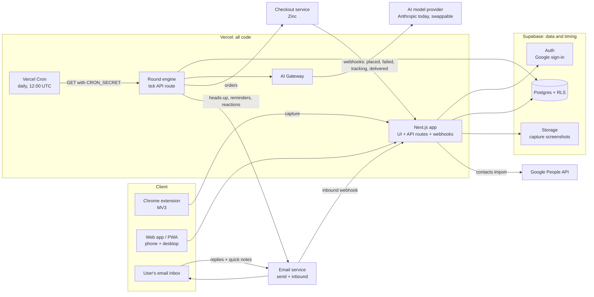
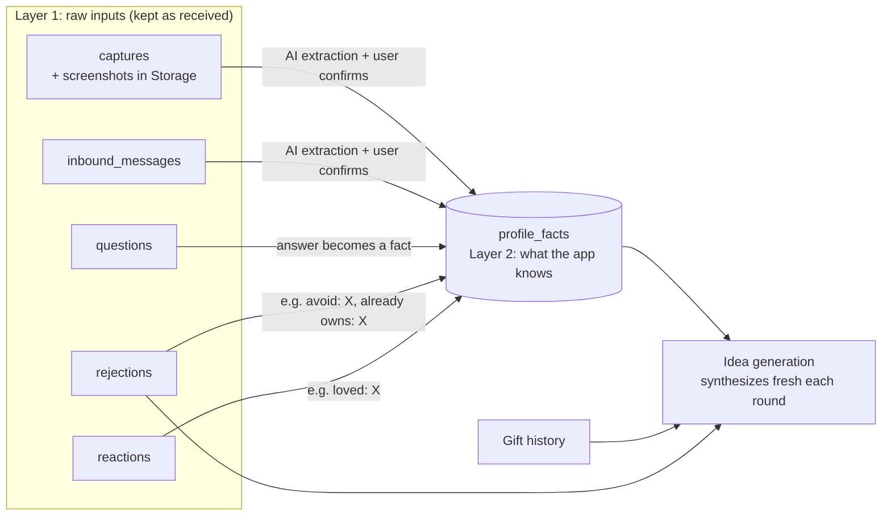
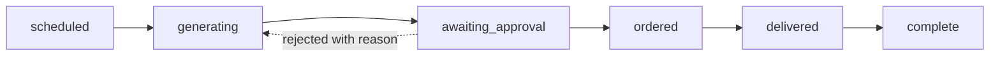

# Gift Concierge: Technical Design (MVP)

| | |
|---|---|
| **Status** | **Approved** v1.0 (2026-10-17). Revised v1.1 (2026-10-18) after the owner's review: Supabase `pg_cron` runs gift rounds once a day (T8, T9), a lean repo layout (T10), a replaceable AI backend billed through Vercel (T11), push deferred (T12), email capture kept (T13), round statuses cut from 11 to 9 (T14), and a new §3.1 on how the app learns about a person. Revised v1.2 (2026-10-25) with the checkout spike's findings (W1-2, `spikes/checkout.md`): funding in stages (T16), one app-owned Zinc account for product lookups (T17), and approval means buy now (T18). Also 2026-10-25: the platform is one app, account and repo, built to split later (§2.2, T19). Revised 2026-10-28 for schema v1.1 (ALL-44, T31): optional budgets, your own address, where an order ships, and picks from a person's own list. Revised 2026-11-01 with the email spike's findings (W1-4, `spikes/email.md`): Resend on `giftsaf.com`, per-user capture addresses (T33). Tunable values (buffers, timings, retries) are sensible defaults to adjust once real usage shows what's needed. |
| **Date** | 2026-10-28 |
| **Implements** | `../planning/PRD.md` (approved v1.0). Requirement IDs (B-3, A-9, etc.) refer to it. |
| **Decisions** | `decisions.md` (T#), `../planning/decisions.md` (D#) |
| **Next stage** | Split into Linear tickets, labeled by wave (§13) |

Items marked **[Claude's call]** are proposals the owner hasn't confirmed yet. **[Verify]** marks a fact to confirm during the named ticket before building on it.

---

## 1. Principles

1. **Keep it simple.** Build only what the PRD marks **M**. Pick the boring option unless it costs real effort later (D21).
2. **The database is the source of truth.** Every gift round's status and its next due time live in Postgres. Background work reads and writes that status, so any step can be retried.
3. **Supabase is the data and timing layer, Vercel runs all the code.** Supabase holds the database, sign-in, files, and the schedule. Every line of app code, including what the schedule triggers, runs in the one Next.js app on Vercel (T8).
4. **Budget is enforced at three layers:** when ideas are generated, at approval, and at checkout through the order's `max_price`. A bug in one layer can't cause overspending (B-3, B-5).
5. **Nothing is bought without a recorded approval** (A-1).
6. **Spend under $100 a month** (T4). Stay on free tiers until something forces an upgrade.
7. **One language and one repo.** TypeScript in a single monorepo, so two people working with Claude can work anywhere in it.
8. **The AI model is replaceable.** The app depends on "an AI model", not a specific vendor. Each AI task names its model in one config file, and calls go through the AI SDK and AI Gateway, so moving a task to a cheaper model or another provider (for example OpenAI) is a config change. Claude is today's default, not a dependency (T11, §7).

## 2. Architecture



### 2.1 Components

| Component | Choice | Notes |
|---|---|---|
| Web app and API | **Next.js (App Router) on Vercel**, Node.js runtime | One app for UI, API routes, webhooks, and the phone page. A PWA manifest (`app/manifest.ts`) and generated icons make it installable to the home screen; no service worker until push (T12). Browser tests: Playwright (`apps/web/e2e/`), in CI (T30). |
| Database | **Supabase Postgres** with Row Level Security | Every user-owned table has `user_id` plus RLS policies. Background jobs use the service role. |
| Auth | **Supabase Auth, Google provider** (plus email and password for existing list users) | Cookie sessions through `@supabase/ssr`; `proxy.ts` sends signed-out visitors to sign-in and back via `?next=`, except on `/lists`, `/share/*`, `/auth/*` and the install files (T30). Google Contacts read access is requested separately, at import time (§6.1). The extension authenticates with the user's Supabase session (§6.2). |
| File storage | **Supabase Storage** (private bucket) | Capture screenshots, in bucket `captures` at `{user_id}/{capture_id}.jpg`. Only the owner can read or write their folder. Deleting a person should delete their files too. That isn't built yet: the rows cascade but the files stay. It's noted on ALL-21, for the person-deletion work (ALL-21 or ALL-37). |
| Background jobs | **Vercel Cron** calls the app's **round engine** (a protected API route, `GET /api/rounds/tick`) **once a day at 12:00 UTC** (8 a.m. Eastern in summer) | One scheduler, shared with the daily health job at 14:00 UTC (T22, T87); Vercel runs crons only on production. All the work runs in the Next.js app, so there's one runtime and one deploy, with no Supabase Edge Functions (T8) and no `pg_cron`/`pg_net` (T49, pending the owner's OK). Vercel Workflow isn't used. See §5.1. |
| AI | Any model through **Vercel AI Gateway** with the **AI SDK**. Default today: **Claude Sonnet 5.5** for every task (`anthropic/claude-sonnet-5.5`, T39; Opus 5.5 is the fallback; take IDs from the gateway's `/v1/models`) | The gateway gives one key, one bill and one spending cap across providers, plus fallbacks. Usage is **billed through the Vercel account**, so there's no separate AI provider account (T11). The model for each task is set in one config file (§7). Web search through the gateway is **confirmed in W1-3** (Anthropic's native tool; the gateway's Perplexity search is a provider-neutral alternative). Hobby plan works; Claude models need **paid** gateway credit (the free credit excludes them). |
| Checkout | **Zinc** (API v2), confirmed by the W1-2 spike | `max_price` caps the whole order (item, shipping and tax), gift orders, signed webhooks, per-package tracking. **MVP:** each user's own Zinc wallet. **Later:** the user's card through Zinc Connect (T16, §6.5a). Product lookups go through one app-owned Zinc account (T17). |
| Email | **Resend** on `giftsaf.com`, confirmed by the W1-4 spike (T33) | Sends from `hello@giftsaf.com` and receives on `in.giftsaf.com` (its own subdomain). The free plan covers 3,000 emails a month and 100 a day, sent and received combined. Inbound arrives as a signed webhook (Svix) carrying metadata only; the app fetches the body and attachments from the API. Open and click tracking stay off. See `spikes/email.md`. |
| Push notifications | **Decision deferred (T12).** If added: standard Web Push (VAPID) using the `web-push` package | Works on Android, and on iOS once the PWA is added to the home screen. Email covers every message without it. The notification service sends through a channel list, so push plugs in later without changing callers. Estimated 1–2 days of work, in its own ticket (W5-4). |
| Extension | Chrome Manifest V3, TypeScript, built with Vite | Popup plus a "Capture for…" action, in `apps/extension` (React and Tailwind with the T28 tokens). Permissions are only `activeTab`, `scripting` and `storage`. There's a dev build (localhost and `gift-me-dev`) and a prod build (giftsaf.com and `gift-me`). See `apps/extension/README.md`. **How people get it (owner, 2026-11-01):** for now, technical testers load it unpacked from the zip. The beta goes out as an **unlisted Chrome Web Store listing**, installed in one click from an "Add to Chrome" link on the site and updated automatically (ALL-65). That needs a privacy policy page, icons, and the web app accepting both the store's extension ID and the dev build's. |
| Contacts | Google People API, `contacts.readonly` scope | An unverified Google app allows up to 100 test users, which is plenty for the MVP. |

### 2.2 One app for the whole platform (T19)

Gift Concierge is one of three products: scan-to-gift, gift lists and the concierge (`../planning/strategy.md`). To users they are **always one app**, a ladder from quick one-off use to the deep concierge. So the platform is built as **one app, one account and one repo now, laid out so a product can be split out later.**

| Hard to undo, so decided now | Rule |
|---|---|
| Printed QR codes (shirts, sashes, plushies) | Every printed code points to **our own short link** (e.g. `<domain>/s/<code>`) that redirects. It never points straight at a page. Nothing is printed until the platform name and domain are settled (ALL-14). |
| Accounts | **One sign-in and one user record** shared by every product, from day one. |
| People across products | One shared `people` record per loved one, which can later link to that person's own user account (for example, Mom's gift list). Products don't keep their own copies. |

| Kept reversible, with guardrails | Rule |
|---|---|
| Data | One Postgres schema per product (`concierge`, `lists`, `scan`) plus a small shared schema (`public`) for accounts and people. Products never read or write another product's schema. They call that product's functions instead. Splitting a product out means moving its schema. |
| Code | One folder per product under `apps/web/modules/`, each exposing a small public `index.ts`. A lint rule (ESLint boundaries) blocks importing another product's internals. |
| Web addresses | Each product under its own path (`/concierge`, `/lists`, `/scan`, short links at `/s`). If a product later needs its own deploy, Vercel can serve separately deployed apps under the same domain without users noticing. |
| Navigation | Each product works on its own. One bar on every signed-in page: logo, Get (`/lists`), Give (`/`), account menu (T58). After sign-in you land on Give: a "You" card, then your people (the concierge). Give needs an account; `/settings` is a list of rows (You, Reminders, Gift ideas, Paying for gifts) that open detail pages, saving as you go (T71). Links between products are low-key and only where they help (T29, `ui.md` > How the products connect). |
| Money and sensitive data | Zinc keys, funding, the addresses you enter for people, and social media content stay inside the concierge (D31). **Exception (D41):** your *own* address is account data in `public.account_addresses`, like your email. Only you read it; if you share it for gifts, a linked buyer sees city and state, and only server code reads the rest. |

**The MVP builds only the concierge.** The shared account and people records, the `concierge` module and schema, and the boundary rule are set up now; `lists` and `scan` are added when their work starts. **GiftsAF is the starting point (T20).** Jim's list app ([gifts-af/GiftsAF](https://github.com/gifts-af/GiftsAF)) uses the same stack (Next.js App Router, Supabase email-and-password sign-in, Vercel, shadcn/ui, Vitest). It's imported with its history as `apps/web` (ALL-15). Its list code becomes `modules/lists`, its tables (`lists`, `list_items`, `gift_claims`) and their functions move into the `lists` schema (done in ALL-19; display names now come from `public.profiles`), and its Vercel and Supabase projects become the platform's production ones. The concierge is built alongside it as `modules/concierge`.

### 2.3 Repository layout

**One repo for the whole platform** (T19). The repo is **`gifts-af/gift-me`** (renamed from `gift-concierge` on 2026-10-25, T21), with code added alongside `planning/` and `design/`. If ALL-14 picks a different platform name, it's renamed again; GitHub redirects old links. It has one shared package, kept as small as the two apps allow (T10):

```
gift-me/
├── apps/
│   ├── web/            Next.js app for the whole platform: UI, API routes, webhooks, round engine
│   │   ├── modules/
│   │   │   ├── concierge/   The MVP: rounds, ideas, orders, Zinc (public API in index.ts)
│   │   │   ├── lists/       From GiftsAF (T20): lists, items, sharing, claiming
│   │   │   └── scan/        Added when scan-to-gift starts
│   │   └── lib/ai/     Prompts, schemas, AI calls, eval fixtures
│   └── extension/      Chrome extension
├── packages/
│   └── core/           Pure domain logic (budget math, schedule/deadline math, round statuses) plus types
│                       shared by both apps, including generated database types (no I/O, heavily tested)
├── supabase/           Supabase CLI folder: SQL migrations, local config
├── spikes/             Throwaway wave-1 experiments (not production code)
├── planning/  design/
└── pnpm-workspace.yaml
```

- **Why a workspace at all:** the web app and the extension build separately but share `core`.
- **No Turborepo:** `pnpm -r build` and `pnpm -r test` are enough at this size. Add it later if builds get slow.
- **AI code lives in the web app** because nothing else calls the AI model. It moves into its own package only if a second app needs it.

Tooling: pnpm workspaces, Vitest for tests, ESLint and Prettier, and GitHub Actions running lint, typecheck, and tests on every pull request. Vercel preview deployments are created per pull request.
- **Browser tests (Playwright)** are added with the first real screens (W2-1, ALL-20): a smoke test that signs in, checks the app shell at phone width and signs out, run in CI. Later screen tickets add their own flows, and the end-to-end dry run (W6-1, ALL-36) uses it. Until then, the only UI tests are Vitest with jsdom, a simulated page that needs no real browser.

## 3. Data model

All tables have `id uuid`, `created_at`, and `updated_at`. Accounts (`profiles`) and `people` are shared by every product and live in `public`. The rest belong to the concierge and live in the `concierge` schema (§2.2, T19). User-owned tables have `user_id` with RLS: `user_id = auth.uid()`.

A diagram of every table and how they connect, with each column listed, is the [database map](https://claude.ai/artifact/9uCRGGJL5Tu4X53VCYV3Rk) (read from the local database on 2026-11-22). The migrations stay the source; redraw the map when tables or foreign keys change.

| Table | Key fields | Notes |
|---|---|---|
| `profiles` | user_id, display_name, email, phone, timezone, notification prefs, over_budget_pct (default 15), **funding_mode** (`zinc_wallet`; `connect` later), zinc_api_key (in Vault), zinc_webhook_secret (in Vault), zinc_connected_at, auto_topup_on (bool, last known) | One row per user. Push subscriptions are added with W5-4 if push goes ahead. Funding fields: §6.5a (T16). |
| `people` | user_id, name, relationship, birth_year (nullable; the birthday itself is an `occasions` row, ALL-21), photo_path (nullable, decision 46), address (structured, nullable: recipient first and last name, line 1, line 2, city, state, ZIP, country), phone (nullable and not collected, T42 and T51; the user's own phone, asked at checkout setup, is used when empty), address_checked_at (when the address last passed the format check, T51), notes, google_contact_id | P-1, P-5. Zinc requires a phone on every order, and the carrier is the only one who uses it. The address is checked when it's entered, not at purchase time (§6.1). |
| `budget_defaults` | user_id, relationship, base_amount_cents | B-2 (S) |
| `occasions` | user_id, person_id (nullable for shared holidays), kind (birthday, anniversary, christmas, mothers_day, …), date rule (fixed date or holiday rule), enabled | P-3. Holidays are computed from rules in `core`. |
| `budgets` | user_id, person_id, occasion_kind, amount_cents | B-1. A person's own budget for one occasion, or for any occasion (`occasion_kind = 'any'`, the base budget, ALL-120). A round uses the occasion's own amount, else the base, else the relationship default, else none (T73). The budget is the buyer's own and optional (D36). A null amount (no longer written) means the same as no row; it becomes not null once no live code writes it. Saved through `concierge.save_budgets` (all or nothing). |
| `account_addresses` (in `public`) | user_id, recipient name, line 1, line 2, city, state, ZIP, country, phone, address_checked_at, share_for_gifts | Your own address, for every product (D41): "My address" when you buy, and where gifts to you ship when you keep a list and turn sharing on. Owner-only. |
| `captures` | user_id, person_id, source_url, page_title, text_excerpt, screenshot_path, status (pending, extracted, failed) | C-1, C-2 |
| `profile_facts` | user_id, person_id, category (interest, dislike, size, brand, owns, wants, style, avoid, constraint, loved), value, source (capture, question, note, reaction, rejection), source_id, confirmed (bool), active | C-3, C-7. A person's profile is the set of their active facts. |
| `questions` | user_id, person_id, question_key, prompt, status | C-4. A row exists only once a question is answered or skipped; open questions are computed from facts (T53). `answer` is left empty: answers live only as `profile_facts` (D51). |
| `saved_gifts` | user_id, person_id, name, price_cents (null when unknown), product_url, image_url | Gifts a buyer spotted for one of their people, kept on that person's page (ALL-93). Only that buyer can read them, never shared (product decision 54). No updates; the database enforces the limits, live people and the `saved_gifts_max` cap (T72). Prices are unverified, so a round must re-check one before using it. |
| `gift_rounds` | user_id, person_id, occasion_id, occasion_date, ship_by_deadline, budget_cents (null = no budget, D36), status (§5), next_action_at, locked_until, attempts, approved_at, delivered_at (set by a trigger when the status becomes `delivered`; users can't read or write it, T91) | One per person per occasion per year. `next_action_at` is when the round engine should look at it next (§5.1). |
| `gift_ideas` | round_id, title, retailer, product_url (the exact size or color variant), retailer_product_id, offer_id, seller_name, first_party (bool), price_cents, est_shipping_cents, est_tax_cents, est_total_cents, handling_days_max, delivery_days_min, delivery_days_max, arrive_by (worst case), reason, over_budget (bool), rank, status (proposed, selected, rejected), source (generated, list), list_item_id | G-1, G-2. `source = list` for a pick from the person's own list (D37). Delivery is a range before purchase; `arrive_by` uses the slowest case. **Ideas can belong to a person with no round (ALL-27, T54):** `round_id` is optional and `person_id` is new, with a check that one of them is set. On-demand ideas have no round, and a new on-demand set replaces the last. | 
| `idea_runs` | user_id, person_id, round_id (null on demand), started_at, finished_at, cost_cents, stage, outcome (`saved`, `none`, `failed`, `cost_cap`, `deadline`) | ALL-27, T68. One row per try at finding ideas, written before any spend, so it counts the run, holds the on-demand lease (`idea_run_lease_ms`) and records its cost as it builds. Only ids, times, cents and an outcome; owner-readable, written only by the server. |
| `rejections` | round_id, reason_code, reason_text | G-3. Also written to `profile_facts`. |
| `orders` | round_id, idea_id, provider (zinc), provider_order_id, idempotency_key, funding_mode, max_price_cents, is_gift, gift_message (≤240 characters), price breakdown (subtotal, shipping, tax, total cents), fee_cents, status (placing, placed, failed, shipped, delivered, cancelled, refunded), failure_type, merchant_order_id, packages (jsonb: carrier, tracking number, status, estimated delivery date, proof-of-delivery photo), est_delivery_date (latest across packages), ship_to (recipient, buyer, other), ship_city, ship_state | A-3 as revised by D38, D-1. The full address it shipped to is snapshotted in `order_addresses`, which only the server reads. Zinc's own status stops at "placed"; shipping progress is per package, and one order can ship as several packages. |
| `reactions` | round_id, order_id (unique: one answer per gift), rating (loved, liked, meh, returned), note, source (email, web), fact_category and fact_value (the fact it wrote, so a changed rating can tell if the buyer touched it) | D-2, T91 |
| `notifications` | user_id, round_id, kind, channel, sent_at, provider_message_id, error | Audit trail plus reminder escalation state. Records delivery; the link token lives in `action_links` (ALL-23). |
| `action_links` | user_id, round_id (nullable), notification_id, action, token_hash (unique), expires_at, used_at | One row per emailed button (ALL-23). Only the SHA-256 hash of the token is stored. Server-only: no policies and no grants for signed-in users. Generic on purpose, so scan-to-gift and ALL-49 can reuse it (T38). |
| `inbound_messages` | user_id, subject, body, image_path, image_type, matched_person_id, status (`asking` or `filed`), capture_id | N-2, C-5. Only notes waiting on "Who is this about?" (ALL-31); subject and body are cleared once filed or when the buttons expire |
| `app_settings` | key, value (jsonb), updated_at | App-wide settings that change without a deploy (T23): `zinc_order_fee_cents` and the §4.1 schedule timings (`planning_delivery_days`, `safety_buffer_days`, `round_lead_days`, `reminder_1_after_heads_up_days`, `reminder_2_before_deadline_days`, `final_notice_before_deadline_days`, `fastest_days_to_arrive`). Not user-owned: only the server can read it, and the owner edits it. |

Gift history (D-3) is read from `gift_rounds`, `gift_ideas`, `orders`, and `reactions` by `/people/{id}/gifts`, newest round first. A skipped round shows only once its occasion date has passed.

**Deletion (C-7, T27):** deleting a person or occasion is a **soft delete**: the row is marked `deleted_at` and hidden from the user, their open rounds are skipped, and gift and order history are kept. Removing data for real (for example a GDPR request) is an admin action, `admin.hard_delete_person` or `admin.hard_delete_account`, which cascades to every row, is logged in `admin.deletion_log`, and is followed by a storage cleanup of their screenshots.

**As built in schema v1** (ALL-19, T26; migrations in `supabase/migrations/`):
- The money fields shown on `profiles` above (over-budget %, notification prefs, funding mode, Zinc connection) live in **`concierge.accounts`**, one row per user. `public.profiles` keeps display name, email, phone and timezone, and is created at sign-up.
- **Paid features (ALL-94, decision 53, T54):** `concierge.accounts.paid_features` marks test and admin users. Only an admin can set it. Everything that spends money asks one SQL function, `concierge.has_paid_features(user_id)`, so premium can replace the rule there. No account row means off, and a failed check spends nothing. Capture reading checks inside `processCapture`, which covers the extension, retry and "Read it now". Without the flag, a capture stays saved and `pending`, which older extensions already understand.
- Every table in `concierge` has `user_id` and the same privacy rule, including rows that belong to a round. Children reference their parent and owner together, so nothing can point at another user's data.
- `app_settings` is the one table with no `user_id`: only the server reads it (T23).
- **Users write their setup, the server writes the rest** (T26): people, occasions, budgets, facts, answers and captures are user-writable; rounds, ideas, orders, reactions, notifications, inbound mail and the Zinc connection are written only by server code, so `packages/core`'s budget and status checks can't be bypassed. One live order per idea.
- `packages/core/src/database.types.ts` is generated from the database (`pnpm db:types`). CI fails if it's out of date.

**As built in schema v1.1** (ALL-44, T31):
- **Optional budgets:** `gift_rounds.budget_cents` can be `null` (no budget). A person or occasion with no budget simply has no `budgets` row (T73 revises the null-row meaning). `budget_defaults` has no row when there's no default.
- **Your own address:** `public.account_addresses`, above. Written from Settings and the list page's sharing switch through `apps/web/lib/account-address.ts` (ALL-63). A round counts a shared address as ready, and a shared row alone decides (T61). `public.shared_city_for_person(person_id)` gives the buyer city and state of a linked person who shares their address; `public.shared_address_for_person(person_id)` gives the full address to the server only.
- **Picks from a person's own list:** a buyer with the list's share link calls `lists.link_person(share_token, person_id)`. That records the list in `lists.person_links` and sets `people.linked_user_id`, with no consent step (D42). `lists.unlink_person(person_id)` reverses it, and so do deleting the list or the person. **A link lasts only while the list is shared (D43):** each link remembers the share token it was made with, and every read (`person_list` and both shared-address functions) goes through `lists.active_link`, which requires that token to still be the list's. Resetting the share link therefore cuts off everyone who linked through the old one, and a trigger also deletes those links so `linked_user_id` is cleared. A future "stop sharing" switch must be checked in `lists.active_link` too. `lists.person_list(person_id)` returns that list's gifts in order, each with `claimed` and `claimed_by_me` (never who claimed it). A signed-in buyer can ask only about their own people; the server (recognised by its `service_role` key) can ask about any, so server code such as the round engine must call it through the service-role client, not a direct database connection. The concierge reads lists only through this function (T19). The list's owner never sees claims on their own list (D39, ALL-20). **From the link itself (ALL-123, T78):** a signed-in buyer opening `/share/{token}` sees whose list it is (`get_shared_list` returns `owner_name` from `profiles.display_name` only, and `linked_person`) and a card to add the owner to their people or link one they already have. Both go through `lists.link_unlinked_person`, which only links a person with no link and refuses a second of the buyer's people on the same list, so it never moves where a held gift ships (T26, T61); it locks the person row, then the list row. "Add" opens `/people/new?list={token}`, and `concierge.add_person`'s optional `p_share_token` creates and links the person in one transaction. A linked person's "Their list" (`/people/[id]/list`) redirects to the share page, found with `lists.person_share_token`, so buyers and the link see one screen; unlinked, the person page shows a prompt to paste the link (through `link_unlinked_person` too). Link previews use `lists.share_preview` (owner name and gift count, no claims). Share pages are `noindex`. Switched off with `list_link_card_enabled` = 0.
- **Adding a gift from a store link (ALL-10, T52):** pasting an Amazon link works in the browser alone (photo from the product ID, name from the link). A link from any other store is read on the server for a signed-in person: the server action fetches the page with guards against reaching anything but the public internet, and reads the name, price and photo from the page's standard product tags. A store that blocks it (Walmart's bot check did from a home connection) falls back to the name in the link, and the person types the price. Saved with `list_items.source` = `store-page` (read from the page) or `store-url` (link only). Switched off with `store_page_read_enabled` = 0.
- **Where an order ships:** `orders.ship_to`, `ship_city` and `ship_state` for the buyer; the full snapshot in `concierge.order_addresses`, server-only, so a shared address never reaches the buyer through their order. A one-off "other" address is saved to the person by writing the person's own address fields.
- **Cost tracking (T90):** `concierge.cost_events` (kind, cents with fractions, `estimated`, `excluded`, and single-column `idea_run_id` and `order_id` links that clear when their row is deleted; no buyer, person or round) and `concierge.monthly_bills` (month, vendor, cents; one row per month and vendor). `accounts.costs_excluded` marks the QA account. Server only: no policies, and only the service role has rights. `record_cost` writes a row (marking it excluded from the account's flag) and `cost_per_gift` works out the weekly numbers. Costs are recorded where the money is spent, through `costRecorder` (`modules/concierge/costs/record.ts`), which never throws and gives up after `cost_record_timeout_ms`: an idea run records its AI and lookup cost when it ends (`ideas/run.ts`), a capture read its AI cost (`capture/extract.ts`), and a price check on an order its lookup cost (`purchase/replace.ts`).

### 3.1 How the app learns about a person

Learning is stored in two layers: **raw inputs**, kept as received, and **learned facts** distilled from them.



**Layer 1: raw inputs**

| Input | Where it lives |
|---|---|
| Social media and web captures (extension) | `captures` (URL, title, visible text) plus the screenshot in Supabase Storage |
| Emailed or forwarded notes | `inbound_messages` |
| Answers to guided questions | `profile_facts` directly, with `source = question`; `questions` records which were asked (T53) |
| Rejected ideas and the reason | `rejections` |
| How the recipient liked a gift | `reactions` |
| A loved one's own gift list (D37) | read through `lists.person_list` once their account is linked (§3, schema v1.1). Its gifts are offered as picks (`gift_ideas.source = list`); turning list items into `profile_facts` is still to be designed |

**Layer 2: learned facts.** `profile_facts` is where the learning lives. Each fact is small and specific ("interest: fly fishing", "size: medium shirt", "avoid: clutter") and records its category, its source, a link back to the input it came from, whether the user confirmed it (facts from captures are saved unconfirmed and marked as AI suggestions, D47), and whether it's still active. **A person's profile is the set of their active facts**, and the user can see, edit, turn off or delete any of them (C-7, D51). Turning off keeps the text so the AI won't suggest it again; deleting erases it.

**Synthesis happens at idea time.** Nothing stores a written summary of a person. Each round, the AI model reads the person's active facts, gift history and rejections and builds its picture from scratch, so the facts stay the single source of truth and nothing goes stale.

**Raw inputs are kept so the learning can be rebuilt.** When a better model or prompt comes along (T11), extraction can be re-run over past captures and notes to rebuild a person's facts.

**Later, if useful:** a stored summary per person ("outdoorsy, practical, prefers experiences"), refreshed when facts change. It's one extra field and isn't needed for the MVP.

**As built for notifications** (ALL-23, T38; plan: [design/plans/ALL-23-notifications.md](plans/ALL-23-notifications.md)):
- New table `concierge.action_links` (above). `notifications.action_token_hash` is gone; `provider_message_id` and `error` record what the email provider said.
- New setting `test_action_link_hours` (24) in `app_settings`: how long the Settings test email's button works (T23).
- Server code writes these server-only tables with the Supabase secret key (`lib/supabase/admin.ts`, server-only import). See design/operations.md > Environments.

**As built in people v1.2** (ALL-21, T41):
- `people.birthday` is gone. A birthday is an `occasions` row; `people.birth_year` (optional) only adds an age. A partial unique index allows one live occasion per kind per person, and holidays can be added for anyone.
- `people.photo_path` points at a photo in the private `person-photos` bucket. Each owner can read and write only their own folder (`<user_id>/...`); the app shows a short-lived signed link. The size limit and the resize width are `app_settings` (`person_photo_max_upload_bytes`, `person_photo_px`).
- `concierge.add_person` creates a person with their starting occasions in one call, so the app and the Chrome extension save people the same way.

**As built for the profile view** (ALL-26, T53): `questions.question_key` and `concierge.answer_questions`, above; `activeFacts` in `modules/concierge/profile` is what idea generation reads; the meter's points and the question limit are `app_settings` rows.

## 4. Key calculations (in `packages/core`, unit-tested)

### 4.1 Ship-by deadline and schedule
- `ship_by_deadline = occasion_date − worst_case_delivery_days − safety_buffer` **[Claude's call: buffer of 2 days]**.
  - `worst_case_delivery_days` comes from the delivery estimate for the chosen idea at checkout.
  - Before any idea exists, use a planning default of 7 days.
- Rounds start on the schedule from D23, measured back from the planning deadline:

| Event | When |
|---|---|
| Round created and ideas generated | 28 days before the deadline |
| Heads-up sent | Once ideas are ready, around 25 days before |
| Reminder 1 | 5 days after the heads-up |
| Reminder 2 (email, plus push if W5-4 ships) | 7 days before the deadline |
| Final notice | 48 hours before the deadline |
| Marked skipped (a short `skipped` email says no gift was chosen and nothing was bought) | At the deadline |

- If a round has to start late, for example a person added close to their birthday, it compresses the schedule, filters ideas to those that can still arrive in time, and says so in the heads-up.
  - **How it compresses** (agreed 2026-10-25, ALL-19): the round starts today, never in the past. Any reminder that would land on or before the heads-up is dropped, and so is reminder 1 if it would land on or after reminder 2. The skip at the deadline always stays. If the 7-day planning deadline has already arrived, the deadline moves to the last day next-day shipping could still make it (occasion − 3 days), ideas are kept only if they can arrive by then with the 2-day buffer, and the chosen idea's own deadline replaces it once ideas exist. A round always leaves at least one day to answer; if it can't, no round is created that year **[Claude's call]**.
- **Dates are calendar days** in US dates (Mother's Day is the 2nd Sunday of May, Father's Day the 3rd Sunday of June). A Feb 29 birthday or anniversary falls on Feb 28 in other years, since early beats late. Delivery and handling days count calendar days, with the slowest case plus the buffer covering weekends **[Claude's call]**. The code is in `packages/core` (`occasions.ts`, `schedule.ts`).

### 4.2 Budget
- **The budget is optional** (D36). With no budget (`null`), nothing is over budget and there's no over-budget label or confirm step. The approval ceiling is then the sum of the picks' estimated totals, and each order's `max_price` is capped at its own estimated total minus the fee, even after other orders in the round settle or fail. The same cap applies to a confirmed over-budget round, whose ceiling is also the sum of the picks. `maxPriceCents` requires the round's budget and the pick's approved total, so the cap can't be skipped. A price rise still stops the order and asks (A-4). B-3 ("automatic purchases never go over budget") applies when a budget is set. Every rule below assumes one is.
- `est_total = price + shipping + tax + fees` (D10). Tax is a **flat percentage** (`idea_tax_estimate_pct`, default 8; revised by T54, ALL-27) until checkout gives the real figure. A per-state table is more than an estimate needs, and the flat figure needs no address (T42).
- An idea is **within budget** if `est_total ≤ budget`. It **counts as over-budget** if `budget < est_total ≤ budget × (1 + over_budget_pct)` (D11). Anything above that is dropped.
- If several ideas are selected, the sum of their `est_total` values must fit the round's budget, unless the over-budget idea was deliberately approved (PRD §6.2.3).
- At checkout: `max_price = approved ceiling − already committed spend in this round`.
  - The approved ceiling is the budget, or the over-budget idea's approved total if that was chosen.
  - If checkout comes in higher than `est_total` but still within `max_price`, the purchase goes ahead and the user is told (D28).
  - Zinc's `max_price` covers item, shipping and tax together, and is never exceeded (confirmed in W1-2). It doesn't include Zinc's $1 order fee, so `max_price = approved ceiling − committed spend − order fee`.
  - **Revised by T56 (ALL-32):** each order is also capped at its estimate plus `order_price_margin_pct` (10%): `max_price = min(the rule above, estimate × 1.10 − fee)`. A wallet then holds about the gift's price, not the whole budget. A price above that cap but within budget stops and asks. `held` orders count as committed spend.
  - **Wallet mode (MVP):** Zinc sets aside `max_price + fee` when the order is placed and refunds what isn't used, so the balance must cover the full cap, not the expected total.
- Refunded orders release their committed spend (D29).
- **The order fee is a setting** (T23). It comes from `app_settings`, never from code, and is passed into every budget calculation.
- **How it's computed** (ALL-19, `packages/core/src/budget.ts`): money is whole cents, and anything that has to round rounds down, so a rounding error only ever spends less. The over-budget limit itself counts as over budget, not dropped. A pick of several ideas is judged by its sum, the same way as one idea, and when the sum is over budget and approved, the approved ceiling is that sum. An order holds its full cap plus fee as committed spend until its real total is known. **[Claude's call]** When several ideas are picked, each order's `max_price` also holds back the estimated totals of the picks not yet ordered, so the first order can't use up the whole budget. A `max_price` of $0 or less is treated as a bug, never as an order.

## 5. Gift round statuses

A round has **nine statuses**: a straight main path plus three side statuses.

**See it drawn:** the [round engine page](https://claude.ai/artifact/Edr5DRi5s53iRPfAsuSnd8) shows every status and arrow, the daily tick and the reminder clock. It's a view of §4.1, §5 and §5.1; this doc is the source.



| Main path | Meaning | Moves on when |
|---|---|---|
| `scheduled` | The round exists; its start date hasn't arrived | Start date reached (→ `generating`, or `needs_address` if there's no address), or the deadline passes (→ `skipped`) |
| `generating` | The AI model is preparing ideas | Ideas are ready and the heads-up is sent, or the deadline passes (→ `skipped`) |
| `awaiting_approval` | Waiting for the user to pick or reject | Approved (→ `ordered`), or "None of these" with a reason (→ `generating`, when a new search is left; otherwise the ideas stay and nothing moves, T85) |
| `ordered` | Approved and bought. Each order's own progress (placing, placed, shipped, delivered) lives in `orders` | Every given order is `delivered`: Zinc's `order.delivered` event or the buyer's "It arrived" (`reconcile_round` makes the move, T89). A gift that may be late does **not** move the round |
| `delivered` | Arrived; the buyer is asked how each gift went on the latest of the occasion date, the last arrival and the day the round became delivered, plus a day (§6.6, T91) | Every delivered gift has an answer (`save_reaction`, or the tick for answers given earlier), or `reaction_close_days` (7) after the asked-on date |
| `complete` | Done. Answers are still taken | — |

| Side status | Meaning | Way out |
|---|---|---|
| `needs_address` | No address yet, so no ideas can be checked (P-5) | Address added (→ `generating`), or the deadline passes (→ `skipped`) |
| `needs_attention` | Something went wrong: order failed, price over the approved amount, or a store-cancelled gift with time left (not a late gift, which is told by email and leaves the round `ordered`, T89; and not ideas: a round that can't get ideas stays in its status, §5.1, T75) | The user re-approves at the new price or picks the next-best idea (→ `ordered`, D29). At the deadline, held gifts are cancelled and failures closed (any the buyer hasn't heard about are told first, ALL-116): → `ordered` if any gift is already placed, otherwise → `skipped`. An order Zinc hasn't confirmed yet keeps the round here (`reconcile_round`) |
| `skipped` | No reply by the deadline. Nothing is bought (D23) | None, on purpose: past the deadline a gift can't arrive in time. The next occasion starts a fresh round |

- Every transition writes `gift_rounds.status` and `next_action_at` together, so the UI and recovery logic only need to read the database.
- **Idempotency:** each Zinc order request uses the order's `idempotency_key`, so a retry can never buy twice (a fresh key after a synchronous 4xx, T56). **Revised by T56:** Zinc webhooks have no event ID, so instead of a dedupe table, order status only moves forward and webhooks write only the order row.
- **Holds (T56, ALL-32):** an approved gift that can't be paid for yet stays in `needs_attention` with `attention_reason` `funds`, `setup` or `paused`, its orders in status `held`. The daily tick and the auto top-up webhook retry it, and it's bought once covered. See §6.5a step 4.
- **Re-generation after "None of these" (ALL-29, T85):** under the round lease, the rejection marks the ideas `rejected`, saves the reason and its facts, renames the round's sent approval emails (`heads_up` to `heads_up@1`, `reminder_1` to `reminder_1@1`, then `@2`) and sets the round back to `generating`, then releases the lease. The next tick runs the idea engine, which ignores `rejected` ideas when deciding whether a round already has ideas and never offers a rejected product again, and the new ideas get a fresh heads-up and reminders under the usual keys. The tick is daily (T49), so new ideas arrive the next morning at the earliest. If the round has no new search left (its runs are used up, or the next tick isn't before the ship-by day), the rejection saves only the reason: the ideas stay `proposed` and buyable and the round stays `awaiting_approval`. A round whose runs find nothing sends the usual "couldn't get gift ideas" email. **Open follow-up:** adding gifts to the person's list doesn't wake a round waiting after `no_ideas`; only a new fact does.
- **Telling failures (ALL-116):** every failed gift is told once, keyed by its order (`fail:<order id>` in `round_sends`), never by a count or a guess at the newest. `orders.failed_at` is set once when it fails. `concierge.untold_failures(round)` is the one rule for what the buyer hasn't heard. The engine claims those keys under the round's lock (`claim_failure_notices`), sends one email (the gift's own email for one failure, a summary with a row and link per gift for two or more), and gives the keys back if the email is refused (`release_failure_notices`). It does this first in each run, whatever the round's reason, and again after placing. The round's `attention_reason` ranks `unconfirmed`, then held, then failed: failures no longer need the reason to be told. **Any close** (the deadline, the cancel link, `skip_open_rounds`) marks untold failures `failed_after_close`, and the "we couldn't buy it" email tells them, grouped per round. On the ship-by day, untold failures and any held gift cancelled then go in one email before the round closes (owner, 2026-11-08). Bad-news emails apologize and end with "What happens next" (`design/ui.md` > Tone in emails).

### 5.1 Round engine (T8, T49)
- **The tick:** Vercel Cron calls `GET /api/rounds/tick` **once a day at 12:00 UTC** (8 a.m. Eastern in summer, 7 a.m. in winter; on Hobby it may fire any time in that hour) with `Authorization: Bearer $CRON_SECRET`, the same secret as the health job (T49, T22, T87). Every step in a round is measured in days, so daily is enough, and reminders and heads-ups always arrive in the morning (T9). Vercel runs crons only on production, so `dev` and previews never tick on their own.
- **Off switch:** `round_engine_enabled` in `concierge.app_settings` (0 on every environment until ALL-27 turns it on in production). While it is 0 the tick logs `round_tick {enabled:false}` and does nothing.
- **Each tick:**
  1. Creates `gift_rounds` for occasions whose start date (§4.1) has arrived. A unique key on person, occasion and year means a repeated tick never creates duplicates. If one occasion fails, the tick logs `round_create_failed` and carries on.
  2. Claims due rounds: `next_action_at <= now()` and not locked. It sets `locked_until = now() + round_lock_minutes` (10) using `FOR UPDATE SKIP LOCKED`, so the tick and a user action or webhook never work on the same round at once.
  3. Advances the claimed rounds **one after another**, each in its own try/catch so one failing round can't stop the rest. A step generates ideas, sends a reminder or the skipped email, or skips at the deadline, then writes the new status, sets the next `next_action_at` and clears the lock. (The daily late-risk check joins in with ordering.)
- **Reminders are just due dates:** the next reminder's date is stored in `next_action_at`, and that morning's tick sends it. No process sleeps or waits. If ticks are missed, only the latest overdue reminder goes out, and an overdue deadline still skips.
- **Every email is recorded first:** each email a round sends is written once per round to `concierge.round_sends` (round, step) before it is sent. A crash between the record and the send means that email is never sent (at-most-once, on purpose: a missing reminder is better than a duplicate). If the email service cleanly refuses, the record is removed so the next tick retries.
- **The deadline skip never waits on its email** (ALL-28 ruling 12): if the `skipped` email is cleanly refused, the round still finishes as `skipped`, the send record is removed (nothing went out) and `round_skip_email_failed` is logged. It isn't retried.
- **A skip is emailed only if the buyer was asked** (ALL-28 ruling 13) **[Claude's call]**: the `skipped` email goes out only when the round already sent its `heads_up`, `address_request` or `no_ideas` email, or its latest idea run ended `no_credit` (T87: the miss is ours). Otherwise (for example a round stuck in `generating` until its deadline) it is skipped silently and `round_skipped_silently` is logged. Switching an occasion off (or deleting it) also skips its open round with no email, in the database.
- **User actions and webhooks don't wait for a tick.** Approving, rejecting, adding an address (the next tick picks up `needs_address` rounds, up to a day later; T68), or a Zinc webhook updates the round and advances it right away, using the same step function. The tick is the safety net.
- **Stuck rounds stay put:** if a step fails, its lock expires and the next tick retries it; `attempts` counts the claims since the round's last successful finish. The claim step logs a `round_stuck` event for the owner (ids only, E6) on each retry once a round has had more than `round_max_attempts` (3) claims end without a successful finish. The round **does not** move to `needs_attention` (that status is for order and price problems, §5); it stays in its status and the deadline skip still happens. The 28-day runway leaves plenty of room to fix it.
- **The heartbeat (T87).** The tick writes one `concierge.tick_heartbeats` row per UTC day: it inserts it when it starts (`start_tick`, which resets the day's counts) and updates it when it finishes with `result` (`ok` or `failed`), `rounds_failed` and `fanout_failed`. The 14:00 health job reads it: no row for today, or a row that never finished, is "the tick didn't finish". With fan-out on, a job that fails after claiming its round adds one to `rounds_failed` through `add_tick_counts` (a thrown job that is redelivered isn't counted). So `rounds_failed` is **at least** the true number of failed rounds: one failed user-kind job (a buyer's held gifts) counts once however many of that buyer's rounds failed. A heartbeat write that fails logs `tick.heartbeat_failed` (an alert) and never changes the tick's or job's result. Round failures reach the owner in the weekly counts only (T76, T87).
- **Out of AI credit (T87).** When the AI Gateway answers 402 and no AI reply in the run was paid for, the run ends `no_credit`: it isn't counted against the round's runs, spends nothing, and logs `ideas.no_credit` (an alert). If an earlier call in the run was paid for (the brainstorm, then a 402 on the ranking call), the run ends `failed` and counts, because money was spent. The round **waits** where it is (still `generating`, released and due), and the buyer gets no email: a "no ideas" email would be false, since nothing was tried. With fan-out off, the idea pass **stops** at the first `no_credit` run: every later run would hit the same 402, so the rest are released without one. With fan-out on, each round's job runs on its own, so each due round tries once; the daily `idea_round_runs_per_day` guard counts these runs and bounds both. The round keeps its place until someone tops up the credit; the health email lists open rounds waiting on ideas within `hold_final_days` of their ship-by deadline, since a round past its deadline still skips (§5.1 "Long steps"). A round whose latest run was `no_credit` counts as told, so that skip sends the buyer the "skipped" email instead of skipping silently.
- **Fan-out: one function call per round (T76, ALL-125).** One call can't fit a busy morning, so with `round_fanout_enabled` = 1 the tick hands the work out instead of doing it:
  1. **The tick** does its housekeeping first: sweeps stale orders, retries refused "ordered" emails, clears unfiled notes, creates due rounds (engine on only) and sends the rejection summary. Then it reads what's due **without claiming it** (`concierge.due_rounds`) and sends messages to the `round-jobs` queue: one per round, and one per buyer for that buyer's held (`needs_attention`) rounds, which share one wallet. With the engine off, only the held-round messages go. It logs `round_fanout` with `due`, `sent` and `failed`. A send that fails, or a batch whose call throws (the keys make the resend safe), is retried once; what's still unsent logs `round_fanout_send_failed` (an alert) and those rounds stay due for the next tick. Messages carry ids only, plus the test time outside production, and each has an idempotency key per day (`round:<round id>:<YYYY-MM-DD>`; `buyer:<user id>:<YYYY-MM-DD>:<hash>`, where the hash is the first 12 hex of sha256 of the buyer's sorted round ids), so a second identical tick that day makes no second delivery, while one that finds a newly held round for a buyer sends it.
  2. **The job** (`/api/rounds/job`, a private route Vercel calls once per message) first checks the signature, then `round_fanout_enabled` (and the engine switch, for a round message), and does nothing if they're off. It claims each of its rounds by id (`claim_round`, so a step never runs twice at once and a round someone else holds is skipped as `busy`), runs the same step code as the tick, and, when the step is an idea run, runs that under the same claim. A buyer's held rounds run one after another, earliest deadline first, sharing that buyer's `zinc_place_budget_ms`. It logs one `round_job` with `result` (`advanced`, `busy`, `off` or `failed`).
  3. **Signed messages.** The queue SDK checks no signature, so the tick signs each message with HMAC-SHA256 keyed by `CRON_SECRET` and the job refuses a missing or bad signature: `round_job {result: "invalid", reason: "bad_signature", alert: true}`, acknowledged and not retried. An unparseable message logs `round_job {result: "invalid"}` and is acknowledged too.
  4. **Retries.** A job that fails **after** it claims a round is logged `round_job {result: "failed"}` with the error's fields (not an alert) and acknowledged, not redelivered: the lease is still held, so the next day's tick picks the round up, as today. A repeat shows as `round_failed` logs and the `round_stuck` alert. A failure **before** any claim (the wiring: `buyingWiring`, env; or a setting the job reads first: `round_fanout_enabled`, `round_engine_enabled`, the schedule settings, `zinc_place_budget_ms`) is the alert: `round_job {result: "failed", alert: true, delivery_count}` with the error's fields, rethrown so the queue redelivers, up to `maxDeliveries` (3). No lease is held, so a redelivery is safe, and a deadline-day held gift doesn't wait a day. A job that dies before it claims leaves no `attempts`, so it never shows as `round_stuck`.
  5. **The daily idea limit.** `start_idea_run` counts today's round idea runs (UTC) under one lock and refuses past `idea_round_runs_per_day` (5) as `daily_limit`: the round is released, uncounted, and `ideas.daily_limit_reached` (an alert) is logged. On-demand runs aren't counted. The limit lives in the database, so it applies with fan-out off too.
  6. **Off switch.** Set `round_fanout_enabled` to 0: the tick runs as in "Each tick" above, and any job that still arrives acknowledges and does nothing. If the tick can't read the switch it runs as off too; a job that can't read it fails before its claim (point 4) and is redelivered. `idea_rounds_per_tick` is still read on that path. At most 5 jobs run at once (`maxConcurrency` in `vercel.json`, which the job route reads so idea runs share `zinc_requests_per_second` between them).
- **Long steps (T68; with fan-out off, or before it):** the tick has one deadline (`tick_deadline_ms`, 270 s of Vercel's 300 s). Idea generation runs in its own pass after the money path, the stale-order sweep and rejection notices, at most `idea_rounds_per_tick` (1) rounds, each started only if the time left covers its worst case; AI and Zinc calls are aborted at the deadline. The deadline bounds only the idea pass: no run starts past it, and each run's signal ends at it. Held (`needs_attention`) rounds and every other step before the idea pass run exactly as before, with no deadline, so a gift waiting to be bought is never put off by it (controller ruling, ALL-27 final review). Rounds that don't get an idea turn wait for the next tick, uncounted: they are released. If `tick_deadline_ms` can't be read, the idea pass is skipped. A round stays in its status and still skips at its deadline, whether the engine is off, the buyer isn't paid or it is out of runs. With fan-out on (below), this is each job's own limit, not the tick's.
- **Testing:** outside production the route accepts `?now=<ISO time>` as a test clock (it reads `VERCEL_ENV` and passes `now` in; production ignores it). `EMAIL_OUTBOX=log` (also never in production) logs emails instead of sending them, so the Playwright round test (ALL-28) needs no Resend key.

## 6. Key flows

### 6.1 Setup and contacts import
1. Sign in with Google through Supabase Auth.
2. **Import contacts** (optional, ALL-24, T45). From Give, "Import from Google" opens `/people/import`. Google Identity Services' popup asks for `contacts.readonly` only, separate from sign-in; the browser reads the contacts from the People API and revokes the token at once, so it never reaches our server. The "Who do you buy gifts for?" checklist (search, A–Z) sends only the ticked contacts, each with a relationship the buyer picks ("Mom", "Dad", "Grandma" pre-fill it). Each becomes a `people` row with their name, birthday and birth year, address (saved unchecked) and Google contact id, plus their relationship's occasions; the server copies a real Google photo into private storage. A unique index on (user, Google contact id) stops duplicates. No phone numbers or emails are imported (T42).
3. Occasions are added automatically by relationship (P-4). A round's budget is the occasion's own, else the person's base budget, else the relationship default (B-2), else none (T73).
4. **Missing address (P-5):** the add-person form doesn't ask for the address (decision 45, ask late, ask once). When a round starts and the address is still missing, the round goes to `needs_address`. The heads-up then asks for the address (one-tap link to a form) and that request follows the same reminder schedule. No ideas are generated until there's an address, because delivery estimates and tax need it. If the deadline passes, the round is skipped **[Claude's call]**. The address form is the **Shipping address** section of the person's page ([ALL-81](https://linear.app/allens-forever/issue/ALL-81)). The `needs_address` emails' button (`add_address`) opens it, and saving an address resumes the person's `needs_address` rounds at once. An address counts as present only when it passes the format check in step 5, so an incomplete imported address is asked for too.
5. **Address check on entry:** Zinc rejects incomplete addresses at order time (for example, a missing apartment number), which would surface on the day of purchase. The form requires the fields Zinc requires (except the phone) and checks the address's **format** when it's saved: names, street, city, a real US state code, and a 5-digit or ZIP+4 ZIP. No outside service is used (T51, T42). An address that looks right but doesn't exist is caught by Zinc at order time, and the round goes back to `needs_address` (ALL-30).
6. **Checkout setup:** connect Zinc and turn on auto top-up (§6.5a).

### 6.2 Capture (extension)
1. **Sign-in (T40, ALL-22):** the extension has **its own Supabase session**. Its **Sign in** button opens `/extension/connect` on the web app. That page needs you signed in, and its server makes a one-time magic-link token for you; no email is sent. The page passes only the token's hash to the extension through `externally_connectable`, and the extension trades it for a session with `verifyOtp`. The session lives in `chrome.storage.local` and refreshes itself, so a browser restart keeps you signed in. Signing out of either one leaves the other alone. Sharing the web app's refresh token would sign each one out whenever the other refreshed, because Supabase revokes a session when a used refresh token comes back. The extension's ID stays the same through a fixed manifest key (`NEXT_PUBLIC_EXTENSION_ID` in the web app). Captures post to `POST /api/captures` with the user's bearer token, so RLS applies. Details are in `design/plans/ALL-22-extension.md`.
2. The popup opens when the user clicks the extension's icon, and that click is the permission C-2 asks for (T77). It reads the open tab then, on the user's computer, and nothing leaves it until Add or Save. On a product page the card at the top, **Add to my list**, fills in from the tab; "or save it for someone" below is the capture flow. For a capture, the user picks a person and clicks **Capture**. The extension collects:
   - the page URL and title,
   - the visible text (`document.body.innerText`, trimmed to about 20k characters),
   - a screenshot of the visible area (`chrome.tabs.captureVisibleTab`).

   It never scrolls or crawls on its own (C-2). Permissions are `activeTab`, `scripting`, and `storage`, with no broad host permissions.

   **Add to my list (ALL-78, T77).** The popup reads the product with the shared reader in `@gifts-af/core/store-page` (with `/limits` and `/link` as parser-free subpaths), from slim fragments the in-page script returns: JSON-LD, `itemprop` elements, `meta` tags, the canonical link and Walmart's `__NEXT_DATA__`. Amazon is read specially (name, price, ASIN). The photo is cropped from the visible-tab screenshot and chosen with ‹ ›. Add posts to `POST /api/lists/items` (bearer token, shape version 1; 503 when `extension_add_enabled` is 0, 400 for an old build). The route uploads the photo to the public `list-photos` bucket (`<gift id>.jpg`, JPEG only, only the route writes) and calls `lists.add_item`. That function takes the list's lock, creates the list if needed, checks duplicates by `match_key` (generated by the database for every gift, with `store_host`) and a likely-duplicate check on product id or name, enforces the 500-gift limit, and inserts at the top. A removed gift's photo is queued in `lists.photo_deletions` and the daily tick deletes it after `list_photo_cleanup_min_age_minutes`, up to `list_photo_cleanup_batch` a run. The saved link is the canonical link with the page's variant parameters carried over (`productLink`, T77). Event `list.extension_add` carries the outcome and ids only. Settings: `list_photo_width_px`, `list_photo_jpeg_quality`, `list_photo_max_bytes` (below the bucket's 1 MB limit), `extension_add_enabled`, `list_photo_cleanup_batch`, `list_photo_cleanup_min_age_minutes`. A photo's public address keeps working after sharing is turned off, until the gift is removed and the next daily cleanup runs (T77 and planning decision 56, which narrow decision 43).
3. The app stores the capture (screenshot to Storage) and reads it **in the same request** while the popup waits (T48).
4. **Extraction:** the AI model gets the text and screenshot and returns structured candidate facts (category, value, confidence). The prompt tells it not to infer sensitive traits, and a post-filter blocks those categories (C-8). Facts under `capture_fact_min_confidence_pct` are dropped, duplicates of existing or removed facts are skipped, and something only seen in a photo is `owns`, never `wants` (D47).
5. The popup shows **"Here's what I learned"** (or that nothing confident was found) with a link to the person. The facts are already saved as active `profile_facts` (`source = capture`, `confirmed = false`), listed on the person's page under "✨ AI suggestions from your captures", where any can be removed (D47, ALL-25).

### 6.3 Gift idea generation (G-1 to G-5)
1. **Input:** the person's active facts, past gifts, past rejections, the occasion, the budget, the ship-by deadline, and the recipient's state.
2. **Brainstorm:** the AI model (with web search) proposes about 10 candidate gift concepts, each with an id, a `product_search` string (brand and model when known) and a retailer hint, **not a URL**: the AI's links and prices aren't reliable (ALL-17, ALL-42). Only retailers Zinc supports are allowed.
2a. **List gifts first (ALL-29, T82).** Before the brainstorm, the run reads the linked person's list through `lists.person_list` and prices and dates each unclaimed gift in list order, from any store Zinc supports. Routes: Amazon and Walmart through offers; Shopify (named by its shop domain) and Etsy through `GET /products/{id}`; Best Buy straight to the store check, because its details call returns 400; any other link through `GET /retailers/check?url=` ([spikes/checkout.md](spikes/checkout.md), answer 7). An Amazon gift's saved ASIN must be the one its link names: a different or unreadable one is refused before any lookup, because buying goes by the link. So is a link to an Amazon marketplace other than amazon.com, where the ASIN is priced. With no saved ASIN an Amazon link goes to the store check, and an ASIN saved with another store's link is ignored. A store Zinc can only check is offered at the list's saved price plus the tax estimate, labelled "Price from their list", arriving in `planning_delivery_days` (a details call with no delivery time falls back to the same setting); with no saved price it's "Buy it yourself". Each call costs `zinc_lookup_cents` inside the run's cost cap, at most `idea_list_lookups_max` (10) a run, stopping once `idea_keep_max` qualify. Qualifying gifts are saved first as `gift_ideas` with `source = 'list'`; **the AI brainstorm runs only when fewer than `idea_list_min` (3) qualify**. List titles never go to the AI or into facts (T42). Claims and links are read only through `lists` functions (`item_shared`, `claim_holder`, T19). A given list gift never returns (`concierge.order_is_given`). A rejected list gift is skipped for the rest of that round only and can come back in a later round; a rejected AI product never returns (`concierge.excluded_offers`, owner, 2026-11-22).
3. **Resolve:** each candidate's `product_search` goes to Zinc's search, then offers, for live price, availability, the seller, condition, shipping cost, and handling plus delivery days. Lookups use the **app-owned Zinc account** at $0.01 each, never the user's wallet (T17). Rules from the ALL-42 spike ([design/spikes/ai.md](spikes/ai.md#resolve-through-zinc-all-42)):
   - **The found item must match the idea.** Amazon's first result can be another brand. Pick the first result that matches the brand and model; if none does, the idea counts as "not found" (or the closest same-brand item, flagged as an alternative). **[Claude's call]** whether a cheap model checks the match, decided in W3-3.
   - **New only.** Refurbished and used offers are never picked, even when cheaper.
   - **Prefer the buy-box offer** (the seller Amazon shows by default), then the one sold by the retailer or brand itself, then the fastest delivery.
   - **Price comes only from the offer.** The AI's estimate was off by up to half in the spike, so budget checks use the live price plus shipping.
   - **Orders don't choose a shipping method, so an offer is judged on its slowest delivery and its highest shipping price** (`zinc/products.ts`).
  - Offers don't include tax, so tax stays estimated (§4.2). Anything unavailable, too late in the slowest case, over the over-budget limit, or already given or rejected is dropped.
4. **Rank:** the AI model ranks the survivors and writes the one-line reasons, **referring to candidates by id** (it shortens titles, so matching on titles fails). The top 3–5 within budget are kept, plus at most one over-budget idea.
5. **One attempt per run** (T68). If fewer than 3 survive, the app saves what it has and notes the shortfall. If none survive, a round tries again on a later tick: at most `idea_round_runs_max` (2) runs, plus one after a new fact, then one "couldn't get gift ideas" email (ALL-27 AC-9). Each run is counted in `concierge.idea_runs` before it spends, and stops once its spend reaches `idea_run_max_cents`.
5a. **Photos (T83).** Each kept idea's `image_url` is the product photo from Zinc's search hit (hits carry `image`, so no extra call) or product details, `https://` only. Never an AI-written URL or a list item's own picture. Pages show it with `referrerpolicy="no-referrer"`; a photo lookup never pushes a run over its cap or drops an idea.
6. Results are saved as `gift_ideas` (`concierge.save_ideas`, once per run: a retried step never saves a second set or spends again), and the heads-up is sent. A round with no ideas after its runs emails the buyer once (`no_ideas`, with a second if a new fact brings one more run) and waits for its deadline. **Nothing is sent, and nothing is spent, while `idea_engine_enabled` is 0 or the buyer isn't paid;** the round skips silently at its deadline (§5.1). On demand, the same engine runs from a person's Gift ideas screen ([ui.md](ui.md)), under one-run-at-a-time and a cost cap.
7. **Ships off:** `idea_engine_enabled` = 0 on every environment until Jim allows spending. Settings and how to turn it off are in [operations.md](operations.md#gift-idea-engine-all-27).

### 6.4 Notifications and one-tap actions
- Emails carry **signed one-time action links**, for example `/a/{token}`. Each token is random, stored hashed, tied to one user, round, and action, and expires at the deadline. Opening one goes to a confirmation page on the phone web app, and that page performs the action with one tap. A link never approves anything on a plain GET, because email security scanners open links automatically **[Claude's call]**.
- **Approval pages don't use these links (ALL-29, T80).** The heads-up email's per-idea "Buy this" links go to plain app URLs (§6.5), so buying is two taps. Everything below still holds for the other signed links.
- **Sign-in required (ALL-23, T38):** a link only works for the person it was sent to. They must be signed in as the link's owner; signed out, the page offers sign-in (Google gets the owner's email as a hint) and returns to the same link. A forwarded link is useless to anyone else.
- **Where the token shows up:** Our code never stores or logs the raw token (only its hash is saved), but `/a/{token}` URLs do appear in the hosting provider's request logs and in the sign-in redirect; that's acceptable because a link needs its owner signed in and works once.
- **What `/a/{token}` shows, first match wins:** (1) unknown token: "This link doesn't work"; (2) signed out: sign-in page; (3) signed in as someone else: "This link is for a different account"; (4) already used; (5) expired; (6) the confirm page. The action and its round appear only at step 6. Confirming is a POST that marks the link used with one conditional update, so a double tap runs the action once. Full reasoning: [the plan](plans/ALL-23-notifications.md#what-was-decided-and-why).
- Emails come from `GiftsAF <hello@giftsaf.com>` through Resend, with click tracking off, so action links are never rewritten (T33).
- **Channels:** every message is sent through a list of channels. The MVP starts with email only. If push is added (W5-4, decision deferred, T12), the same messages also go out as Web Push notifications linking to the same pages.
- **Escalation** follows the §4.1 schedule. Each send is logged in `notifications`.

### 6.5 Approval and purchase
1. **Three plain app pages (T80, ALL-29)**, each needing the owner signed in. Loading one never buys, rejects, saves a budget or spends (AC-4a); only server actions in `app/rounds/actions.ts` do, each taking the user from the session, validating with zod and re-checking ownership.
   - `/rounds/<id>`, the round screen: the ideas with photo, store, full cost, arrive-by date and reason; list gifts first under "From their list" (greyed when claimed, "No longer shared" when the link was cut, "Buy it yourself" when Zinc can't buy from the store). The buyer ticks one or more; a bar shows the count and total against the budget. An optional "Your budget" field appears when the round has none (T84). Over budget asks "Yes, pick it" or "Keep within budget"; past the over-budget allowance can't be bought (B-4, §4.2). "None of these" takes a reason (chips plus text) and re-generates (§5, T85).
   - `/rounds/<id>/buy?ideas=…`, the confirm page, which the email's "Buy this" links open for one idea: photo, store, arrive-by date, estimate with shipping and tax, Zinc's order fee, "never more than $cap", "Ships to" (the recipient by default; the buyer, or another address, D38), an optional gift note, the Zinc balance and the money notice. One "Buy now · about $total" button. It re-checks over-budget and the allowance on the server, so `over=1` can't be forged.
   - `/rounds/<id>/fix/<orderId>`, the fix page for a failed gift (steps 4 and 5).
2. **Approval** (`approveAndBuy`) re-checks the budget (§4.2) under the round lease, records `approved_at`, moves the round to `ordered`, and places the orders right away (§5.1). `approve_round` refuses ideas that aren't `proposed`, list gifts that are claimed or no longer shared, and a list gift already on this buyer's live order, so two tabs place one order set.
3. **Purchase:** one Zinc order per selected idea, placed on the user's own Zinc account (§6.5a), with `max_price`, `is_gift: true`, `fulfillment.gift: "best_effort"` (prices hidden on the packing slip, and the order still goes ahead if a store has no gift option), and an optional gift message the user can edit. It ships where the user chose (D38): the recipient (their address on the person, or the address they share through their list), the buyer's own address, or another address, which can be saved to the person. The order records `ship_to` and a snapshot of the address used. Both address forms take `?next=` (`/rounds/` paths only), so adding an address returns to the page.
   - **Approval means buy now (T18).** Once Zinc has placed an order with the store, it can't be cancelled; a return is the only way out. The pages say so (decision 53).
4. If the order fails, the round moves to `needs_attention` and the email's button reads "Review the gift", opening that gift's fix page. The fix page is read-only until a tap, and one page serves every failure kind (T81). The message depends on Zinc's failure type: `max_price_exceeded` means the price went up (step 5), `out_of_stock` or `product_variant_unavailable` means pick another idea, `invalid_shipping_address` means fix the address, and `insufficient_funds` means top up (§6.5a). The next-best idea is the highest-ranked `proposed` idea that can still arrive in time; with none left the page offers "See all ideas".
   - **A list owner's shared address (T61, ALL-112):** an order remembers which address it was approved against (`orders.address_source`) and, for a shared one, whose it is (`orders.address_owner_id`, T88). It only ever ships to that owner: if the person is relinked to someone else's list before it's bought, it ends as `address_withdrawn`, and `begin_placing` refuses the mismatch too. If a shared address is no longer shared, fails the format check, or Zinc rejects it, the order ends with nothing bought (`address_withdrawn`, `address_rejected`). It's never sent to the buyer's own entry instead, and nothing retries by itself. After a rejection, the owner gets one neutral "please check your saved address" email, and the rejected address is then deleted from the order. **The fix page offers the same gift again** (not a different one): to the buyer, another address, or the person's own address once one is added (only while no list owner shares an address for them). The new order ships to that fixed address, never re-read from the recipient.
5. **Price went over the approved amount (A-4):** the round moves to `needs_attention`. Opening the fix page costs nothing. "Check today's price" (with the money notice) makes one product lookup for the idea's own offer ($0.01, inside the paid-features check) and shows old and new totals. "Buy at about $new" looks the price up once more under the lease and refuses if it rose above what the page showed, then calls `replace_failed_order`, which saves the new total on the idea (so the order's cap follows it) and applies §4.2's budget rules with the deliberate over-budget choice. **Once per gift:** if the price rises again the page offers "See all ideas". A list gift is looked up by its link, with the idea run's own routing (§6.3 step 2a); refused when the link names a different product, is an Amazon link naming none, or is another Amazon marketplace's. One that can't be looked up makes no call and costs nothing. The re-quote prefers the idea's own seller and falls back to the best offer; the cap bounds the price either way (T81). Or the buyer picks the next-best idea in one tap (D29).
6. **`replace_failed_order` (T81)** does a replacement in one transaction under the round lease: checks the round is open and before its ship-by date, the failed order is unresolved and current, the idea is `proposed` (the failed order's own `selected` idea is allowed for a re-buy), list claims are held and shared, and the other picks' committed spend; then resolves the failure and inserts the new order, which keeps the failed one's ship-to and gift note. It replaces `reapprove_order`, which stays unused until a later contract migration (E7). `concierge.order_is_given` is the single rule for "given": an order that isn't `failed`, `cancelled` or `refunded`.

### 6.5a Funding gifts (T6, T16)

Funding comes in two stages. Ordering, tracking and the data model are the same in both; only where the money comes from changes, recorded as `profiles.funding_mode` and `orders.funding_mode`.

**Stage 1, MVP: each user's own Zinc wallet** (a little friction, no Stripe). **As built (ALL-32, T56):** spec and plan in [`plans/ALL-32-zinc-connection.md`](plans/ALL-32-zinc-connection.md); runbooks (stop ordering, unconfirmed orders) in [`operations.md`](operations.md).
1. **Connect (one time, in Settings).** The app starts Zinc's sign-in (`POST /device/code`) and shows the user a link. The user signs in to Zinc (or creates an account) and clicks **Allow**, and the app collects that user's key once (`POST /device/token`). The key goes into Supabase Vault, and only the server can read it. The app then registers its webhook URL on that account (`Set Webhook Endpoint`) and stores the account's webhook secret in Vault. No keys to copy or paste. W1-2 tested this flow for real.
2. **Fund (one time, in Zinc).** The app links the user straight to Zinc's wallet page and walks them through adding funds and turning on **auto top-up** (a minimum balance plus a top-up amount, charged to a card saved in Zinc). With auto top-up on, Zinc charges the card when an order would otherwise be short, and the order goes ahead. Suggested settings: a minimum of their largest gift budget plus $1, topping up by about $100, since card top-ups cost 2.9% + $0.30 each and fewer, larger top-ups waste less.
3. **Keep it visible in our app.** The app reads the balance (`GET /wallet/me`, free) and shows it in Settings and on the approval screen. It looks ahead: the approved and upcoming gifts in the next 3 weeks are compared with the balance, and the heads-up email warns early ("$160 in gifts due, $40 in Zinc"). This matters because each order needs its **full cap plus $1** available at once (§4.2).
4. **If funds are short anyway** (auto top-up off, or Zinc reports `wallet.auto_topup.disabled` after failed charges): the order isn't placed. **As built (T56, ALL-32):** the orders are held and the user is emailed the exact shortfall, again after a partial top-up and at deadline − 7 and − 2, with a one-tap cancel. The daily tick and the auto top-up webhook re-check, and the gift is bought with no user step once covered. At the deadline the round is skipped. Several picks are held together.

**Stage 2, before friends join: the user's card in our app (Zinc Connect; planning 59, ALL-98)**
- The user adds a card in our app (Stripe's card form); it's saved on **our** Stripe account, connected to the app's Zinc account. Each order then sends a `payment` object with `mode: "connect"`. Zinc holds the card for the cap plus fees, buys, and charges the real total. There's no per-user Zinc account and no balance. The margin can be $0 or our markup (D34).
- Needs our own Stripe account, and makes us the seller the user sees: our name on their statement, and refunds or disputes go to our Stripe account. **[Verify with Zinc before stage 2]** how return refunds reach the card.
- Switching is per user (`funding_mode`), so both can run side by side during the move.

### 6.6 Tracking, late risk, reactions
- Zinc webhooks update `orders`: `order.placed` (real price breakdown), `order.failed` (failure type), `order.tracking_received`, `order.shipped`, `order.estimated_delivery_updated`, `order.delivered` and `order.cancelled` (the store cancelled; the wallet is refunded automatically). Each is checked against an HMAC-SHA256 signature (`X-Webhook-Signature`) using that user's Zinc account secret. The webhook URL carries a per-user token, so the app knows which secret to check against.
- **Delivery dates:** before purchase there's only a range (§6.3). The carrier's `estimated_delivery_date` appears per package once tracking arrives, and is updated when it changes.
- **As built (ALL-33, T89).** Order status moves one way: `placing`/`unconfirmed` → `placed` → `shipped` → `delivered`. Older or repeated events change nothing, and a tracking or shipped event on an order that is still `placing` settles it `placed` first.
  - **Events handled:** `order.tracking_received`, `order.shipped`, `order.estimated_delivery_updated`, `order.delivered` and `order.cancelled`. `order.available_for_pickup` is logged and ignored. `order_tracking_enabled` = 0 ignores all but `order.cancelled`, which is never behind a switch because the money came back.
  - **Package whitelist (T42):** per package we keep only carrier, tracking number, status, estimated delivery date and Zinc's own tracking link. Never the delivery photo or checkpoints. The carrier estimate comes from one `GET /orders/{id}` per tracking event (`zinc_tracking_fetch_enabled`).
  - **The late rule:** a gift is late when its expected date is after the occasion date, in UTC days. The expected date is the latest carrier estimate across the order's packages, or else `placed_at` plus the idea's `handling_days_max + delivery_days_max`. With neither there's no check. Delivered gifts are never late. The rule lives in `packages/core/src/tracking.ts`.
  - **Late risk lives on the order, not the round (T89).** Nothing moves to `needs_attention`: its deadline close-out would act on a gift that is already bought. Each late, back-on-time or late-cancel notice is claimed once in `round_sends` (`late:`, `ontime:`, `cancel_late:` plus the order id). Every change is told, so the second time is `late:2:` or `ontime:2:` plus the order id, and so on.
  - **The daily summary:** webhooks only save the new estimate or status. The daily run (`late_check_enabled`) checks every `placed` or `shipped` order whose occasion date is today or later and sends one email per buyer listing all their news, bad news first, or the single item's own email when there is one. If the send fails the keys are given back and the next run tries again. Nothing is told after the occasion date.
  - **Store cancels:** `store_cancel_order` marks the order `failed` / `store_cancelled`. Before the ship-by date on an open round it goes through the failure path (failure email and fix page, T81). On or after it, or on a closed round, it is resolved at once, told with its own "store cancelled, too late to ship another" email through the daily summary, and never reaches the deadline close-out. The round stays `ordered` if another gift is given, else becomes `skipped`. No close (the deadline, the cancel link, the person removed) ever hands a store cancel to the "we couldn't buy it, you haven't been charged" email: an untold one is resolved by the close and told by the daily summary. The emails and the round screen state Zinc's own `refund_amount`, kept as `orders.refund_cents`; when Zinc didn't send one they say the money is back, with no amount (owner, 2026-11-23). Buying anything after the ship-by date is a follow-up.
  - **It arrived:** the buyer can mark a `shipped` order delivered from the round screen (not a `placed` one, so a mistaken tap can't hide a later cancel). It does what the webhook does with `delivered_by = 'buyer'`. When the last given order is delivered the round becomes `delivered` and one delivered email names every gift.
  - **Prune:** the daily tick clears tracking numbers on delivered or failed orders older than `tracking_prune_days` (30; 0 turns it off), and on placed or shipped ones whose occasion is that far past, since the delivered event can be late or never come (T42) and logs `housekeeping.tracking_pruned`. Settings and alerts are in [operations.md > Order tracking](operations.md).
- One day after the occasion, the reaction prompt goes out (D-2). Notes are **text only in the MVP**. The phone keyboard's built-in dictation covers voice input, and recording and storing audio waits for later **[Claude's call]**. The answer is written to `reactions` and turned into `profile_facts` (for example, "loved: X").
- **As built (ALL-34, T91).** Notes are text only. The rules and their reasons are in T91; this is where they live.
  - **Asking:** the tick's `runReactions` (`modules/concierge/reactions/ask.ts`) first closes, then asks. `concierge.reactions_due` finds `delivered` rounds from the asked-on day (`reaction_asked_on`) until `reaction_close_days` later, with an unanswered gift and no `reaction_prompt` row in `round_sends`. A removed occasion is still asked about; a removed person isn't. Each buyer gets one email listing every due round, and the key is claimed per round before sending and given back if the email is refused or throws. It runs whatever `round_engine_enabled` says.
  - **Closing:** `concierge.close_reacted_rounds` closes a `delivered` round with no unanswered gift, or one past its close date, with the round locked first. `save_reaction` closes it too when the last answer comes in. Only these two write `complete`, and neither touches `closed_at`.
  - **Answering:** `/rounds/{id}/reaction` (opened by the round screen's link or an email link) calls `concierge.save_reaction` through `saveReaction` (`reactions/reactions.ts`), one call per gift. It is refused before the occasion date, when `reactions_enabled` is 0, or for a gift that isn't delivered. The route checks the round's owner through `roundAccess` (T80).
  - **Facts:** Loved it writes `loved` with the title (or "title: note"), Meh writes `avoid` ("Didn't love: title"), Returned it writes `avoid` only with a note, Liked it writes none. All have source `reaction`, `confirmed` true. Text that trips the sensitive-text filter is refused, and a title that trips it saves the answer with no fact. A changed note updates the reaction's own fact while it is still exactly as written, or adds one if none was recorded.
  - **History:** `/people/{id}/gifts` and the person page's "Past gifts" row (shown when there is something to show). When the switch is off it still shows, and only the links to answer are hidden.
  - **Gaps:** a round whose delivered event never arrives is never asked (ALL-33); two gifts with the same title on one person share one fact; two ticks at once can send one buyer two emails. Settings, alerts and the off switch: [operations.md > Gift reactions](operations.md).

### 6.7 Guided questions by email (C-4)
- Open questions for a person are included in heads-up and reminder emails as a signed link to a short form on the phone web page. That counts as "answerable by email" for the MVP. Replying in the body of the email is not parsed **[Claude's call]**.
- **As built (ALL-26, T53):** a plain link under the email's one button, using the `answer_questions` action on `action_links`. It follows §6.4's sign-in and confirm steps, then goes straight to `/people/{id}/questions`. Answers become `profile_facts` with `source = question`, `confirmed = true`.

### 6.8 Inbound email quick capture (N-2, C-5)
- **One address for everyone, `notes@in.giftsaf.com` (T70, revises T33).** The user emails a note from their account email. The sender must match the account and pass DMARC; anyone else is dropped and logged with no reply, so a forged From gets no backscatter. Unpaid users get one reply ever and nothing is kept.
- **Webhook handling (W1-4 findings):** verify the Svix signature against the raw body (missing `RESEND_WEBHOOK_SECRET` is a 500, never unsigned mail accepted), answer 200 straight away, and dedupe through `inbound_seen`. Then fetch the body and attachments from Resend's API, and **copy the first image under the size cap into Supabase Storage at once**, because download links expire after an hour. Use the plain-text body, with quoted text stripped, and ignore the HTML.
- **No AI matching.** A note is matched to a person by reply threading (the notification's Resend id, then its Message-ID looked up later, because SES rewrites custom Message-IDs), then by capitalised names in code. No match asks "Who is this about?" with buttons that work for `inbound_link_hours`; unfiled notes are cleared by the daily tick. The note is stored as a capture once the person is known, and AI only reads the capture, as for extension captures.
- **Reply-To** is set only on the "Did you know?" tip email. Purchase emails never carry it, and "Who is this about?" has buttons and no Reply-To.
- **Cap:** `inbound_max_per_user_per_day` (20) counts messages in and emails out; auto-replies are dropped.

## 7. AI design

**Keeping the provider replaceable (T11):**
- All AI calls go through `apps/web/lib/ai`, using the AI SDK's provider-neutral functions (`generateObject`, `generateText`) and the AI Gateway. No other code calls a model directly.
- Each task's model and settings live in one config map, for example `{ extraction: "anthropic/claude-sonnet-5.5", ... }`. Changing a model is a one-line config change, re-checked against the eval fixtures.
- **Signing in to the gateway (T39):** on Vercel (Preview and Production) the AI SDK uses Vercel's automatic OIDC token, so there's no production key. Locally it uses the dev `AI_GATEWAY_API_KEY` from Vercel's Development variables (`vercel env pull`). **[Verify]** OIDC on a preview deploy with the first real AI call (W3-1 or W3-3); the fallback is a Sensitive production key.
- Prompts are plain instructions plus a schema, with no vendor-specific prompt tricks.
- **Contact details are filtered before text goes to a model (T42).** `stripContactDetails` (`packages/core/src/contact.ts`, ALL-134) replaces emails, phone numbers, street addresses, flat or unit numbers and PO boxes with `[contact removed]`. The idea run strips each fact and avoid title, then replaces the person's and buyer's names with "them" (`redactNames`, ALL-27 AC-21); contacts go first, so "12 Harris Rd" can't hide as "12 them Rd". Capture extraction strips the "already recorded" facts, the buyer's note, and an emailed note's subject and body (ALL-31, both filing paths); a web page's text, title and URL are the store's and go as written. Saved facts, notes and what the buyer sees are unchanged. **It prefers stripping over missing:** short street suffixes match in any case ("12 elm st"), so "bought 2 Main St signs" loses its middle, an accepted trade-off; long suffix words that are everyday words (drive, road, way, court, place) count only when capitalised, so "a 3 hour drive" stays. A phone needs 10 to 15 digits, at most two 4-digit groups and, without a +, a last group of 3 or more and no run of three 1-2 digit groups, so prices, dates, sizes and lists of years, ages, ISBNs, UPCs and SKUs stay. **Known limit:** a screenshot sent with a capture goes to the model as an image, unfiltered; reading it is the point of the capture, and redacting text inside an image would need an OCR step (PR #106 review).
- **The one vendor-specific feature is web search** during brainstorming. It sits behind a small `searchWeb` step, so a different provider's search tool, or a search API, can replace it.

| Task | Default model and settings (T39) | Output | Cost (measured in W1-3 and ALL-42) |
|---|---|---|---|
| Capture extraction | Claude Sonnet 5.5, effort `low`, vision | Structured facts (schema-validated) | ~$0.005 per text capture, ~$0.01 per phone screenshot |
| Idea brainstorm | Claude Sonnet 5.5, web search (up to 3 searches) | 8 candidates with ids and `product_search` terms, no URLs (schema) | ~$0.18 (mostly search results read) |
| Idea ranking and reasons | Claude Sonnet 5.5, effort `low` | Ranked list by candidate id (schema) | ~$0.01 |

**A full round costs about $0.20** with Sonnet 5.5 (ALL-42), against $0.30–0.45 with Opus 5.5 (W1-3). Sonnet's ideas were nearly as good as Opus's; Haiku 5.5 is far cheaper but missed the main need (it put a $15 pack of hooks above the vise Dad needs) and caught fewer facts. Opus stays the fallback if quality slips. Comparison in [`spikes/ai.md`](spikes/ai.md#model-comparison-all-42).

**Prompt rules learned in W1-3** (prompt v3): stated wants come first (use the over-budget slot if needed); a worn-out owned item is a replacement need; check every idea against owned items; stock items only, no personalization; prefer Amazon, Walmart, Target and Best Buy; ship-to isn't where hobbies happen. Captured facts must reach idea generation: without them, ideas are generic.

- All outputs use structured outputs or schemas. Inputs and outputs are logged, and inputs are kept so prompts can be improved later.
- **Cost control:** the AI spend cap is Vercel's **$100 team budget**, with alert emails to the owner at 50%, 75% and 100% (set by the owner, 2026-11-23, T87; it replaces the earlier $60 plan). Auto top-up is off for now, so the owner tops up by hand when the health email says AI credit is low (below `ai_credit_low_cents`, $5) or that ideas are paused (§5.1). App-side limits cap the number of retries per round. **Corrected in ALL-27 (follows §5.1):** a round that can't get ideas never moves to `needs_attention`; the buyer gets the `no_ideas` email, and the round skips at its deadline. Each run is also capped by `idea_run_max_cents`: it stops resolving when spend reaches it, and ranks only if the rank call's worst cost still fits. The brainstorm has no check before it. Its output and search costs are capped by settings, but search results come back as input tokens that no setting caps, so its real worst case isn't known yet: the AC-28 dev runs will give the real figure **[Verify]**, and it must stay under the cap (operations.md). An AI call cut off by a timeout or the tick's deadline, dropped, or answered with a reply that can't be read or priced reports no usage, so its run's `ideas.run` event says `costUnknown: true`. The tick's deadline (§5.1) bounds only the idea pass, never the money pass.
- **Evals (light):** W1-3 builds a small fixture set (about 10 captures and 5 profiles) that later prompt changes are re-checked against.

## 8. Security and privacy
- **No ORM (T46):** SQL migrations, the typed Supabase client running as the signed-in user, and SQL functions for multi-step work.
- RLS on every user table. The service role is only used inside the round engine and webhooks.
- The tick endpoint rejects any call without the shared secret.
- Webhooks verify signatures where the provider supports them. Otherwise they use a secret path token plus an IP allowlist if one is available.
- No retailer passwords are ever stored (A-5). The app **never touches card numbers**: in stage 1, cards live in each user's Zinc account; in stage 2, in Stripe (§6.5a). Users' Zinc keys and webhook secrets are kept in Supabase Vault.
- Secrets live in Vercel environment variables. Supabase keys are split into anon and service role.
- The sensitive-trait filter runs on AI output (C-8). Captures store only what the user captured.
- **Bot check on public forms (T43):** Cloudflare Turnstile on sign-up, sign-in, password reset, request access and feedback. Supabase Auth verifies the token for the auth forms; our server actions verify it for the two that email us, and fail closed.
- Deletion cascades (C-7). Users can export their data later.
- **Data minimization (T42):** a column or form field for personal data is added only with the feature that needs it, and is optional until that feature is used. Analytics, AI and other vendors get IDs and amounts, never names, emails or addresses, unless the vendor's job needs them (e.g. Zinc needs the shipping address to ship).

## 9. Environments and operations
- **Supabase:** two projects on the free tier, `dev` and `prod`, plus the local Supabase CLI for development. `pg_cron` and `pg_net` are enabled on `dev` only and aren't needed (T49).
  - **Migrations deploy from CI (T50):** every merge to `main` applies new migrations to `dev`, then to `prod` if `dev` succeeded, while Vercel deploys the code alongside. Migrations are expand-then-contract (E7) so either order is safe.
  - **Inactivity pause:** free projects pause after 7 days without activity, which would stop the round engine. The daily `/api/health` job's first query is a keep-alive ping (T22, T87), so `prod` keeps seeing activity; if that ever isn't enough, upgrade `prod` to Pro ($25 a month).
- **Vercel:** Hobby while developing and testing (T24). Production comes from `main`, and pull requests get preview deployments against Supabase `dev`.
  - Move to Pro before a commercial launch. **[Verify in W3]** that idea generation fits Hobby's function time limit.
  - Upgrade to Pro ($20 a month) if they aren't.
- **Monitoring:** Vercel logs and observability, AI Gateway dashboards, and the owner's health email (T87). `GET /api/health` runs daily at 14:00 UTC and emails the owner inbox when something needs them (the database unreachable, a tick that didn't finish or reported failures, stuck rounds, orders unconfirmed, stuck placing or held for a Zinc problem, ideas that can't run, low or out AI credit, failed idea runs, a low Zinc app balance, a vendor balance that can't be read, a round waiting on the buyer near its deadline), and every Monday with the week's counts and cost per completed gift (T90) even when all is well. Problems are read from the database and the two vendor balances, not from logs, because Hobby keeps logs about an hour. Each line links to a runbook in `design/operations.md` > Health email. The Monday costs are read after the report is built, bounded by `health_vendor_timeout_ms`, so they can't change its problems; a read that fails logs `health.costs_failed` and the email says the costs couldn't be read.
- **Test mode:** Zinc's sandbox (a `zn_test_` key: test product URLs for success, price exceeded, out of stock, bad address and more, delivering in seconds, with its own webhook settings and no cost), plus a `DRY_RUN` flag that does everything except place the real order.

## 10. Cost estimate (monthly, 3 users)

| Item | Estimate |
|---|---|
| Vercel Hobby, or Pro if needed | $0 / $20 |
| Supabase free, or Pro if needed | $0 / $25 |
| AI model usage through AI Gateway, billed by Vercel (prepaid credit) | ~$5–15 (about a dozen rounds a month at ~$0.40, plus captures at ~$0.01; capped at $100) |
| Email service (Resend) | $0 (free tier: 3,000 a month, 100 a day, sent plus received) |
| Zinc | $1 per successful order (paid from each user's wallet), plus $0.01 per product lookup on the app account (~$1–3). No minimum or monthly fee. |
| Domain (`giftsaf.com`, $12.03 a year) | ~$1 |
| **Total** | **~$15–40** expected. The AI budget ($100) is the ceiling for model spend, so a worst month can pass the old "$100 total" goal (How we work 6); the owner chose the cap knowingly (T87) |

## 11. Spikes (wave 1)

| Spike | Questions it must answer | Done when |
|---|---|---|
| **W1-2 Checkout (Zinc)** | How does each user pay with their own card (A-9)? Options: a Zinc account per user, a user-funded wallet, or a payment method passed per order. What is Zinc's pricing and minimum? Does `max_price` include shipping and tax? How reliable are its delivery estimates? Which webhook events does it send? Does product and offer lookup work for idea resolution? **Can the wallet be funded automatically:** an API to add funds, auto-recharge from a saved card, or a balance check the app can poll? | A written recommendation in `design/spikes/checkout.md`, plus one real test order placed, tracked, and delivered (or returned). If Zinc doesn't work, Rye is evaluated as the fallback. |
| **W1-3 AI** | Can it pull useful facts from real captures (Instagram, Pinterest, a product page)? Can it produce 3–5 good, purchasable ideas from a profile? What is the real cost per call? | `design/spikes/ai.md` with sample inputs and outputs, prompt v1, and measured cost. The fixture set is committed. |
| **W1-4 Email** | Which provider (Resend or Postmark) supports inbound email on the free tier? Which domain? Which address scheme? | `design/spikes/email.md`, plus a working send and receive using the chosen provider. **Done 2026-11-01:** Resend on `giftsaf.com`, both directions tested (T33). |

## 12. Risks

| Risk | Mitigation |
|---|---|
| Zinc can't support "user pays with own card" | **Resolved in W1-2:** each user's own Zinc wallet for the MVP, and the user's card through Zinc Connect later (T16). Rye wasn't needed. |
| Zinc is young and changes weekly | Pin the API version in W4-2. The sandbox catches breaking changes early. |
| AI ideas are poor or can't be bought | The resolve step requires a live offer. The spike measures quality early. The rejection loop teaches the app. |
| Retailers block agent or API vendors | Avoid account automation. Support more than one retailer through Zinc. Add a gift card fallback later. |
| Vercel Hobby limits | Verify in W1-6, upgrade to Pro within budget if needed. |
| Supabase `prod` pauses and the round engine stops | The daily `/api/health` job pings the database first, which keeps it awake (T22, T87). If the ping fails, the health email says so, and the tick-missed check flags a day with no finished tick. |
| Delivery estimates are wrong | 2-day buffer, the late-risk check, and a replacement offer. |

## 13. Work breakdown by wave (draft for Linear)

Each wave can start once the waves before it have the dependencies it lists. Within a wave, tickets run in parallel. The ticket IDs here are draft IDs, and Linear will assign real ones.

### Wave 1: Foundations and spikes (7 tickets in parallel)
| ID | Ticket | Depends on |
|---|---|---|
| W1-1 | Monorepo scaffold and CI (pnpm workspaces, Next.js shell, `packages/core`, `supabase/` folder, lint, typecheck, tests, GitHub Actions, branch protection), plus the platform guardrails (§2.2, T19): `apps/web/modules/concierge` with a public `index.ts`, the ESLint boundary rule, and `/concierge` as the product path | — |
| W1-6 | Platform provisioning and environments: Vercel project and previews, Supabase dev and prod with `pg_cron` and `pg_net` (superseded for the round tick by T49: Vercel Cron), the inactivity-pause check, AI Gateway with Vercel billing and cap, domain and DNS, env and secrets conventions, Hobby limits check, Jim's access to every service | — |
| W1-2 | Checkout spike (Zinc) | — |
| W1-3 | AI spike (extraction, ideas, cost) | — |
| W1-4 | Email spike (send and inbound) | — |
| W1-5 | Database schema v1: migrations in `supabase/`, a `concierge` schema for the product's tables plus shared accounts and `people` in `public` (§2.2, T19), RLS, generated types in `core`, plus `packages/core` holiday, deadline, and budget math with tests. Order, payment, and inbound fields are left as placeholders and finalized after W1-2 and W1-4. | W1-6 for applying to hosted `dev` (it can start immediately in a branch against local Supabase) |
| W1-7 | Look and feel: UI kit (Tailwind plus shadcn/ui, shared with the extension), a style guide as tokens, and clickable phone-first mock-ups of the approval, profile, home, extension popup and approval email screens, signed off by the owner and Jim. Written up in `design/ui.md` (T15). | — |

### Wave 2: Core app and capture plumbing
| ID | Ticket | Depends on |
|---|---|---|
| W2-1 | Auth (Google sign-in), app shell, mobile layout, PWA manifest | W1-1, W1-5, W1-6, W1-7 |
| W2-2 | People, occasions, and budgets: screens and API (P-1, P-3, P-4, B-1, B-2) | W1-5, W1-7, W2-1 |
| W2-3 | Google Contacts import with checklist (P-2) | W2-1, W2-2 |
| W2-4 | Chrome extension MVP: sign-in handoff, person picker, capture and upload, **including the capture-upload API route** (C-1, C-2) | W1-5, W1-7, W2-1 |
| W2-5 | Notification service: email sending, templates, signed action links, a channel list ready for push (N-1, N-3) | W1-4, W1-5, W1-7, W2-1 |
| W2-6 | Schema v1.1 (ALL-44): optional budgets, the buyer's own address, where an order ships, and a `lists` function so a round can offer picks from a person's own list (product decisions 36–39) | W1-5, W1-7 |

### Wave 3: Intelligence and the round engine
| ID | Ticket | Depends on |
|---|---|---|
| W3-1 | Capture extraction plus the "Here's what I learned" review (C-3, C-8) | W1-3, W2-4 |
| W3-2 | Profile view and editing, guided questions, readiness meter (C-4, C-6, C-7) | W1-7, W2-2 |
| W3-3 | Gift idea engine: brainstorm, resolve via checkout lookup, rank (G-1, G-2, G-4, G-5) | W1-2, W1-3, W2-2 |
| W3-4 | Round engine: Vercel Cron tick (T49), round creation, claiming and locking, round statuses, reminders as due times, skip (A-2) (§5.1) | W1-5, W1-6, W2-2, W2-5 |

### Wave 4: Approve and buy
| ID | Ticket | Depends on |
|---|---|---|
| W4-1 | Approval UI: idea cards, multi-select, over-budget handling, reject with reason, re-generate (A-1, B-4, G-3) | W1-7, W3-3, W3-4 |
| W4-2 | Purchase integration: Zinc orders, `max_price`, the A-8 price rule, idempotency, `DRY_RUN` (A-3, A-4, A-8, A-9, B-3, B-5) | W1-2, W3-4 |
| W4-3 | Inbound email quick capture: match person, file note (N-2, C-5) | W1-4, W3-1 |
| W4-4 | Zinc connection by sign-in and Allow (key and webhook secret in Vault, webhook registration), guided funding and auto top-up, balance shown in the app, look-ahead warning, held order when short (§6.5a stage 1) | W1-2, W2-1 |

### Wave 5: After the purchase
| ID | Ticket | Depends on |
|---|---|---|
| W5-1 | Order tracking webhooks, late-risk check, failure and replacement flow (D-1, D-4) | W4-1, W4-2 |
| W5-2 | Reaction prompts and gift history (D-2, D-3) | W4-2 |
| W5-3 | Owner health email and monitoring | W3-4 |
| W5-4 | **Optional, decide before starting:** Web Push notifications. Service worker, VAPID keys, subscribe from the PWA, push channel in the notification service (T12) | W2-1, W2-5 |

### Wave 6: Ready for real use
| ID | Ticket | Depends on |
|---|---|---|
| W6-1 | End-to-end dry run with real profiles in `DRY_RUN`, then 1–2 real orders | All above |
| W6-2 | Privacy pass: deletion cascade check, sensitive-trait filter test, secrets review | All above |
| W6-3 | Onboard Jim and 1–2 friends | W6-1, W6-2 |

**Within wave 2, W2-1 goes first.** W2-2 and W2-4 can start right after it, and W2-3 and W2-5 follow. So wave 2 is really two steps, though still more tickets than builders at each step. With two builders, nobody is blocked. Wave 1's spikes are the critical path: they decide W3-3 and W4-2. **Start Wave 1 with the spikes and look and feel (W1-7), not the scaffold.** Start the Zinc signup on day one, because account approval may take days. W1-1 is small and low-risk, so it can fill gaps or run in parallel. **W2-6** (added 2026-10-26) runs alongside W2-1 once the W1-7 mock-ups are signed off, and must land before W2-2; it also blocks W3-3, W4-1 and W4-2.

## 14. Accounts
All services (Google, Vercel including AI Gateway billing, Supabase, Zinc, Linear) are under the owner's **allensforever711@gmail.com** account, and the code is in the free **gifts-af** GitHub organization (github.com/gifts-af/gift-me), where allensforever711, aarontallen, JimtheBurger and brb3 are all owners. Jim is added to each service (T7). **Zinc:** the app-owned account (product lookups, sandbox, T17) exists under allensforever711@gmail.com, created in W1-2; each user also has their own Zinc account for buying (§6.5a). **Domain:** `giftsaf.com`, bought 2026-11-01 under that account in the Vercel GiftMe team (DNS on Vercel). **Email:** Resend, under the same account (T33).
