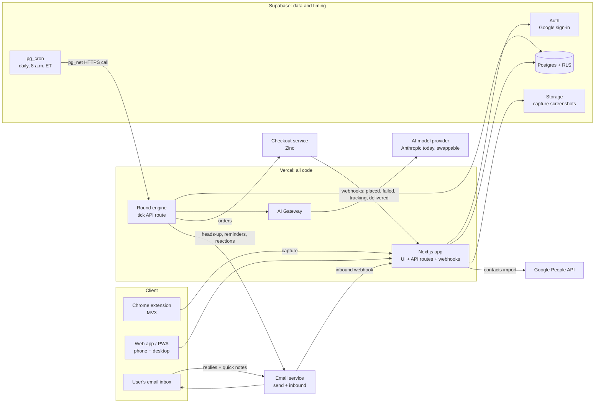
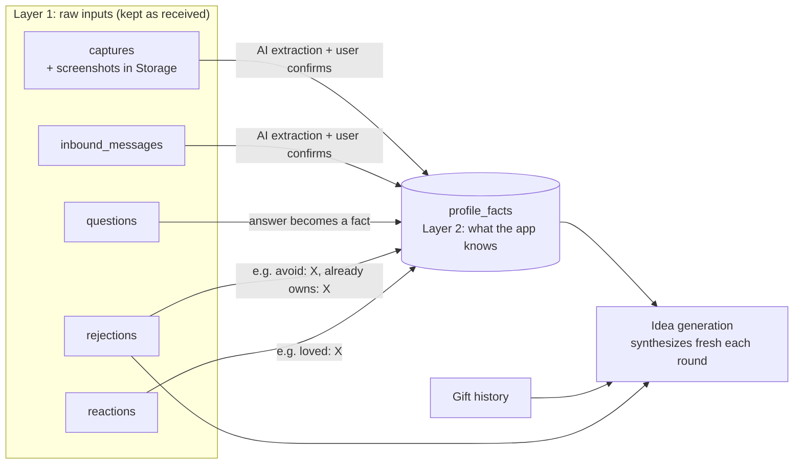
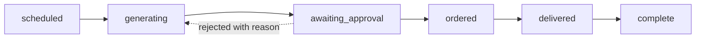

# Gift Concierge: Technical Design (MVP)

| | |
|---|---|
| **Status** | **Approved** v1.0 (2026-10-17). Revised v1.1 (2026-10-18) after the owner's review: Supabase `pg_cron` runs gift rounds once a day (T8, T9), a lean repo layout (T10), a replaceable AI backend billed through Vercel (T11), push deferred (T12), email capture kept (T13), round statuses cut from 11 to 9 (T14), and a new §3.1 on how the app learns about a person. Revised v1.2 (2026-10-25) with the checkout spike's findings (W1-2, `spikes/checkout.md`): funding in stages (T16), one app-owned Zinc account for product lookups (T17), and approval means buy now (T18). Also 2026-10-25: the platform is one app, account and repo, built to split later (§2.2, T19). Revised 2026-10-28 for schema v1.1 (ALL-44, T31): optional budgets, your own address, where an order ships, and picks from a person's own list. Tunable values (buffers, timings, retries) are sensible defaults to adjust once real usage shows what's needed. |
| **Date** | 2026-10-28 |
| **Implements** | `../planning/PRD.md` (approved v1.0). Requirement IDs (B-3, A-9, etc.) refer to it. |
| **Decisions** | `decisions.md` (T#), `../planning/decisions.md` (D#) |
| **Next stage** | Split into Linear tickets, labeled by wave (§13) |

Items marked **[Claude's call]** are proposals the owner hasn't confirmed yet. **[Verify]** marks a fact to confirm during the named ticket before building on it.

---

## 1. Principles

1. **Keep it simple.** Build only what the PRD marks **M**. Pick the boring option unless it costs real effort later (D21).
2. **The database is the source of truth.** Every gift round's status and its next due time live in Postgres. Background work reads and writes that status, so any step can be retried.
3. **Supabase is the data and timing layer, Vercel runs all the code.** Supabase holds the database, sign-in, files, and the schedule. Every line of app code, including what the schedule triggers, runs in the one Next.js app on Vercel (T8).
4. **Budget is enforced at three layers:** when ideas are generated, at approval, and at checkout through the order's `max_price`. A bug in one layer can't cause overspending (B-3, B-5).
5. **Nothing is bought without a recorded approval** (A-1).
6. **Spend under $100 a month** (T4). Stay on free tiers until something forces an upgrade.
7. **One language and one repo.** TypeScript in a single monorepo, so two people working with Claude can work anywhere in it.
8. **The AI model is replaceable.** The app depends on "an AI model", not a specific vendor. Each AI task names its model in one config file, and calls go through the AI SDK and AI Gateway, so moving a task to a cheaper model or another provider (for example OpenAI) is a config change. Claude is today's default, not a dependency (T11, §7).

## 2. Architecture



### 2.1 Components

| Component | Choice | Notes |
|---|---|---|
| Web app and API | **Next.js (App Router) on Vercel**, Node.js runtime | One app for UI, API routes, webhooks, and the phone page. A PWA manifest (`app/manifest.ts`) and generated icons make it installable to the home screen; no service worker until push (T12). Browser tests: Playwright (`apps/web/e2e/`), in CI (T30). |
| Database | **Supabase Postgres** with Row Level Security | Every user-owned table has `user_id` plus RLS policies. Background jobs use the service role. |
| Auth | **Supabase Auth, Google provider** (plus email and password for existing list users) | Cookie sessions through `@supabase/ssr`; `proxy.ts` sends signed-out visitors to sign-in and back via `?next=`, except on `/lists`, `/share/*`, `/auth/*` and the install files (T30). Google Contacts read access is requested separately, at import time (§6.1). The extension authenticates with the user's Supabase session (§6.2). |
| File storage | **Supabase Storage** (private bucket) | Capture screenshots. Deleting a person deletes their files. |
| Background jobs | **Supabase `pg_cron`** calls the app's **round engine** (a protected API route) **once a day at 8 a.m. Eastern**, using `pg_net` | The schedule lives next to the data it checks. Vercel Cron and Workflow aren't used. All the work runs in the Next.js app, so there's one runtime and one deploy, with no Supabase Edge Functions (T8). See §5.1. |
| AI | Any model through **Vercel AI Gateway** with the **AI SDK**. Default today: **Claude Opus 5.5** (`anthropic/claude-opus-5.5`; take IDs from the gateway's `/v1/models`) | The gateway gives one key, one bill and one spending cap across providers, plus fallbacks. Usage is **billed through the Vercel account**, so there's no separate AI provider account (T11). The model for each task is set in one config file (§7). Web search through the gateway is **confirmed in W1-3** (Anthropic's native tool; the gateway's Perplexity search is a provider-neutral alternative). Hobby plan works; Claude models need **paid** gateway credit (the free credit excludes them). |
| Checkout | **Zinc** (API v2), confirmed by the W1-2 spike | `max_price` caps the whole order (item, shipping and tax), gift orders, signed webhooks, per-package tracking. **MVP:** each user's own Zinc wallet. **Later:** the user's card through Zinc Connect (T16, §6.5a). Product lookups go through one app-owned Zinc account (T17). |
| Email | Resend or Postmark **[decided in W1-4]** | Needs sending and inbound-to-webhook. **[Verify]** inbound support and free-tier limits. |
| Push notifications | **Decision deferred (T12).** If added: standard Web Push (VAPID) using the `web-push` package | Works on Android, and on iOS once the PWA is added to the home screen. Email covers every message without it. The notification service sends through a channel list, so push plugs in later without changing callers. Estimated 1–2 days of work, in its own ticket (W5-4). |
| Extension | Chrome Manifest V3, TypeScript, built with Vite | Popup plus a "Capture for…" action. Lives in the same repo. |
| Contacts | Google People API, `contacts.readonly` scope | An unverified Google app allows up to 100 test users, which is plenty for the MVP. |

### 2.2 One app for the whole platform (T19)

Gift Concierge is one of three products: scan-to-gift, gift lists and the concierge (`../planning/strategy.md`). To users they are **always one app**, a ladder from quick one-off use to the deep concierge. So the platform is built as **one app, one account and one repo now, laid out so a product can be split out later.**

| Hard to undo, so decided now | Rule |
|---|---|
| Printed QR codes (shirts, sashes, plushies) | Every printed code points to **our own short link** (e.g. `<domain>/s/<code>`) that redirects. It never points straight at a page. Nothing is printed until the platform name and domain are settled (ALL-14). |
| Accounts | **One sign-in and one user record** shared by every product, from day one. |
| People across products | One shared `people` record per loved one, which can later link to that person's own user account (for example, Mom's gift list). Products don't keep their own copies. |

| Kept reversible, with guardrails | Rule |
|---|---|
| Data | One Postgres schema per product (`concierge`, `lists`, `scan`) plus a small shared schema (`public`) for accounts and people. Products never read or write another product's schema. They call that product's functions instead. Splitting a product out means moving its schema. |
| Code | One folder per product under `apps/web/modules/`, each exposing a small public `index.ts`. A lint rule (ESLint boundaries) blocks importing another product's internals. |
| Web addresses | Each product under its own path (`/concierge`, `/lists`, `/scan`, short links at `/s`). If a product later needs its own deploy, Vercel can serve separately deployed apps under the same domain without users noticing. |
| Navigation | Each product works on its own. After sign-in, Home (`/`) is the one front door: a "My list" card, then "People" (the concierge). Home needs an account; `/settings` holds time zone and over-budget %. A top bar, not tabs (T30). Links between products are low-key and only where they help (T29, `ui.md` > How the products connect). |
| Money and sensitive data | Zinc keys, funding, the addresses you enter for people, and social media content stay inside the concierge (D31). **Exception (D41):** your *own* address is account data in `public.account_addresses`, like your email. Only you read it; if you share it for gifts, a linked buyer sees city and state, and only server code reads the rest. |

**The MVP builds only the concierge.** The shared account and people records, the `concierge` module and schema, and the boundary rule are set up now; `lists` and `scan` are added when their work starts. **GiftsAF is the starting point (T20).** Jim's list app ([gifts-af/GiftsAF](https://github.com/gifts-af/GiftsAF)) uses the same stack (Next.js App Router, Supabase email-and-password sign-in, Vercel, shadcn/ui, Vitest). It's imported with its history as `apps/web` (ALL-15). Its list code becomes `modules/lists`, its tables (`lists`, `list_items`, `gift_claims`) and their functions move into the `lists` schema (done in ALL-19; display names now come from `public.profiles`), and its Vercel and Supabase projects become the platform's production ones. The concierge is built alongside it as `modules/concierge`.

### 2.3 Repository layout

**One repo for the whole platform** (T19). The repo is **`gifts-af/gift-me`** (renamed from `gift-concierge` on 2026-10-25, T21), with code added alongside `planning/` and `design/`. If ALL-14 picks a different platform name, it's renamed again; GitHub redirects old links. It has one shared package, kept as small as the two apps allow (T10):

```
gift-me/
├── apps/
│   ├── web/            Next.js app for the whole platform: UI, API routes, webhooks, round engine
│   │   ├── modules/
│   │   │   ├── concierge/   The MVP: rounds, ideas, orders, Zinc (public API in index.ts)
│   │   │   ├── lists/       From GiftsAF (T20): lists, items, sharing, claiming
│   │   │   └── scan/        Added when scan-to-gift starts
│   │   └── lib/ai/     Prompts, schemas, AI calls, eval fixtures
│   └── extension/      Chrome extension
├── packages/
│   └── core/           Pure domain logic (budget math, schedule/deadline math, round statuses) plus types
│                       shared by both apps, including generated database types (no I/O, heavily tested)
├── supabase/           Supabase CLI folder: SQL migrations (including the pg_cron schedule), local config
├── spikes/             Throwaway wave-1 experiments (not production code)
├── planning/  design/
└── pnpm-workspace.yaml
```

- **Why a workspace at all:** the web app and the extension build separately but share `core`.
- **No Turborepo:** `pnpm -r build` and `pnpm -r test` are enough at this size. Add it later if builds get slow.
- **AI code lives in the web app** because nothing else calls the AI model. It moves into its own package only if a second app needs it.

Tooling: pnpm workspaces, Vitest for tests, ESLint and Prettier, and GitHub Actions running lint, typecheck, and tests on every pull request. Vercel preview deployments are created per pull request.
- **Browser tests (Playwright)** are added with the first real screens (W2-1, ALL-20): a smoke test that signs in, checks the app shell at phone width and signs out, run in CI. Later screen tickets add their own flows, and the end-to-end dry run (W6-1, ALL-36) uses it. Until then, the only UI tests are Vitest with jsdom, a simulated page that needs no real browser.

## 3. Data model

All tables have `id uuid`, `created_at`, and `updated_at`. Accounts (`profiles`) and `people` are shared by every product and live in `public`. The rest belong to the concierge and live in the `concierge` schema (§2.2, T19). User-owned tables have `user_id` with RLS: `user_id = auth.uid()`.

| Table | Key fields | Notes |
|---|---|---|
| `profiles` | user_id, display_name, email, phone, timezone, notification prefs, over_budget_pct (default 15), **funding_mode** (`zinc_wallet`; `connect` later), zinc_api_key (in Vault), zinc_webhook_secret (in Vault), zinc_connected_at, auto_topup_on (bool, last known) | One row per user. Push subscriptions are added with W5-4 if push goes ahead. Funding fields: §6.5a (T16). |
| `people` | user_id, name, relationship, birthday (nullable), address (structured, nullable: recipient first and last name, line 1, line 2, city, state, ZIP, country), phone (nullable; the user's own phone is used when empty), address_checked_at, notes, google_contact_id | P-1, P-5. Zinc requires a phone on every order, and the carrier is the only one who uses it. The address is checked when it's entered, not at purchase time (§6.1). |
| `budget_defaults` | user_id, relationship, base_amount_cents | B-2 (S) |
| `occasions` | user_id, person_id (nullable for shared holidays), kind (birthday, anniversary, christmas, mothers_day, …), date rule (fixed date or holiday rule), enabled | P-3. Holidays are computed from rules in `core`. |
| `budgets` | user_id, person_id, occasion_kind, amount_cents (nullable) | B-1. Overrides the default for that person and occasion. The budget is the buyer's own and optional (D36): `null` means no budget, even when the relationship has a default. |
| `account_addresses` (in `public`) | user_id, recipient name, line 1, line 2, city, state, ZIP, country, phone, address_checked_at, share_for_gifts | Your own address, for every product (D41): "My address" when you buy, and where gifts to you ship when you keep a list and turn sharing on. Owner-only. |
| `captures` | user_id, person_id, source_url, page_title, text_excerpt, screenshot_path, status (pending, extracted, failed) | C-1, C-2 |
| `profile_facts` | user_id, person_id, category (interest, dislike, size, brand, owns, style, avoid), value, source (capture, question, note, reaction, rejection), source_id, confirmed (bool), active | C-3, C-7. A person's profile is the set of their active facts. |
| `questions` | user_id, person_id, prompt, answer, status | C-4 |
| `gift_rounds` | user_id, person_id, occasion_id, occasion_date, ship_by_deadline, budget_cents (null = no budget, D36), status (§5), next_action_at, locked_until, attempts, approved_at | One per person per occasion per year. `next_action_at` is when the round engine should look at it next (§5.1). |
| `gift_ideas` | round_id, title, retailer, product_url (the exact size or color variant), retailer_product_id, offer_id, seller_name, first_party (bool), price_cents, est_shipping_cents, est_tax_cents, est_total_cents, handling_days_max, delivery_days_min, delivery_days_max, arrive_by (worst case), reason, over_budget (bool), rank, status (proposed, selected, rejected), source (generated, list), list_item_id | G-1, G-2. `source = list` for a pick from the person's own list (D37). Delivery is a range before purchase; `arrive_by` uses the slowest case. |
| `rejections` | round_id, reason_code, reason_text | G-3. Also written to `profile_facts`. |
| `orders` | round_id, idea_id, provider (zinc), provider_order_id, idempotency_key, funding_mode, max_price_cents, is_gift, gift_message (≤240 characters), price breakdown (subtotal, shipping, tax, total cents), fee_cents, status (placing, placed, failed, shipped, delivered, cancelled, refunded), failure_type, merchant_order_id, packages (jsonb: carrier, tracking number, status, estimated delivery date, proof-of-delivery photo), est_delivery_date (latest across packages), ship_to (recipient, buyer, other), ship_city, ship_state | A-3 as revised by D38, D-1. The full address it shipped to is snapshotted in `order_addresses`, which only the server reads. Zinc's own status stops at "placed"; shipping progress is per package, and one order can ship as several packages. |
| `reactions` | round_id, rating (loved, liked, meh, returned), note, source (email, web) | D-2 |
| `notifications` | user_id, round_id, kind, channel, sent_at, action_token_hash | Audit trail plus reminder escalation state. |
| `inbound_messages` | user_id, from, subject, body, attachments, matched_person_id, status | N-2, C-5 |
| `app_settings` | key, value (jsonb), updated_at | App-wide settings that change without a deploy (T23): `zinc_order_fee_cents` and the §4.1 schedule timings (`planning_delivery_days`, `safety_buffer_days`, `round_lead_days`, `reminder_1_after_heads_up_days`, `reminder_2_before_deadline_days`, `final_notice_before_deadline_days`, `fastest_days_to_arrive`). Not user-owned: only the server can read it, and the owner edits it. |

Gift history (D-3) is a view over `gift_rounds`, `gift_ideas`, `orders`, and `reactions`.

**Deletion (C-7, T27):** deleting a person or occasion is a **soft delete**: the row is marked `deleted_at` and hidden from the user, their open rounds are skipped, and gift and order history are kept. Removing data for real (for example a GDPR request) is an admin action, `admin.hard_delete_person` or `admin.hard_delete_account`, which cascades to every row, is logged in `admin.deletion_log`, and is followed by a storage cleanup of their screenshots.

**As built in schema v1** (ALL-19, T26; migrations in `supabase/migrations/`):
- The money fields shown on `profiles` above (over-budget %, notification prefs, funding mode, Zinc connection) live in **`concierge.accounts`**, one row per user. `public.profiles` keeps display name, email, phone and timezone, and is created at sign-up.
- Every table in `concierge` has `user_id` and the same privacy rule, including rows that belong to a round. Children reference their parent and owner together, so nothing can point at another user's data.
- `app_settings` is the one table with no `user_id`: only the server reads it (T23).
- **Users write their setup, the server writes the rest** (T26): people, occasions, budgets, facts, answers and captures are user-writable; rounds, ideas, orders, reactions, notifications, inbound mail and the Zinc connection are written only by server code, so `packages/core`'s budget and status checks can't be bypassed. One live order per idea.
- `packages/core/src/database.types.ts` is generated from the database (`pnpm db:types`). CI fails if it's out of date.

**As built in schema v1.1** (ALL-44, T31):
- **Optional budgets:** `gift_rounds.budget_cents` and `budgets.amount_cents` can be `null` (no budget). `budget_defaults` has no row when there's no default.
- **Your own address:** `public.account_addresses`, above. `public.shared_city_for_person(person_id)` gives the buyer city and state of a linked person who shares their address; `public.shared_address_for_person(person_id)` gives the full address to the server only.
- **Picks from a person's own list:** a buyer with the list's share link calls `lists.link_person(share_token, person_id)`. That records the list in `lists.person_links` and sets `people.linked_user_id`, with no consent step (D42). `lists.unlink_person(person_id)` reverses it, and so does deleting the list, which also ends address sharing through it. `lists.person_list(person_id)` returns that list's gifts in order, each with `claimed` and `claimed_by_me` (never who claimed it). A signed-in buyer can ask only about their own people; the server can ask about any. The concierge reads lists only through this function (T19). The list's owner never sees claims on their own list (D39, ALL-20).
- **Where an order ships:** `orders.ship_to`, `ship_city` and `ship_state` for the buyer; the full snapshot in `concierge.order_addresses`, server-only, so a shared address never reaches the buyer through their order. A one-off "other" address is saved to the person by writing the person's own address fields.

### 3.1 How the app learns about a person

Learning is stored in two layers: **raw inputs**, kept as received, and **learned facts** distilled from them.



**Layer 1: raw inputs**

| Input | Where it lives |
|---|---|
| Social media and web captures (extension) | `captures` (URL, title, visible text) plus the screenshot in Supabase Storage |
| Emailed or forwarded notes | `inbound_messages` |
| Answers to guided questions | `questions` |
| Rejected ideas and the reason | `rejections` |
| How the recipient liked a gift | `reactions` |
| A loved one's own gift list (D37) | read through `lists.person_list` once their account is linked (§3, schema v1.1). Its gifts are offered as picks (`gift_ideas.source = list`); turning list items into `profile_facts` is still to be designed |

**Layer 2: learned facts.** `profile_facts` is where the learning lives. Each fact is small and specific ("interest: fly fishing", "size: medium shirt", "avoid: clutter") and records its category, its source, a link back to the input it came from, whether the user confirmed it, and whether it's still active. **A person's profile is the set of their active facts**, and the user can see, edit or remove any of them (C-7).

**Synthesis happens at idea time.** Nothing stores a written summary of a person. Each round, the AI model reads the person's active facts, gift history and rejections and builds its picture from scratch, so the facts stay the single source of truth and nothing goes stale.

**Raw inputs are kept so the learning can be rebuilt.** When a better model or prompt comes along (T11), extraction can be re-run over past captures and notes to rebuild a person's facts.

**Later, if useful:** a stored summary per person ("outdoorsy, practical, prefers experiences"), refreshed when facts change. It's one extra field and isn't needed for the MVP.

## 4. Key calculations (in `packages/core`, unit-tested)

### 4.1 Ship-by deadline and schedule
- `ship_by_deadline = occasion_date − worst_case_delivery_days − safety_buffer` **[Claude's call: buffer of 2 days]**.
  - `worst_case_delivery_days` comes from the delivery estimate for the chosen idea at checkout.
  - Before any idea exists, use a planning default of 7 days.
- Rounds start on the schedule from D23, measured back from the planning deadline:

| Event | When |
|---|---|
| Round created and ideas generated | 28 days before the deadline |
| Heads-up sent | Once ideas are ready, around 25 days before |
| Reminder 1 | 5 days after the heads-up |
| Reminder 2 (email, plus push if W5-4 ships) | 7 days before the deadline |
| Final notice | 48 hours before the deadline |
| Marked skipped | At the deadline |

- If a round has to start late, for example a person added close to their birthday, it compresses the schedule, filters ideas to those that can still arrive in time, and says so in the heads-up.
  - **How it compresses** (agreed 2026-10-25, ALL-19): the round starts today, never in the past. Any reminder that would land on or before the heads-up is dropped, and so is reminder 1 if it would land on or after reminder 2. The skip at the deadline always stays. If the 7-day planning deadline has already arrived, the deadline moves to the last day next-day shipping could still make it (occasion − 3 days), ideas are kept only if they can arrive by then with the 2-day buffer, and the chosen idea's own deadline replaces it once ideas exist. A round always leaves at least one day to answer; if it can't, no round is created that year **[Claude's call]**.
- **Dates are calendar days** in US dates (Mother's Day is the 2nd Sunday of May, Father's Day the 3rd Sunday of June). A Feb 29 birthday or anniversary falls on Feb 28 in other years, since early beats late. Delivery and handling days count calendar days, with the slowest case plus the buffer covering weekends **[Claude's call]**. The code is in `packages/core` (`occasions.ts`, `schedule.ts`).

### 4.2 Budget
- **The budget is optional** (D36). With no budget (`null`), nothing is over budget and there's no over-budget label or confirm step. The approval ceiling is then the sum of the picks' estimated totals, and each order's `max_price` is capped at its own estimated total minus the fee (pass `pickTotalCents`), even after other orders in the round settle or fail. A price rise still stops the order and asks (A-4). B-3 ("automatic purchases never go over budget") applies when a budget is set. Every rule below assumes one is.
- `est_total = price + shipping + tax + fees` (D10). Tax is estimated from the recipient's state until checkout gives the real figure.
- An idea is **within budget** if `est_total ≤ budget`. It **counts as over-budget** if `budget < est_total ≤ budget × (1 + over_budget_pct)` (D11). Anything above that is dropped.
- If several ideas are selected, the sum of their `est_total` values must fit the round's budget, unless the over-budget idea was deliberately approved (PRD §6.2.3).
- At checkout: `max_price = approved ceiling − already committed spend in this round`.
  - The approved ceiling is the budget, or the over-budget idea's approved total if that was chosen.
  - If checkout comes in higher than `est_total` but still within `max_price`, the purchase goes ahead and the user is told (D28).
  - Zinc's `max_price` covers item, shipping and tax together, and is never exceeded (confirmed in W1-2). It doesn't include Zinc's $1 order fee, so `max_price = approved ceiling − committed spend − order fee`.
  - **Wallet mode (MVP):** Zinc sets aside `max_price + fee` when the order is placed and refunds what isn't used, so the balance must cover the full cap, not the expected total.
- Refunded orders release their committed spend (D29).
- **The order fee is a setting** (T23). It comes from `app_settings`, never from code, and is passed into every budget calculation.
- **How it's computed** (ALL-19, `packages/core/src/budget.ts`): money is whole cents, and anything that has to round rounds down, so a rounding error only ever spends less. The over-budget limit itself counts as over budget, not dropped. A pick of several ideas is judged by its sum, the same way as one idea, and when the sum is over budget and approved, the approved ceiling is that sum. An order holds its full cap plus fee as committed spend until its real total is known. **[Claude's call]** When several ideas are picked, each order's `max_price` also holds back the estimated totals of the picks not yet ordered, so the first order can't use up the whole budget. A `max_price` of $0 or less is treated as a bug, never as an order.

## 5. Gift round statuses

A round has **nine statuses**: a straight main path plus three side statuses.



| Main path | Meaning | Moves on when |
|---|---|---|
| `scheduled` | The round exists; its start date hasn't arrived | Start date reached (→ `generating`, or `needs_address` if there's no address) |
| `generating` | The AI model is preparing ideas | Ideas are ready and the heads-up is sent |
| `awaiting_approval` | Waiting for the user to pick or reject | Approved (→ `ordered`), or rejected with a reason (→ `generating`) |
| `ordered` | Approved and bought. Each order's own progress (placing, placed, shipped, …) lives in `orders` | The delivered webhook arrives |
| `delivered` | Arrived; the reaction prompt goes out the day after the occasion | A reaction is logged, or 7 days pass |
| `complete` | Done | — |

| Side status | Meaning | Way out |
|---|---|---|
| `needs_address` | No address yet, so no ideas can be checked (P-5) | Address added (→ `generating`), or the deadline passes (→ `skipped`) |
| `needs_attention` | Something went wrong: order failed, price over the approved amount, likely late, or the AI budget was hit | The user re-approves at the new price or picks the next-best idea (→ `ordered`, D29), or the deadline passes (→ `skipped`) |
| `skipped` | No reply by the deadline. Nothing is bought (D23) | — |

- Every transition writes `gift_rounds.status` and `next_action_at` together, so the UI and recovery logic only need to read the database.
- **Idempotency:** each Zinc order request uses `idempotency_key = order.id`, so a retry can never buy twice. Zinc webhooks have no event ID, so they're de-duplicated on event type plus order ID (Zinc's own guidance).

### 5.1 Round engine (T8)
- **The tick:** a `pg_cron` job runs **once a day at 12:00 UTC** (8 a.m. Eastern in summer, 7 a.m. in winter) and uses `pg_net` to POST to `/api/rounds/tick` on the production app. Every step in a round is measured in days, so daily is enough, and it means reminders and heads-ups always arrive in the morning (T9). A shared secret, kept in Supabase Vault and in Vercel environment variables, authenticates the call.
- **Each tick:**
  1. Creates `gift_rounds` for occasions whose start date (§4.1) has arrived. A unique key on person, occasion and year means a repeated tick never creates duplicates.
  2. Claims due rounds: `next_action_at <= now()` and not locked. It sets `locked_until = now() + 10 minutes` using `FOR UPDATE SKIP LOCKED`, so the tick and a user action or webhook never work on the same round at once.
  3. Advances each claimed round one step (generate ideas, send a reminder, skip at the deadline, run the daily late-risk check), then writes the new status, sets the next `next_action_at`, and clears the lock.
- **Reminders are just due dates:** the next reminder's date is stored in `next_action_at`, and that morning's tick sends it. No process sleeps or waits.
- **User actions and webhooks don't wait for a tick.** Approving, rejecting, adding an address, or a Zinc webhook updates the round and advances it right away, using the same step function. The tick is the safety net.
- **Crash recovery:** if a step dies, its lock expires and the next day's tick retries it. `attempts` counts retries. After 3 failed days, the round moves to `needs_attention` and the owner is alerted. The 28-day runway leaves plenty of room for this.
- **Long steps:** idea generation can take a minute or two. The tick hands each round to its own function call, so one slow round doesn't hold up the others, and each stays within Vercel's function time limit **[Verify in W1-6]**.
- **Testing:** outside production, the tick takes a "now" override for a test clock, and the dev project's schedule is off by default. It's run by hand or from tests.

## 6. Key flows

### 6.1 Setup and contacts import
1. Sign in with Google through Supabase Auth.
2. **Import contacts** (optional). This is a separate Google authorization for `contacts.readonly` only. The app calls the People API, shows the "Who do you buy gifts for?" checklist, and creates `people` rows with any names, birthdays, and addresses it finds. The Google token is used once and not stored **[Claude's call]**.
3. Occasions are added automatically by relationship (P-4). Budgets come from relationship defaults (B-2).
4. **Missing address (P-5):** the add-person form asks for the address but doesn't require it. When a round starts and the address is still missing, the round goes to `needs_address`. The heads-up then asks for the address (one-tap link to a form) and that request follows the same reminder schedule. No ideas are generated until there's an address, because delivery estimates and tax need it. If the deadline passes, the round is skipped **[Claude's call]**.
5. **Address check on entry:** Zinc rejects incomplete addresses at order time (for example, a missing apartment number), which would surface on the day of purchase. The form requires the fields Zinc requires and checks the address when it's saved **[Verify in W2-2: which address check to use, since Zinc has no standalone one]**.
6. **Checkout setup:** connect Zinc and turn on auto top-up (§6.5a).

### 6.2 Capture (extension)
1. The extension is signed in by opening the web app once. The app passes a session token to the extension through `externally_connectable` messaging, and the extension refreshes it from there **[Claude's call; Verify in W2-4]**.
2. The user picks a person and clicks **Capture**. The extension collects:
   - the page URL and title,
   - the visible text (`document.body.innerText`, trimmed to about 20k characters),
   - a screenshot of the visible area (`chrome.tabs.captureVisibleTab`).

   It never scrolls or crawls on its own (C-2). Permissions are `activeTab`, `scripting`, and `storage`, with no broad host permissions.
3. The app stores the capture (screenshot to Storage) and queues extraction.
4. **Extraction:** the AI model gets the text and screenshot and returns structured candidate facts (category, value, confidence). The prompt tells it not to infer sensitive traits, and a post-filter blocks those categories (C-8).
5. The user reviews **"Here's what I learned"** in the web app or extension popup, then confirms or removes items. Confirmed items become active `profile_facts`.

### 6.3 Gift idea generation (G-1 to G-5)
1. **Input:** the person's active facts, past gifts, past rejections, the occasion, the budget, the ship-by deadline, and the recipient's state.
2. **Brainstorm:** the AI model (with web search) proposes about 10 candidate gift concepts, each with a specific product and retailer URL. Only retailers Zinc supports are allowed.
3. **Resolve:** each candidate is checked with Zinc's product and offer lookup for live price, availability, the seller, shipping cost, and handling plus delivery days. Lookups use the **app-owned Zinc account** at $0.01 each, never the user's wallet (T17). Offers sold by the retailer itself are preferred. Offers don't include tax, so tax stays estimated (§4.2). Anything unavailable, too late in the slowest case, over the over-budget limit, or already given or rejected is dropped.
4. **Rank:** the AI model ranks the survivors and writes the one-line reasons. The top 3–5 within budget are kept, plus at most one over-budget idea.
5. If fewer than 3 survive, the app repeats steps 2–4 up to 2 more times. After that it sends what it has and notes it.
6. Results are saved as `gift_ideas`, and the heads-up is sent.

### 6.4 Notifications and one-tap actions
- Emails carry **signed one-time action links**, for example `/a/{token}`. Each token is random, stored hashed, tied to one user, round, and action, and expires at the deadline. Opening one goes to a confirmation page on the phone web app, and that page performs the action with one tap. A link never approves anything on a plain GET, because email security scanners open links automatically **[Claude's call]**.
- **Channels:** every message is sent through a list of channels. The MVP starts with email only. If push is added (W5-4, decision deferred, T12), the same messages also go out as Web Push notifications linking to the same pages.
- **Escalation** follows the §4.1 schedule. Each send is logged in `notifications`.

### 6.5 Approval and purchase
1. The user selects one or more ideas, or rejects them with a reason code and optional text.
2. **Approval** re-checks the budget (§4.2), records `approved_at`, moves the round to `ordered`, and places the orders right away (§5.1).
3. **Purchase:** one Zinc order per selected idea, placed on the user's own Zinc account (§6.5a), with `max_price`, `is_gift: true`, `fulfillment.gift: "best_effort"` (prices hidden on the packing slip, and the order still goes ahead if a store has no gift option), and an optional gift message the user can edit. It ships where the user chose (D38): the recipient (their address on the person, or the address they share through their list), the buyer's own address, or another address, which can be saved to the person. The order records `ship_to` and a snapshot of the address used.
   - **Approval means buy now (T18).** Once Zinc has placed an order with the store, it can't be cancelled; a return is the only way out. The approval screen says so.
4. If the order fails, the round moves to `needs_attention` and the user is offered the next-best idea to approve in one tap (D29). The message depends on Zinc's failure type: `max_price_exceeded` means the price went up (step 5), `out_of_stock` or `product_variant_unavailable` means pick another idea, `invalid_shipping_address` means fix the address, and `insufficient_funds` means top up (§6.5a).
5. **Price went over the approved amount (A-4):** the round moves to `needs_attention`. The user can either **re-approve the same gift at the new price**, which goes through the same budget and over-budget rules as §4.2 (one tap, with the new total shown), or pick the next-best idea **[Claude's call]**.

### 6.5a Funding gifts (T6, T16)

Funding comes in two stages. Ordering, tracking and the data model are the same in both; only where the money comes from changes, recorded as `profiles.funding_mode` and `orders.funding_mode`.

**Stage 1, MVP: each user's own Zinc wallet** (a little friction, no Stripe)
1. **Connect (one time, in Settings).** The app starts Zinc's sign-in (`POST /device/code`) and shows the user a link. The user signs in to Zinc (or creates an account) and clicks **Allow**, and the app collects that user's key once (`POST /device/token`). The key goes into Supabase Vault, and only the server can read it. The app then registers its webhook URL on that account (`Set Webhook Endpoint`) and stores the account's webhook secret in Vault. No keys to copy or paste. W1-2 tested this flow for real.
2. **Fund (one time, in Zinc).** The app links the user straight to Zinc's wallet page and walks them through adding funds and turning on **auto top-up** (a minimum balance plus a top-up amount, charged to a card saved in Zinc). With auto top-up on, Zinc charges the card when an order would otherwise be short, and the order goes ahead. Suggested settings: a minimum of their largest gift budget plus $1, topping up by about $100, since card top-ups cost 2.9% + $0.30 each and fewer, larger top-ups waste less.
3. **Keep it visible in our app.** The app reads the balance (`GET /wallet/me`, free) and shows it in Settings and on the approval screen. It looks ahead: the approved and upcoming gifts in the next 3 weeks are compared with the balance, and the heads-up email warns early ("$160 in gifts due, $40 in Zinc"). This matters because each order needs its **full cap plus $1** available at once (§4.2).
4. **If funds are short anyway** (auto top-up off, or Zinc reports `wallet.auto_topup.disabled` after failed charges): the order isn't placed. The round waits on the normal reminder schedule with a "Top up your Zinc balance" link, rather than failing.

**Stage 2, later: the user's card in our app (Zinc Connect)**
- The user adds a card in our app (Stripe's card form); it's saved on **our** Stripe account, connected to the app's Zinc account. Each order then sends a `payment` object with `mode: "connect"`. Zinc holds the card for the cap plus fees, buys, and charges the real total. There's no per-user Zinc account and no balance. The margin can be $0 or our markup (D34).
- Needs our own Stripe account, and makes us the seller the user sees: our name on their statement, and refunds or disputes go to our Stripe account. **[Verify with Zinc before stage 2]** how return refunds reach the card.
- Switching is per user (`funding_mode`), so both can run side by side during the move.

### 6.6 Tracking, late risk, reactions
- Zinc webhooks update `orders`: `order.placed` (real price breakdown), `order.failed` (failure type), `order.tracking_received`, `order.shipped`, `order.estimated_delivery_updated`, `order.delivered` and `order.cancelled` (the store cancelled; the wallet is refunded automatically). Each is checked against an HMAC-SHA256 signature (`X-Webhook-Signature`) using that user's Zinc account secret. The webhook URL carries a per-user token, so the app knows which secret to check against.
- **Delivery dates:** before purchase there's only a range (§6.3). The carrier's `estimated_delivery_date` appears per package once tracking arrives, and is updated when it changes.
- A late-risk check runs whenever an update arrives and once a day from the round engine: if `est_delivery_date > occasion_date`, the round goes to `needs_attention` and the user is alerted (D-1, D-4).
- One day after the occasion, the reaction prompt goes out (D-2). Notes are **text only in the MVP**. The phone keyboard's built-in dictation covers voice input, and recording and storing audio waits for later **[Claude's call]**. The answer is written to `reactions` and turned into `profile_facts` (for example, "loved: X").

### 6.7 Guided questions by email (C-4)
- Open questions for a person are included in heads-up and reminder emails as a signed link to a short form on the phone web page. That counts as "answerable by email" for the MVP. Replying in the body of the email is not parsed **[Claude's call]**.

### 6.8 Inbound email quick capture (N-2, C-5)
- Each user gets an address such as `notes+{user-token}@<domain>`, or the app matches on the sender's address **[decided in W1-4]**.
- The inbound webhook stores the message. The AI model then matches it to a person, using names in the text and the user's list of people, and extracts facts. If it isn't confident, it emails back asking "Who is this about?"

## 7. AI design

**Keeping the provider replaceable (T11):**
- All AI calls go through `apps/web/lib/ai`, using the AI SDK's provider-neutral functions (`generateObject`, `generateText`) and the AI Gateway. No other code calls a model directly.
- Each task's model and settings live in one config map, for example `{ extraction: "anthropic/claude-opus-5.5", ... }`. Changing a model is a one-line config change, re-checked against the eval fixtures.
- Prompts are plain instructions plus a schema, with no vendor-specific prompt tricks.
- **The one vendor-specific feature is web search** during brainstorming. It sits behind a small `searchWeb` step, so a different provider's search tool, or a search API, can replace it.

| Task | Default model and settings (today) | Output | Cost (measured in W1-3 unless marked) |
|---|---|---|---|
| Capture extraction | Claude Opus 5.5, effort `low`, vision | Structured facts (schema-validated) | ~$0.01 each (text; screenshots not yet measured) |
| Inbound note matching and extraction | Claude Opus 5.5, effort `low` | Person match plus facts | ~$0.01 each (estimate) |
| Idea brainstorm | Claude Opus 5.5, web search (up to 3 searches) | 8 candidates with `product_search` terms, no URLs (schema) | ~$0.25–0.45 (mostly search results read) |
| Idea ranking and reasons | Claude Opus 5.5, effort `low` | Ranked list (schema) | ~$0.02–0.04 |

**A full round costs about $0.30–0.45** (W1-3, `spikes/ai.md`). Cheaper models are worth trying per task now that fixtures exist: Sonnet 5.5 is half the price, and brainstorm is the expensive step.

**Prompt rules learned in W1-3** (prompt v3): stated wants come first (use the over-budget slot if needed); a worn-out owned item is a replacement need; check every idea against owned items; stock items only, no personalization; prefer Amazon, Walmart, Target and Best Buy; ship-to isn't where hobbies happen. Captured facts must reach idea generation: without them, ideas are generic.

- All outputs use structured outputs or schemas. Inputs and outputs are logged, and inputs are kept so prompts can be improved later.
- **Cost control:** the AI Gateway budget is capped at **$60 a month**, with an alert email to the owner at 50% and 80% of the cap **[Claude's call]**. App-side limits cap the number of retries per round. If the cap is hit, rounds already waiting on ideas move to `needs_attention` and the owner is alerted. They never fail quietly, because a stalled round risks a late gift.
- **Evals (light):** W1-3 builds a small fixture set (about 10 captures and 5 profiles) that later prompt changes are re-checked against.

## 8. Security and privacy
- RLS on every user table. The service role is only used inside the round engine and webhooks.
- The tick endpoint rejects any call without the shared secret.
- Webhooks verify signatures where the provider supports them. Otherwise they use a secret path token plus an IP allowlist if one is available.
- No retailer passwords are ever stored (A-5). The app **never touches card numbers**: in stage 1, cards live in each user's Zinc account; in stage 2, in Stripe (§6.5a). Users' Zinc keys and webhook secrets are kept in Supabase Vault.
- Secrets live in Vercel environment variables. Supabase keys are split into anon and service role.
- The sensitive-trait filter runs on AI output (C-8). Captures store only what the user captured.
- Deletion cascades (C-7). Users can export their data later.

## 9. Environments and operations
- **Supabase:** two projects on the free tier, `dev` and `prod`, plus the local Supabase CLI for development. `pg_cron` and `pg_net` are enabled on both.
  - **Inactivity pause:** free projects pause after 7 days without activity, which would stop the round engine. W1-6 checks whether the tick counts as activity. If it doesn't, the owner either upgrades `prod` to Pro ($25 a month) or schedules a keep-alive call.
- **Vercel:** Hobby while developing and testing (T24). Production comes from `main`, and pull requests get preview deployments against Supabase `dev`.
  - Move to Pro before a commercial launch. **[Verify in W3]** that idea generation fits Hobby's function time limit.
  - Upgrade to Pro ($20 a month) if they aren't.
- **Monitoring:** Vercel logs and observability, AI Gateway dashboards, and a daily "health" email to the owner listing rounds in `needs_attention` **[Claude's call]**.
- **Test mode:** Zinc's sandbox (a `zn_test_` key: test product URLs for success, price exceeded, out of stock, bad address and more, delivering in seconds, with its own webhook settings and no cost), plus a `DRY_RUN` flag that does everything except place the real order.

## 10. Cost estimate (monthly, 3 users)

| Item | Estimate |
|---|---|
| Vercel Hobby, or Pro if needed | $0 / $20 |
| Supabase free, or Pro if needed | $0 / $25 |
| AI model usage through AI Gateway, billed by Vercel (prepaid credit) | ~$5–15 (about a dozen rounds a month at ~$0.40, plus captures at ~$0.01; capped at $60) |
| Email service | $0 (free tier) |
| Zinc | $1 per successful order (paid from each user's wallet), plus $0.01 per product lookup on the app account (~$1–3). No minimum or monthly fee. |
| Domain | ~$1–2 |
| **Total** | **~$15–85** worst case, under the $100 budget |

## 11. Spikes (wave 1)

| Spike | Questions it must answer | Done when |
|---|---|---|
| **W1-2 Checkout (Zinc)** | How does each user pay with their own card (A-9)? Options: a Zinc account per user, a user-funded wallet, or a payment method passed per order. What is Zinc's pricing and minimum? Does `max_price` include shipping and tax? How reliable are its delivery estimates? Which webhook events does it send? Does product and offer lookup work for idea resolution? **Can the wallet be funded automatically:** an API to add funds, auto-recharge from a saved card, or a balance check the app can poll? | A written recommendation in `design/spikes/checkout.md`, plus one real test order placed, tracked, and delivered (or returned). If Zinc doesn't work, Rye is evaluated as the fallback. |
| **W1-3 AI** | Can it pull useful facts from real captures (Instagram, Pinterest, a product page)? Can it produce 3–5 good, purchasable ideas from a profile? What is the real cost per call? | `design/spikes/ai.md` with sample inputs and outputs, prompt v1, and measured cost. The fixture set is committed. |
| **W1-4 Email** | Which provider (Resend or Postmark) supports inbound email on the free tier? Which domain? Which address scheme? | `design/spikes/email.md`, plus a working send and receive using the chosen provider. |

## 12. Risks

| Risk | Mitigation |
|---|---|
| Zinc can't support "user pays with own card" | **Resolved in W1-2:** each user's own Zinc wallet for the MVP, and the user's card through Zinc Connect later (T16). Rye wasn't needed. |
| Zinc is young and changes weekly | Pin the API version in W4-2. The sandbox catches breaking changes early. |
| AI ideas are poor or can't be bought | The resolve step requires a live offer. The spike measures quality early. The rejection loop teaches the app. |
| Retailers block agent or API vendors | Avoid account automation. Support more than one retailer through Zinc. Add a gift card fallback later. |
| Vercel Hobby limits | Verify in W1-6, upgrade to Pro within budget if needed. |
| Supabase `prod` pauses and the round engine stops | Verify in W1-6. Upgrade to Pro or schedule a keep-alive. The owner health email (W5-3) also flags it if no tick has arrived in 26 hours. |
| Delivery estimates are wrong | 2-day buffer, the late-risk check, and a replacement offer. |

## 13. Work breakdown by wave (draft for Linear)

Each wave can start once the waves before it have the dependencies it lists. Within a wave, tickets run in parallel. The ticket IDs here are draft IDs, and Linear will assign real ones.

### Wave 1: Foundations and spikes (7 tickets in parallel)
| ID | Ticket | Depends on |
|---|---|---|
| W1-1 | Monorepo scaffold and CI (pnpm workspaces, Next.js shell, `packages/core`, `supabase/` folder, lint, typecheck, tests, GitHub Actions, branch protection), plus the platform guardrails (§2.2, T19): `apps/web/modules/concierge` with a public `index.ts`, the ESLint boundary rule, and `/concierge` as the product path | — |
| W1-6 | Platform provisioning and environments: Vercel project and previews, Supabase dev and prod with `pg_cron` and `pg_net`, the inactivity-pause check, AI Gateway with Vercel billing and cap, domain and DNS, env and secrets conventions, Hobby limits check, Jim's access to every service | — |
| W1-2 | Checkout spike (Zinc) | — |
| W1-3 | AI spike (extraction, ideas, cost) | — |
| W1-4 | Email spike (send and inbound) | — |
| W1-5 | Database schema v1: migrations in `supabase/`, a `concierge` schema for the product's tables plus shared accounts and `people` in `public` (§2.2, T19), RLS, generated types in `core`, plus `packages/core` holiday, deadline, and budget math with tests. Order, payment, and inbound fields are left as placeholders and finalized after W1-2 and W1-4. | W1-6 for applying to hosted `dev` (it can start immediately in a branch against local Supabase) |
| W1-7 | Look and feel: UI kit (Tailwind plus shadcn/ui, shared with the extension), a style guide as tokens, and clickable phone-first mock-ups of the approval, profile, home, extension popup and approval email screens, signed off by the owner and Jim. Written up in `design/ui.md` (T15). | — |

### Wave 2: Core app and capture plumbing
| ID | Ticket | Depends on |
|---|---|---|
| W2-1 | Auth (Google sign-in), app shell, mobile layout, PWA manifest | W1-1, W1-5, W1-6, W1-7 |
| W2-2 | People, occasions, and budgets: screens and API (P-1, P-3, P-4, B-1, B-2) | W1-5, W1-7, W2-1 |
| W2-3 | Google Contacts import with checklist (P-2) | W2-1, W2-2 |
| W2-4 | Chrome extension MVP: sign-in handoff, person picker, capture and upload, **including the capture-upload API route** (C-1, C-2) | W1-5, W1-7, W2-1 |
| W2-5 | Notification service: email sending, templates, signed action links, a channel list ready for push (N-1, N-3) | W1-4, W1-5, W1-7, W2-1 |
| W2-6 | Schema v1.1 (ALL-44): optional budgets, the buyer's own address, where an order ships, and a `lists` function so a round can offer picks from a person's own list (product decisions 36–39) | W1-5, W1-7 |

### Wave 3: Intelligence and the round engine
| ID | Ticket | Depends on |
|---|---|---|
| W3-1 | Capture extraction plus the "Here's what I learned" review (C-3, C-8) | W1-3, W2-4 |
| W3-2 | Profile view and editing, guided questions, readiness meter (C-4, C-6, C-7) | W1-7, W2-2 |
| W3-3 | Gift idea engine: brainstorm, resolve via checkout lookup, rank (G-1, G-2, G-4, G-5) | W1-2, W1-3, W2-2 |
| W3-4 | Round engine: `pg_cron` tick, round creation, claiming and locking, round statuses, reminders as due times, skip (A-2) (§5.1) | W1-5, W1-6, W2-2, W2-5 |

### Wave 4: Approve and buy
| ID | Ticket | Depends on |
|---|---|---|
| W4-1 | Approval UI: idea cards, multi-select, over-budget handling, reject with reason, re-generate (A-1, B-4, G-3) | W1-7, W3-3, W3-4 |
| W4-2 | Purchase integration: Zinc orders, `max_price`, the A-8 price rule, idempotency, `DRY_RUN` (A-3, A-4, A-8, A-9, B-3, B-5) | W1-2, W3-4 |
| W4-3 | Inbound email quick capture: match person, file note (N-2, C-5) | W1-4, W3-1 |
| W4-4 | Zinc connection by sign-in and Allow (key and webhook secret in Vault, webhook registration), guided funding and auto top-up, balance shown in the app, look-ahead warning, held order when short (§6.5a stage 1) | W1-2, W2-1 |

### Wave 5: After the purchase
| ID | Ticket | Depends on |
|---|---|---|
| W5-1 | Order tracking webhooks, late-risk check, failure and replacement flow (D-1, D-4) | W4-1, W4-2 |
| W5-2 | Reaction prompts and gift history (D-2, D-3) | W4-2 |
| W5-3 | Owner health email and monitoring | W3-4 |
| W5-4 | **Optional, decide before starting:** Web Push notifications. Service worker, VAPID keys, subscribe from the PWA, push channel in the notification service (T12) | W2-1, W2-5 |

### Wave 6: Ready for real use
| ID | Ticket | Depends on |
|---|---|---|
| W6-1 | End-to-end dry run with real profiles in `DRY_RUN`, then 1–2 real orders | All above |
| W6-2 | Privacy pass: deletion cascade check, sensitive-trait filter test, secrets review | All above |
| W6-3 | Onboard Jim and 1–2 friends | W6-1, W6-2 |

**Within wave 2, W2-1 goes first.** W2-2 and W2-4 can start right after it, and W2-3 and W2-5 follow. So wave 2 is really two steps, though still more tickets than builders at each step. With two builders, nobody is blocked. Wave 1's spikes are the critical path: they decide W3-3 and W4-2. **Start Wave 1 with the spikes and look and feel (W1-7), not the scaffold.** Start the Zinc signup on day one, because account approval may take days. W1-1 is small and low-risk, so it can fill gaps or run in parallel. **W2-6** (added 2026-10-26) runs alongside W2-1 once the W1-7 mock-ups are signed off, and must land before W2-2; it also blocks W3-3, W4-1 and W4-2.

## 14. Accounts
All services (Google, Vercel including AI Gateway billing, Supabase, Zinc, Linear) are under the owner's **allensforever711@gmail.com** account, and the code is in the free **gifts-af** GitHub organization (github.com/gifts-af/gift-me), where allensforever711, aarontallen, JimtheBurger and brb3 are all owners. Jim is added to each service (T7). **Zinc:** the app-owned account (product lookups, sandbox, T17) exists under allensforever711@gmail.com, created in W1-2; each user also has their own Zinc account for buying (§6.5a). **Domain:** if none is already set up, W1-6 buys a cheap placeholder domain under that account **[Claude's call]**.
